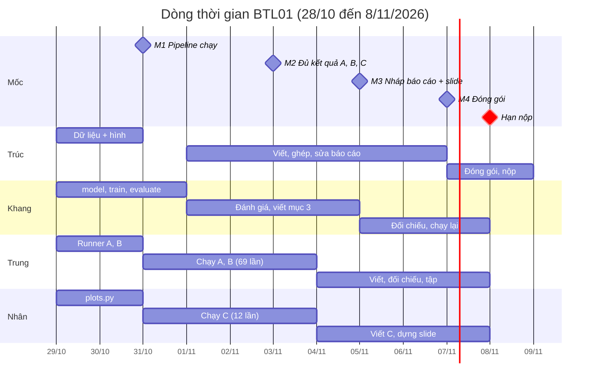

# BTL01 – Kế hoạch chia việc Nhóm 5

Cập nhật: 28/10/2026 · Người lập: Huỳnh Ngọc Trúc · Hạn nộp: **Chủ nhật 8/11/2026**

## 1. Đề bài yêu cầu gì

Nhóm phải dùng PyTorch xây mạng MLP 2 đầu vào, 1 đầu ra để xấp xỉ hàm mật độ Gaussian 2 chiều, rồi chạy 3 nhóm thực nghiệm A, B, C và nộp code, báo cáo, slide trước ngày 8/11/2026. Hàm cần xấp xỉ:

$$
f(\mathbf{x}) = \frac{1}{2\pi\sqrt{\det C}} \exp\left(-\tfrac{1}{2}(\mathbf{x}-\boldsymbol{\mu})^T C^{-1} (\mathbf{x}-\boldsymbol{\mu})\right), \quad \boldsymbol{\mu} = \begin{bmatrix}0\\0\end{bmatrix},\; C = \begin{bmatrix}0.3 & -0.5\\ -0.5 & 2\end{bmatrix}
$$

Điểm lấy mẫu đều trong miền −2 ≤ x₁ ≤ 2, −4 ≤ x₂ ≤ 4. Tập test cố định 100 mẫu, thêm một tập validation riêng để chọn mô hình. Test chỉ dùng để đánh giá cuối.

| Hạng mục | Yêu cầu cụ thể | Điểm rubric |
| --- | --- | --- |
| Dữ liệu | Hàm Gaussian đúng μ, C, miền; chia train/val/test có seed, không rò rỉ; scatter 3D, bề mặt hàm thật, thống kê x₁, x₂, y | 10 |
| Code PyTorch | `nn.Module` + `nn.Linear` tùy số tầng/nơ-ron; `DataLoader`, `MSELoss`, Adam/SGD; vòng lặp train tự viết; `model.train()/eval()`, `torch.no_grad()`; log loss theo epoch; checkpoint theo val loss; README, requirements, chạy lại được | 25 |
| Thực nghiệm A | Số mẫu train A = 200, 400, …, 2000; bảng MSE + MAE/RMSE; đồ thị sai số theo A | 10 |
| Thực nghiệm B | 1 tầng ẩn, B = 1…10 nơ-ron; bảng/đồ thị; nhận xét thiếu khớp, quá khớp | 10 |
| Thực nghiệm C | C = 1, 2, 3, 4 tầng ẩn; test error, loss hội tụ, thời gian train | 10 |
| Đánh giá chung | MSE + MAE/RMSE; đồ thị y–ŷ, bề mặt xấp xỉ; lý giải chọn mô hình, hạn chế | 10 |
| Báo cáo | Word + PDF, 10–20 trang, 6 phần theo đề, hình/bảng đánh số, số liệu truy được về log | 15 |
| Slide + vấn đáp | 10–15 slide .pptx, trình bày 10–15 phút, demo code và trả lời câu hỏi | 10 |

File nộp: `BTL01_Nhom_HoTen_MSSV.zip` gồm báo cáo .docx + .pdf, slide .pptx (+ .pdf), toàn bộ code .py/.ipynb, `requirements.txt`, `README.md`, CSV dữ liệu và log, hình, trọng số `.pt` của mô hình được chọn, bảng thành viên + nhiệm vụ + tỷ lệ đóng góp cộng đủ 100%.

## 2. Phân tích: chỗ dễ mất điểm

Code PyTorch chiếm 25/100 điểm và mọi thực nghiệm A, B, C đều chạy trên nó, nên pipeline phải xong sớm nhất (mốc 31/10). Thầy chấm theo minh chứng: kết quả không có log hoặc code không chạy lại được thì mất điểm mục đó.

- Code mẫu (`Sample_Code.html`) viết bằng Keras, báo cáo mẫu viết bằng TensorFlow. Đề cấm nộp TensorFlow/Keras, nên chỉ mượn cách tổ chức hàm (generate_data, load_dataset, vẽ 3D), phần mô hình và vòng train viết lại từ đầu.
- Báo cáo mẫu dùng `cov = [[1,0],[0,1]]` và lấy tập test làm validation. Chép theo là sai cả hai chỗ: đề của mình dùng C = [[0.3, −0.5], [−0.5, 2]] và cấm dùng test để chọn cấu hình.
- det C = 0.35, nên giá trị lớn nhất của y khoảng 0.269 (tại gốc tọa độ). Lấy mẫu đều trên miền 4 × 8 làm phần lớn điểm có y gần 0, MSE sẽ rất nhỏ (cỡ 1e−5). Bảng kết quả cần ghi dạng số mũ và báo cáo thêm RMSE để so với đỉnh 0.269 cho dễ hiểu.
- Thực nghiệm A chỉ công bằng khi validation và test giữ nguyên. Đề xuất: sinh 1 lần với seed cố định một pool train 2000 mẫu, validation 500 mẫu, test 100 mẫu. A = 200 lấy 200 dòng đầu của pool, A = 400 lấy 400 dòng đầu, v.v.
- Trong mỗi nhóm chỉ được đổi đúng một biến. Baseline (seed, batch size, epochs, optimizer, lr, activation, số tầng/nơ-ron, điều kiện dừng) phải chốt trước khi chạy và ghi vào `configs/baseline.yaml`.
- Đề khuyến khích ≥ 3 seed, báo cáo trung bình ± độ lệch chuẩn. Khối lượng: A 10 cấu hình × 3 seed = 30 lần chạy, B 13 × 3 = 39, C 4 × 3 = 12, tổng 81 lần. Mạng nhỏ, chạy CPU vẫn kịp nếu bật early stopping.
- Thực nghiệm C bắt buộc đo thời gian train, nên phải ghi `time.perf_counter()` ngay từ lúc viết `train.py`, không để đến khi chạy mới thêm.
- 3 điểm vấn đáp tính cho cả nhóm. Thầy có thể hỏi bất kỳ ai về vòng train/val/test, nên ai cũng phải đọc và giải thích được `model.py` và `train.py`, kể cả người không viết hai file này.
- Đường dẫn tuyệt đối kiểu `C:\Users\dell\...` làm code không chạy trên máy thầy. Toàn bộ đường dẫn dùng `pathlib` tương đối so với gốc project.

## 3. Phân vai

Mỗi người giữ một phần code, tự chạy phần thực nghiệm của mình và viết phần báo cáo tương ứng, nên số liệu trong báo cáo luôn do người có log viết. Khối lượng chia gần đều, tỷ lệ đóng góp dự kiến 25% mỗi người và chốt lại ngày 7/11 theo việc thực tế.

| Thành viên | Vai trò | Code phụ trách | Phần báo cáo | Slide | Rubric liên quan |
| --- | --- | --- | --- | --- | --- |
| Huỳnh Ngọc Trúc (STT 43, 3123411312) | Trưởng nhóm, dữ liệu, ghép báo cáo | `src/data.py` (hàm Gaussian, sinh và lưu CSV, chia tập), `scripts/plot_data.py`, `README.md`, `requirements.txt` | 1. Giới thiệu, 2. Dữ liệu, 6. Kết luận; ghép và định dạng toàn bài | 1–3 (bài toán, dữ liệu) | Dữ liệu 10, Báo cáo 15 |
| Phạm Trần Minh Khang (STT 19, 3123411143) | Lõi PyTorch | `src/model.py` (MLP tùy biến), `src/train.py` (vòng lặp, log CSV, checkpoint, đo thời gian), `src/evaluate.py` (MSE, MAE, RMSE, bề mặt xấp xỉ, y–ŷ) | 3. Mô hình và cài đặt | 4–6 (sơ đồ MLP, code chính), demo code | PyTorch 25, Đánh giá 10 |
| Tạ Quang Trung (STT 44, 3123411318) | Thực nghiệm A và B | `experiments/run_A.py`, `experiments/run_B.py`, hàm chạy nhiều seed và gộp bảng mean ± std | 4.1 Thiết lập + 4.2 Kết quả A, B; 5. Thảo luận phần A, B | 7–9 (A, B) | A 10, B 10 |
| Ngô Nguyễn Thành Nhân (STT 29, 3123411205) | Thực nghiệm C và slide | `experiments/run_C.py`, `src/plots.py` (đường loss, đồ thị so sánh, thời gian train) | 4.3 Kết quả C; 5. Thảo luận phần C, hạn chế, cải tiến | 10–14 (C, kết luận); dựng file .pptx chung | C 10, Slide 10 |

Việc cả nhóm cùng làm: chốt baseline ngày 29/10, review code chéo ngày 31/10, tự giải thích được `model.py` và `train.py`, tập thuyết trình ngày 6/11. Mỗi người trình bày đúng phần slide của mình, khoảng 3 phút.

## 4. Lịch theo ngày (28/10 → 8/11)

Có 11 ngày làm việc và 1 ngày dự phòng. Bốn mốc phải giữ: pipeline chạy được ngày 31/10, đủ kết quả A, B, C ngày 3/11, báo cáo + slide bản nháp ngày 5/11, file zip hoàn chỉnh ngày 7/11. Trễ mốc 31/10 thì Trung và Nhân không có gì để chạy, nên Khang ưu tiên phần này trước mọi việc khác.



M1 = pipeline chạy được, M2 = đủ kết quả A, B, C, M3 = nháp báo cáo + slide, M4 = đóng gói. Bảng dưới ghi việc cụ thể từng ngày.

| Ngày | Mốc | Trúc | Khang | Trung | Nhân |
| --- | --- | --- | --- | --- | --- |
| T4 28/10 | Khởi động | Đọc đề, gửi kế hoạch, tạo thư mục BTL01 trên GitHub + cấu trúc thư mục | Đọc đề, cài Python + PyTorch, clone repo | Đọc đề, cài môi trường | Đọc đề, cài môi trường |
| T5 29/10 | Chốt baseline | Viết `data.py`: hàm Gaussian, sinh pool train 2000 / val 500 / test 100, lưu CSV | Viết `model.py` (MLP nhận danh sách số nơ-ron) | Đọc tài liệu Dataset/DataLoader, phác `run_A.py` | Đọc tài liệu, phác `plots.py` (vẽ loss từ CSV) |
| T6 30/10 |  | Vẽ scatter 3D, bề mặt hàm thật, histogram x₁ x₂ y; viết nháp mục 2 | Viết `train.py` (DataLoader, Adam, MSELoss, log CSV, checkpoint, đo thời gian) | Viết hàm chạy nhiều seed + gộp mean ± std | Hoàn thiện `plots.py`, phác `run_C.py` |
| T7 31/10 | Mốc 1: pipeline chạy | Chạy thử baseline end-to-end; review code chéo | Viết `evaluate.py`; sửa lỗi sau review | Chạy thử A với 2 giá trị, 1 seed | Chạy thử C với 1 giá trị, 1 seed |
| CN 1/11 |  | Viết nháp mục 1 Giới thiệu | Vẽ bề mặt xấp xỉ + y–ŷ; hỗ trợ Trung, Nhân khi lỗi | Chạy đủ A (10 giá trị × 3 seed) | Chạy đủ C (4 giá trị × 3 seed) |
| T2 2/11 |  | Kiểm tra log và hình A, C khớp với config | Viết nháp mục 3 (sơ đồ MLP, công thức forward, loss) | Chạy đủ B (10 giá trị × 3 seed); xuất bảng + đồ thị A | Xuất bảng + đồ thị C (test error, loss hội tụ, thời gian) |
| T3 3/11 | Mốc 2: đủ kết quả | Chọn mô hình cuối theo val loss, đánh giá 1 lần trên test cùng Khang | Lưu `.pt` mô hình được chọn; đánh giá test | Xuất bảng + đồ thị B; viết nháp 4.2 | Viết nháp 4.3 |
| T4 4/11 |  | Ghép báo cáo bản 1, đánh số hình/bảng | Viết mục đánh giá chung (y–ŷ, bề mặt) | Viết thảo luận A, B (thiếu khớp, quá khớp) | Viết thảo luận C; dựng khung slide |
| T5 5/11 | Mốc 3: nháp báo cáo + slide | Viết mục 6, tài liệu tham khảo; viết README | So số liệu báo cáo với log (chéo phần Trung) | So số liệu báo cáo với log (chéo phần Nhân) | Đưa hình, bảng vào slide; mỗi người gửi phần slide của mình |
| T6 6/11 | Tập thuyết trình | Sửa báo cáo theo góp ý | Hỏi xoáy cả nhóm về vòng train/val/test | Tập phần trình bày | Sửa slide sau buổi tập |
| T7 7/11 | Mốc 4: đóng gói | Xuất .docx + .pdf; chốt bảng đóng góp; nén zip | Chạy lại toàn bộ từ đầu trên máy sạch theo README | Kiểm tra checklist nộp | Xuất .pptx + .pdf |
| CN 8/11 | Hạn nộp | Nộp bài buổi sáng | Dự phòng | Dự phòng | Dự phòng |

## 5. Quy ước chung và checklist nộp

Baseline dưới đây đã chốt ngày 29/10 (khớp `configs/baseline.yaml`). Không ai tự đổi tham số ngoài biến đang khảo sát.

| Tham số | Giá trị đã chốt | Dùng cho |
| --- | --- | --- |
| Seed dữ liệu | 42 (sinh 1 lần: pool train 2000, val 500, test 100) | A, B, C |
| Seed huấn luyện | 0, 1, 2 | A, B, C |
| Kiến trúc baseline | 2 tầng ẩn × 16 nơ-ron, tanh, đầu ra tuyến tính | A |
| Số mẫu train mặc định | 1000 | B, C |
| B | 1 tầng ẩn, 1…10 nơ-ron, thêm 16, 32, 64 để thấy rõ quá khớp | B |
| C | 1, 2, 3, 4 tầng ẩn, mỗi tầng 16 nơ-ron | C |
| Optimizer, lr | Adam, 1e−3 | A, B, C |
| Batch size | 32 | A, B, C |
| Điều kiện dừng | Tối đa 1000 epoch, early stopping patience 100 theo val loss | A, B, C |
| Chuẩn hóa y | Không, train và tính chỉ số trên y gốc | A, B, C |
| Chỉ số | MSE, MAE, RMSE trên train, val, test (ghi dạng số mũ) | A, B, C |

Cấu trúc thư mục thống nhất để mọi người ghi kết quả vào đúng chỗ:

```
BTL01/
  configs/baseline.yaml
  data/            train_pool.csv, val.csv, test.csv
  src/             data.py, model.py, train.py, evaluate.py, plots.py
  experiments/     run_A.py, run_B.py, run_C.py
  results/A|B|C/   logs/*.csv, figures/*.png, summary.csv
  models/          best_model.pt
  report/          BTL01_Nhom05.docx, .pdf
  slides/          BTL01_Nhom05.pptx, .pdf
  README.md, requirements.txt
```

Quy ước làm việc:

- Mỗi người làm trên nhánh riêng (`data`, `core`, `exp-ab`, `exp-c`), merge vào `main` sau khi một người khác đọc qua.
- Tên file log: `<nhóm>_<giá trị>_seed<k>.csv`, ví dụ `A_800_seed1.csv`. Mỗi lần chạy ghi kèm config vào `summary.csv`.
- Mọi con số trong báo cáo và slide phải chỉ ra được file log sinh ra nó.
- Báo lên nhóm chat ngay khi biết mình trễ mốc, không đợi đến hôm sau.

Checklist trước khi nén file (ngày 7/11):

- [ ] Code chạy lại từ đầu trên máy khác chỉ bằng lệnh trong README
- [ ] Không còn `import tensorflow` / `keras` và không còn đường dẫn tuyệt đối
- [ ] Không có bước nào dùng tập test để chọn cấu hình
- [ ] Báo cáo đủ 6 mục, 10–20 trang, hình/bảng có số và chú thích
- [ ] Báo cáo có bảng baseline và bảng A, B, C ghi mean ± std
- [ ] Slide 10–15 trang, trục đồ thị có nhãn
- [ ] Có đủ .docx, .pdf, .pptx, `requirements.txt`, `README.md`, CSV, hình, `best_model.pt`
- [ ] Bảng thành viên, nhiệm vụ, tỷ lệ đóng góp cộng đủ 100%
- [ ] Tên file zip theo mẫu `BTL01_Nhom_HoTen_MSSV.zip`
