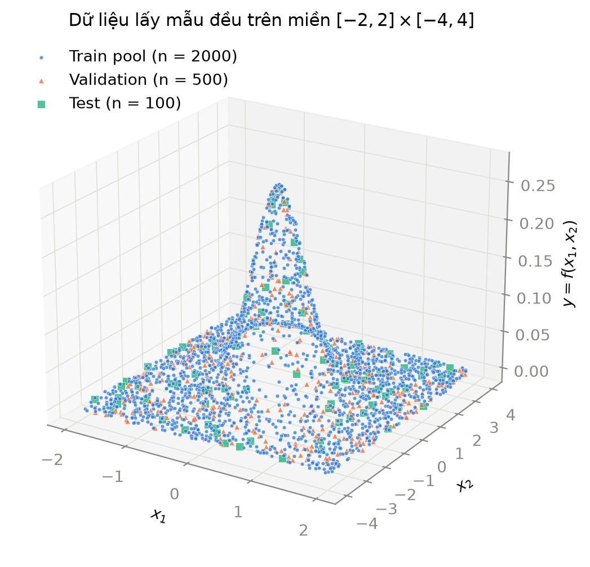
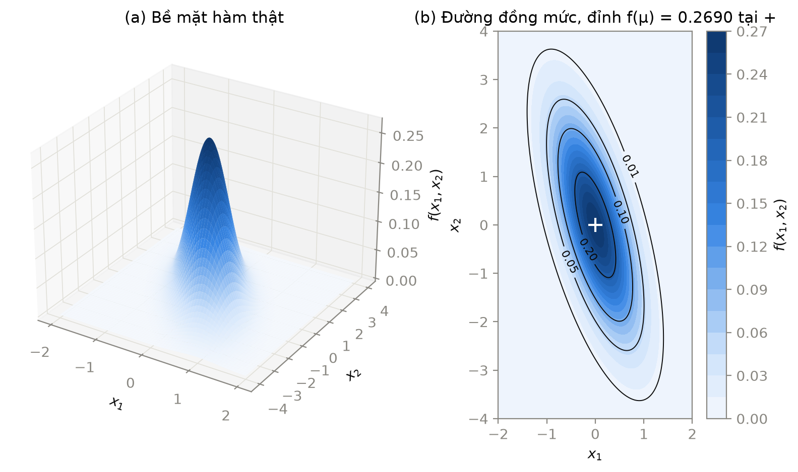
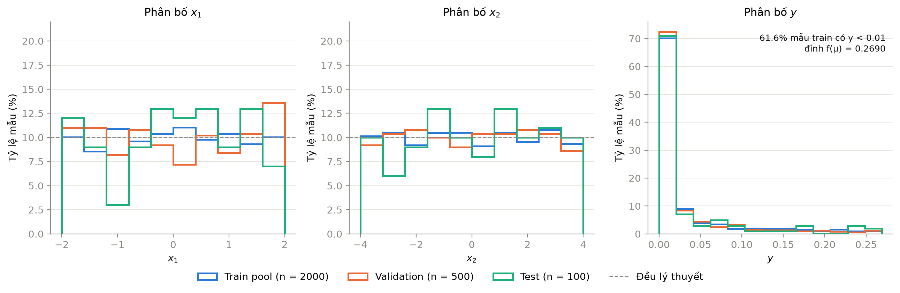
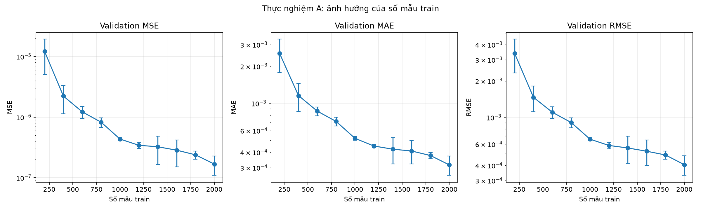
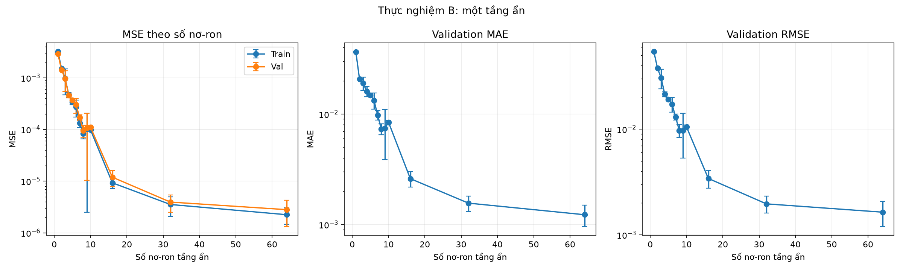
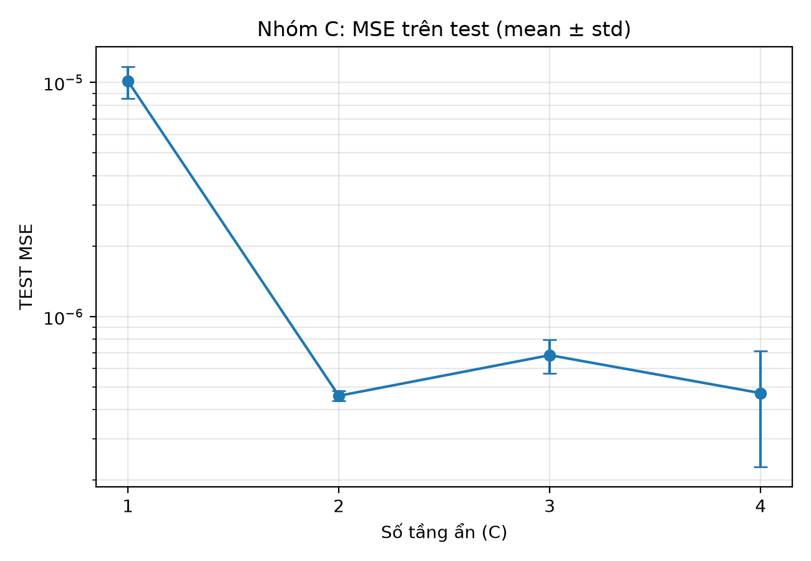
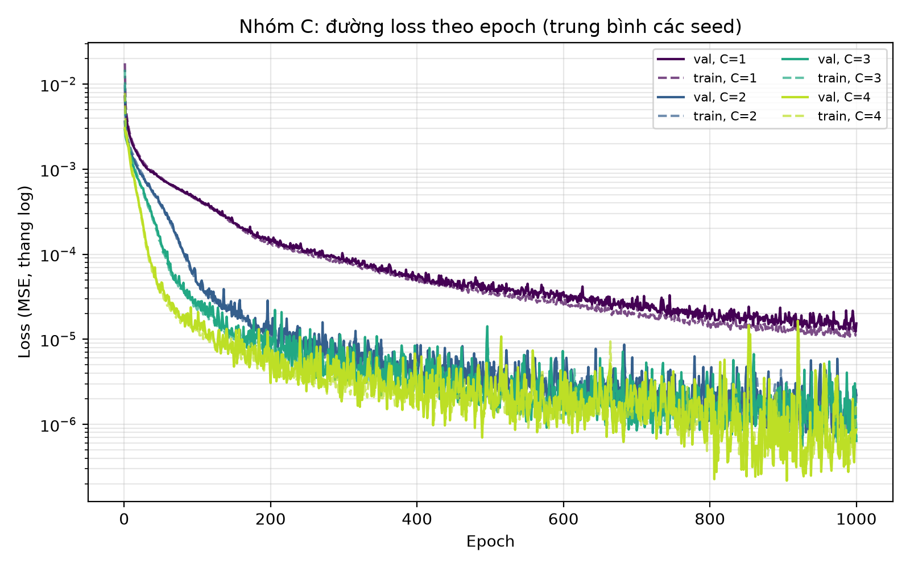
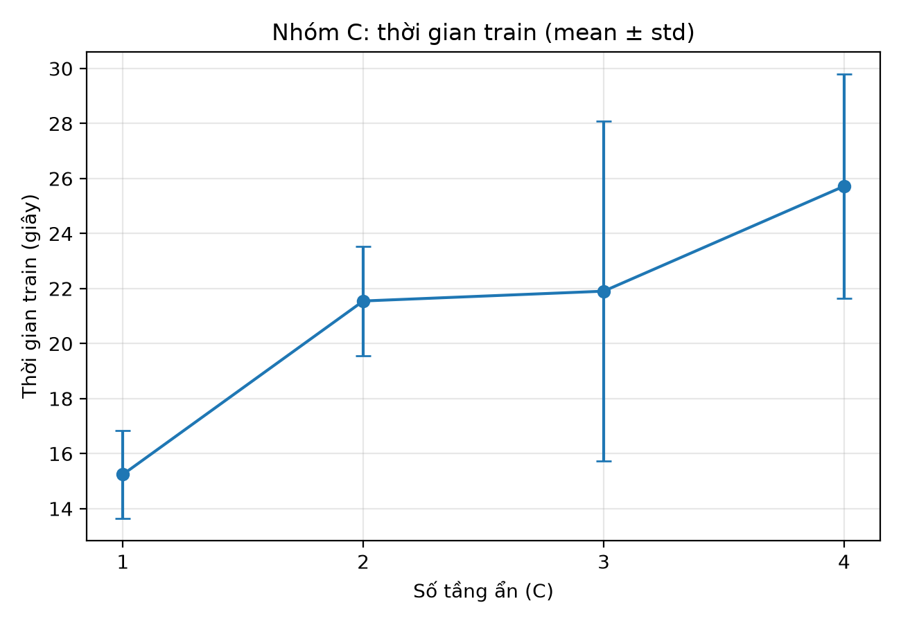
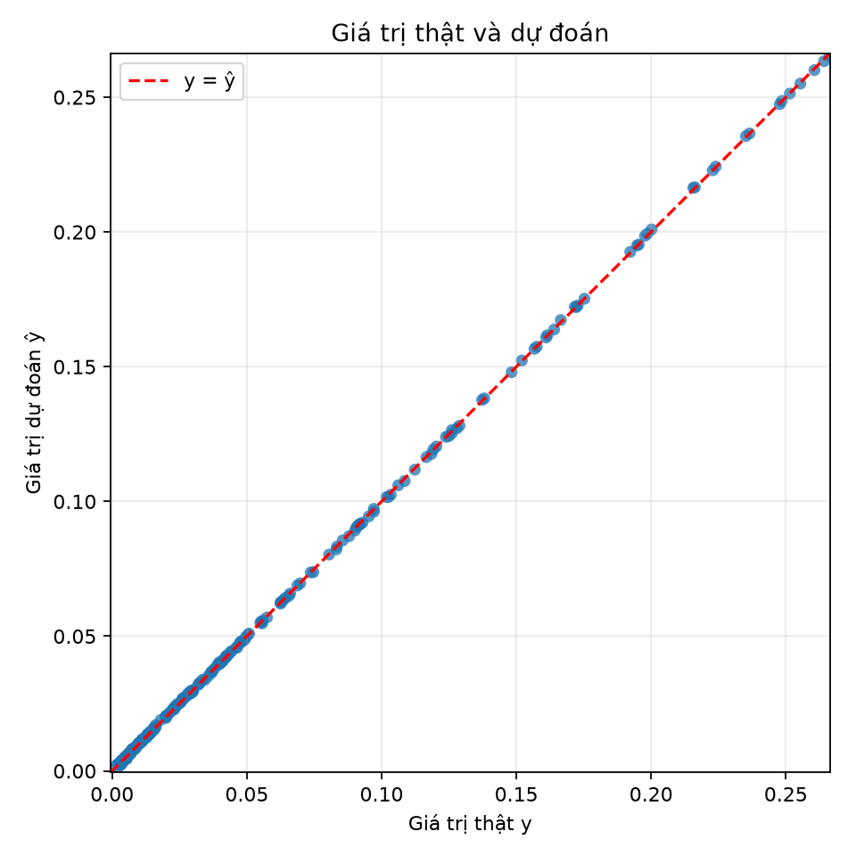
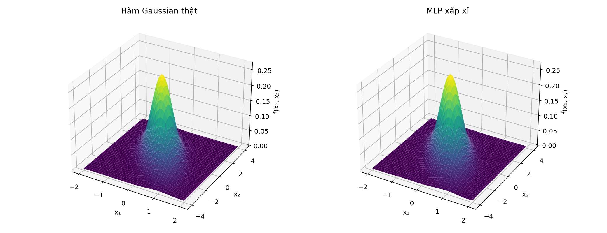

# 1. Giới thiệu

## 1.1. Mục tiêu

Nhóm 5 dùng mạng perceptron nhiều tầng (MLP) viết bằng PyTorch để học lại một hàm mật độ Gaussian hai chiều từ các điểm lấy mẫu, rồi đo sai số thay đổi ra sao khi đổi số mẫu train, số nơ-ron và số tầng ẩn. Công thức của hàm đã biết trước, nên tại bất kỳ điểm nào trong miền nhóm cũng tính được giá trị đúng để đặt cạnh dự đoán của mạng. Dữ liệu không có nhiễu, vì vậy mọi chênh lệch giữa hai bề mặt là sai số của mạng.

Đề bài [1] bắt buộc tự viết mô hình và vòng huấn luyện bằng PyTorch [2] (`nn.Module`, `nn.Linear`, `DataLoader`, `MSELoss`, Adam [4]) và không chấp nhận TensorFlow hay Keras. Code mẫu và báo cáo mẫu đi kèm đề viết bằng TensorFlow/Keras, dùng ma trận hiệp phương sai đơn vị và lấy tập test làm validation. Nhóm chỉ tham khảo cách chia hàm của chúng (sinh dữ liệu, đọc dữ liệu, vẽ 3D), phần mô hình và vòng train viết lại từ đầu.

## 1.2. Phát biểu bài toán

Đầu vào là điểm x = (x₁, x₂) lấy đều trong miền −2 ≤ x₁ ≤ 2, −4 ≤ x₂ ≤ 4. Nhãn là y = f(x), với f là mật độ Gaussian hai chiều có kỳ vọng μ = (0, 0) và ma trận hiệp phương sai C = [[0.3, −0.5], [−0.5, 2]] (công thức đầy đủ ở mục 2.1). Mạng nhận hai số x₁, x₂ và trả về một số thực ŷ. Huấn luyện nhằm đưa ŷ về gần y theo sai số bình phương trung bình (MSE).

Hàm đạt đỉnh f(μ) ≈ 0.269 tại gốc tọa độ rồi giảm nhanh khi ra xa, đến mức hơn 60% điểm lấy mẫu có y < 0.01. MSE của các mô hình vì thế rất nhỏ, trong 81 lần chạy của nhóm nằm trong khoảng từ cỡ 10⁻³ (mạng 1 nơ-ron) xuống cỡ 10⁻⁷ (baseline với 2000 mẫu train). Nhóm báo cáo thêm MAE và RMSE, hai chỉ số có cùng đơn vị với y, để đọc sai số so với đỉnh 0.269.

Dữ liệu gồm ba tập độc lập, sinh một lần với seed 42 và lưu thành CSV: pool train 2000 điểm, validation 500 điểm, test 100 điểm. Validation quyết định khi nào dừng sớm, giữ checkpoint nào và cấu hình nào tốt hơn. Tập test không tham gia lựa chọn nào trong số đó, vì đề cấm dùng test để chọn siêu tham số. Nhóm chỉ tính sai số test ở hai chỗ. Chỗ thứ nhất là từng lượt chạy của thực nghiệm C, vì đề yêu cầu báo test error theo số tầng. Chỗ thứ hai là mô hình cuối, sau khi đã chọn xong theo validation.

Bảng 1.1 liệt kê ba nhóm thực nghiệm và số lần chạy của mỗi nhóm.

Bảng 1.1. Ba nhóm thực nghiệm. Mỗi nhóm chỉ đổi một yếu tố, các tham số khác giữ theo baseline.

| Nhóm | Yếu tố thay đổi | Giá trị | Số lần chạy (3 seed) |
| --- | --- | --- | --- |
| A | Số mẫu train | 200, 400, ..., 2000 | 30 |
| B | Số nơ-ron của mạng 1 tầng ẩn | 1 đến 10, thêm 16, 32, 64 | 39 |
| C | Số tầng ẩn, mỗi tầng 16 nơ-ron | 1, 2, 3, 4 | 12 |

Baseline là mạng 2 tầng ẩn × 16 nơ-ron, kích hoạt tanh, đầu ra tuyến tính, Adam với learning rate 10⁻³, batch 32, tối đa 1000 epoch, dừng sớm khi val loss 100 epoch liên tiếp không giảm, và 1000 mẫu train cho B, C (Bảng 3.1 ở mục 3.3). Đề gợi ý B từ 1 đến 10 và cho phép mở rộng. Nhóm thêm 16, 32 và 64 nơ-ron để có những mạng đủ rộng mà xét chuyện quá khớp, vì với tối đa 10 nơ-ron mạng có thể chỉ thiếu khớp.

## 1.3. Cách nhóm giữ cho phép so sánh công bằng

Mọi tham số baseline và danh sách giá trị của A, B, C nằm trong một file `configs/baseline.yaml`. Các script thực nghiệm đều đọc file này, nên không lần chạy nào lệch tham số so với lần khác. Kiểm tra cột `config_json` trong 81 file log cho thấy cả 81 lần chạy dùng cùng optimizer, learning rate, batch, số epoch tối đa, patience và hàm kích hoạt.

Ở thực nghiệm A, tập 200 mẫu là 200 dòng đầu của pool, tập 400 mẫu là 400 dòng đầu, và cứ thế đến 2000. Hai cấu hình liền nhau chỉ khác phần mẫu thêm vào. Validation và test giữ nguyên cho cả ba nhóm thực nghiệm.

Mỗi cấu hình chạy với ba seed huấn luyện 0, 1, 2. Seed quyết định trọng số khởi tạo và thứ tự xáo mini-batch, nên kết quả báo cáo dưới dạng trung bình ± độ lệch chuẩn qua ba seed thay vì một lần chạy. Để kiểm tra tính tái lập, ngày 31/10 nhóm chạy lại cấu hình baseline (seed 0) bằng script riêng. Val loss của cả 1000 epoch trùng khớp với log A (A = 1000, seed 0) và log C (C = 2, seed 0) đã chạy trước đó, chênh lệch bằng 0.

## 1.4. Phân công và đóng góp

Mỗi thành viên giữ một phần code, tự chạy phần thực nghiệm của mình và viết phần báo cáo tương ứng. Người viết số liệu cũng là người có log sinh ra số liệu đó. Ngày 31/10 nhóm review chéo toàn bộ code, sửa lỗi runner ghi đè bảng tổng hợp khi chạy một phần cấu hình và lỗi chồng nhãn trục ở hình bề mặt. Bảng 1.2 ghi phần việc và tỷ lệ đóng góp của từng người.

Bảng 1.2. Thành viên, nhiệm vụ và tỷ lệ đóng góp.

| Thành viên | MSSV | Vai trò | Code phụ trách | Phần báo cáo | Đóng góp |
| --- | --- | --- | --- | --- | --- |
| Huỳnh Ngọc Trúc | 3123411312 | Trưởng nhóm, dữ liệu, ghép báo cáo | `src/data.py`, `scripts/plot_data.py`, `scripts/run_baseline.py`, `README.md`, `requirements.txt` | 1, 2, 6 + ghép, định dạng | [...] |
| Phạm Trần Minh Khang | 3123411143 | Lõi PyTorch | `src/model.py`, `src/train.py`, `src/evaluate.py` | 3 + đánh giá chung | [...] |
| Tạ Quang Trung | 3123411318 | Thực nghiệm A, B | `experiments/run_A.py`, `experiments/run_B.py`, `experiments/common.py` | 4.1, 4.2 + thảo luận A, B | [...] |
| Ngô Nguyễn Thành Nhân | 3123411205 | Thực nghiệm C, slide | `experiments/run_C.py`, `src/plots.py` | 4.3 + thảo luận C, hạn chế | [...] |

[Tỷ lệ đóng góp chốt ngày 07/11 theo việc thực tế, tổng 100%.]

## 1.5. Kết quả chính

Nhóm xếp hạng cả 27 cấu hình của A, B, C theo val MSE trung bình qua ba seed. Đứng đầu là baseline 2 tầng ẩn × 16 nơ-ron train với đủ 2000 mẫu của pool (A = 2000), val MSE 1.68 × 10⁻⁷ ± 5.89 × 10⁻⁸. Cấu hình tốt nhất của B (64 nơ-ron) chỉ đạt 2.81 × 10⁻⁶, của C (4 tầng) đạt 4.10 × 10⁻⁷ với 1000 mẫu train. Trong ba seed của A = 2000, seed 1 có val MSE thấp nhất (1.05 × 10⁻⁷). Nhóm train lại đúng cấu hình và seed này, lưu trọng số ở epoch có val loss nhỏ nhất vào `results/final/selected_model.pt` (337 tham số), rồi nạp lại file đó để tính sai số trên test một lần. Bảng 1.3 ghi sai số của checkpoint này trên validation và test.

Bảng 1.3. Sai số của mô hình cuối (checkpoint ở epoch 980). Nguồn: `results/final/final_metrics.json`.

| Tập | MSE | MAE | RMSE |
| --- | ---: | ---: | ---: |
| Validation (500 điểm) | 1.081954e-07 | 2.450498e-04 | 3.289307e-04 |
| Test (100 điểm) | 8.651794e-08 | 2.163969e-04 | 2.941393e-04 |

RMSE trên test bằng khoảng 0.11% giá trị đỉnh 0.269 của hàm. Con số test cần đọc kèm một giới hạn. Runner C đã tính sai số trên chính 100 điểm test này trước khi nhóm chọn mô hình, nên đây là điểm đo trên một tập nhóm đã từng xem kết quả, không phải tập test hoàn toàn mới. Sai số test của C không tham gia vào việc chọn cấu hình.

Checkpoint cuối train trên một máy khác máy đã chạy A, nên val MSE của nó (1.08 × 10⁻⁷ ở epoch 980) lệch nhẹ so với log A (1.05 × 10⁻⁷ ở epoch 999). Hai log khác nhau ngay từ epoch 1, ở chữ số có nghĩa thứ tám. Nhóm chạy lại cấu hình này trên một máy thứ ba và thu được log trùng log A ở cả 1000 epoch, tức chênh lệch đến từ môi trường tính toán của máy train checkpoint, không đến từ code.

Ở A, val MSE giảm đều qua cả mười cỡ mẫu, từ 1.22 × 10⁻⁵ với 200 mẫu xuống 1.68 × 10⁻⁷ với 2000 mẫu, khoảng 72.5 lần. Ở B, val MSE giảm từ 2.92 × 10⁻³ với 1 nơ-ron xuống 2.81 × 10⁻⁶ với 64 nơ-ron và chững lại ở 9, 10 nơ-ron. Train và val MSE của B sát nhau ở mọi độ rộng, chưa cho thấy quá khớp rõ ràng. Ở C, tầng ẩn thứ hai đưa val MSE từ 1.19 × 10⁻⁵ xuống 4.35 × 10⁻⁷. Tầng thứ ba và thứ tư không giảm thêm rõ rệt, trong khi thời gian train trung bình tăng từ 15.2 lên 25.7 giây.

## 1.6. Bố cục báo cáo

- Mục 2. Dữ liệu: công thức Gaussian, cách lấy mẫu và chia tập, hình và thống kê.
- Mục 3. Mô hình và cài đặt: kiến trúc MLP, công thức forward và loss, quy trình train, validation, checkpoint.
- Mục 4. Thực nghiệm: bảng siêu tham số, kết quả A, B, C kèm bảng và đồ thị.
- Mục 5. Thảo luận: giải thích xu hướng, trường hợp không như dự đoán, hạn chế và hướng cải tiến.
- Mục 6. Kết luận, tài liệu tham khảo và lệnh tái lập.

# 2. Dữ liệu

Mọi số trong mục này lấy từ `data/stats.csv` và các hình trong `report/figures/`, sinh lại bằng `python -m src.data` rồi `python -m scripts.plot_data`.

## 2.1. Hàm mục tiêu

Nhãn y là giá trị của hàm mật độ Gaussian hai chiều tại điểm x = (x₁, x₂):

$$
f(\mathbf{x}) = \frac{1}{2\pi\sqrt{\det C}} \exp\left(-\tfrac{1}{2}(\mathbf{x}-\boldsymbol{\mu})^T C^{-1} (\mathbf{x}-\boldsymbol{\mu})\right),
\quad \boldsymbol{\mu} = \begin{bmatrix}0\\0\end{bmatrix},\;
C = \begin{bmatrix}0.3 & -0.5\\ -0.5 & 2\end{bmatrix}
$$

Với ma trận C của đề, det C = 0.3 · 2 − 0.5² = 0.35 và

$$
C^{-1} = \frac{1}{0.35}\begin{bmatrix}2 & 0.5\\ 0.5 & 0.3\end{bmatrix} = \begin{bmatrix}5.714 & 1.429\\ 1.429 & 0.857\end{bmatrix}.
$$

Hàm đạt cực đại tại μ = (0, 0) với f(μ) = 1 / (2π√0.35) ≈ 0.2690. Đây là giá trị lớn nhất y có thể nhận, nên nhóm dùng nó làm mốc để đọc RMSE ở mục 4.

Hệ số tương quan giữa x₁ và x₂ trong C là ρ = −0.5 / √(0.3 · 2) ≈ −0.645. Dấu âm làm các đường đồng mức là elip nghiêng: đi lên theo x₂ thì tâm elip lệch sang phía x₁ âm. Hai trị riêng của C là 0.164 và 2.136, ứng với độ lệch chuẩn 0.405 theo trục ngắn và 1.462 theo trục dài. Trục dài có hướng (−0.263, 0.965), lệch khoảng 15° so với trục x₂. Hình 2.2b cho thấy đúng hình dạng này.

Nhóm tự viết hàm `gaussian_2d` trong `src/data.py` theo công thức trên bằng NumPy [7], không gọi `scipy.stats.multivariate_normal`. Dạng toàn phương (x − μ)ᵀC⁻¹(x − μ) được tính cho cả n điểm một lúc bằng `np.einsum("ni,ij,nj->n", d, C⁻¹, d)`. Để kiểm tra, nhóm tính tay tại điểm (1, 1): dạng toàn phương bằng 3.3 / 0.35 = 9.4286, f = e^(−4.7143) / (2π√0.35) = 0.0024121140460877. Hàm trả về 0.002412114046087728, khớp đến chữ số thứ 15.

## 2.2. Lấy mẫu và chia tập

x₁ lấy đều trong [−2, 2], x₂ lấy đều trong [−4, 4], độc lập với nhau, rồi gắn nhãn y = f(x₁, x₂). Dữ liệu không có nhiễu, nên sai số của mô hình chỉ đến từ việc xấp xỉ chưa đúng hàm.

Toàn bộ dữ liệu sinh một lần với seed 42 và lưu thành CSV. Từ seed này, `np.random.default_rng(42).spawn(3)` tách ra ba bộ sinh số ngẫu nhiên độc lập, mỗi tập dùng một bộ. Nhờ vậy, nếu sau này đổi kích thước pool train thì tập validation và test vẫn giữ nguyên từng điểm, và kết quả các lần chạy vẫn so được với nhau. Các tham số (seed, miền, μ, C, số mẫu) đọc từ `configs/baseline.yaml`, code không ghi cứng giá trị nào. Bảng 2.1 ghi kích thước và vai trò của ba tập.

Bảng 2.1. Ba tập dữ liệu và vai trò.

| Tập | File | Số mẫu | Vai trò |
| --- | --- | --- | --- |
| Train pool | `data/train_pool.csv` | 2000 | Cập nhật trọng số. Thực nghiệm A lấy n dòng đầu (n = 200, 400, ..., 2000), B và C lấy 1000 dòng đầu |
| Validation | `data/val.csv` | 500 | Early stopping, chọn checkpoint, so sánh và chọn cấu hình |
| Test | `data/test.csv` | 100 | Chỉ đánh giá mô hình cuối cùng, không tham gia bất kỳ lựa chọn nào |

Thực nghiệm A lấy tiền tố của cùng một pool, nên tập 200 mẫu nằm trọn trong tập 400 mẫu, tập 400 nằm trọn trong tập 600, và cứ thế. Hai cấu hình A liền nhau chỉ khác nhau ở số mẫu thêm vào, phần dữ liệu chung giữ nguyên. Validation và test cố định cho mọi cấu hình của cả A, B, C.

Trước khi ghi file, hàm `check()` dừng chương trình nếu một trong các điều kiện sau sai:

- mỗi tập có đúng số mẫu khai báo trong yaml,
- mọi x₁ nằm trong [−2, 2] và mọi x₂ nằm trong [−4, 4],
- 0 < y ≤ f(μ) với mọi mẫu,
- không có điểm (x₁, x₂) nào xuất hiện ở hai tập khác nhau.

Điều kiện cuối bảo đảm không có mẫu test hay validation nào lọt vào train. Chạy `python -m src.data` hai lần cho ra bốn file CSV giống nhau từng byte.

## 2.3. Trực quan hóa

Các hình trong báo cáo vẽ bằng Matplotlib [8]. Hình 2.1 đặt cả ba tập lên cùng một hệ trục để xem chúng có phủ đều miền không. Hình 2.2 vẽ hàm thật trên lưới dày, và Hình 2.3 so phân bố của x₁, x₂, y giữa ba tập.



Hình 2.1. Scatter 3D của 2600 mẫu: train pool (chấm tròn xanh dương), validation (tam giác cam), test (ô vuông xanh lục).



Hình 2.2. Hàm thật f(x₁, x₂) trên lưới đều 201 × 201 điểm phủ toàn miền. (a) Bề mặt 3D. (b) Đường đồng mức tại các mức 0.01, 0.05, 0.10, 0.20, dấu + là đỉnh tại μ.



Hình 2.3. Phân bố x₁, x₂, y của từng tập. Trục tung là phần trăm số mẫu của chính tập đó, để so được các tập có kích thước khác nhau. Đường đứt nét ở hai hình đầu là mức 10% mỗi khoảng của phân bố đều.

Ở Hình 2.1, các mẫu phủ kín miền chữ nhật và ba tập trộn lẫn nhau, không tập nào dồn vào một vùng riêng. Phần lớn điểm nằm sát mặt phẳng y = 0, chỉ một dải hẹp quanh gốc tọa độ nhô lên thành đỉnh. Hình 2.2 cho thấy rõ hơn rằng đỉnh này hẹp theo x₁ và dài theo x₂: đường mức 0.01 trải từ x₂ ≈ −3.6 đến 3.6, còn trên đường x₂ = 0 nó chỉ chiếm x₁ từ −1.07 đến 1.07.

## 2.4. Thống kê mô tả

Bảng 2.2 ghi thống kê mô tả của x₁, x₂, y theo từng tập. Bảng 2.3 đếm tỷ lệ mẫu theo ba mức giá trị của y.

Bảng 2.2. Thống kê x₁, x₂, y của từng tập (trích từ `data/stats.csv`).

| Tập | Cột | Trung bình | Độ lệch chuẩn | Min | Trung vị | Max |
| --- | --- | --- | --- | --- | --- | --- |
| Train pool | x₁ | 0.008 | 1.144 | −1.999 | 0.020 | 1.998 |
| | x₂ | −0.017 | 2.310 | −3.999 | −0.080 | 4.000 |
| | y | 0.0318 | 0.0587 | 3.5e−13 | 0.0031 | 0.2685 |
| Validation | x₁ | 0.034 | 1.227 | −1.995 | −0.050 | 1.990 |
| | x₂ | 0.001 | 2.268 | −3.989 | 0.052 | 4.000 |
| | y | 0.0277 | 0.0540 | 7.6e−13 | 0.0032 | 0.2663 |
| Test | x₁ | 0.041 | 1.142 | −1.986 | 0.115 | 1.988 |
| | x₂ | 0.160 | 2.292 | −3.927 | 0.464 | 3.913 |
| | y | 0.0332 | 0.0636 | 4.7e−12 | 0.0039 | 0.2558 |

Bảng 2.3. Tỷ lệ mẫu theo mức giá trị của y.

| Tập | y < 0.01 | y > 0.10 | y > 0.20 |
| --- | --- | --- | --- |
| Train pool | 61.6% | 12.1% | 3.9% |
| Validation | 65.2% | 9.8% | 2.8% |
| Test | 65.0% | 11.0% | 5.0% |

Với phân bố đều trên đoạn dài L, độ lệch chuẩn lý thuyết là L/√12, tức 1.155 cho x₁ và 2.309 cho x₂. Train pool cho 1.144 và 2.310, gần như trùng. Validation có độ lệch chuẩn x₁ là 1.227, cao hơn lý thuyết khoảng 6%, do khoảng x₁ ∈ [1.6, 2] chứa 13.6% số mẫu validation thay vì 10% (Hình 2.3). Tập test chỉ có 100 mẫu nên các cột histogram dao động mạnh nhất, có khoảng chỉ chứa 3% mẫu. Ba tập vẫn phủ hết miền và có trung bình x gần 0, nên nhóm giữ nguyên cách chia, không sinh lại.

Phân bố của y lệch hẳn về 0. Trung vị chỉ khoảng 0.003, trong khi giá trị lớn nhất là 0.27. Hơn 60% mẫu ở mọi tập có y < 0.01, và chỉ 2.8% đến 5% số mẫu có y > 0.2. Hệ quả cho các mục sau:

1. MSE rất nhỏ (trong 81 lượt chạy, val MSE trung bình từ cỡ 10⁻³ ở mạng 1 nơ-ron xuống cỡ 10⁻⁷ ở cấu hình tốt nhất), nên các bảng kết quả ghi số dạng mũ và báo thêm RMSE, đơn vị giống y, để đọc được tương đối so với đỉnh 0.269.
2. Vùng đỉnh, nơi hàm thay đổi nhanh nhất, lại có ít mẫu nhất. Nhóm dự đoán sai số lớn nhất của mô hình sẽ nằm quanh μ và kiểm tra dự đoán này bằng bề mặt xấp xỉ và đồ thị y–ŷ của mô hình cuối ở mục 5.3.
3. Một mô hình luôn dự đoán ŷ = 0 vẫn có MSE trên test bằng trung bình của y², tức khoảng 0.005. Mô hình nào không thấp hơn mức này nhiều thì chưa học được hàm.

Nhóm không chuẩn hóa y (`normalize_y: false` trong yaml) vì Adam tự điều chỉnh bước cập nhật theo độ lớn gradient, và giữ y gốc thì MSE, MAE, RMSE trong báo cáo tính thẳng trên thang của đề, không cần đổi ngược.

# 3. Mô hình và cài đặt

Mục này mô tả phần lõi PyTorch trong `src/model.py`, `src/train.py` và `src/evaluate.py`. Các tham số lấy từ `configs/baseline.yaml`; kết quả tổng hợp A/B/C được trình bày ở mục 4, không suy ra từ một lần chạy minh họa trong mục này.

## 3.1. Kiến trúc mạng

Bài toán nhận hai đặc trưng \(x_1,x_2\) và dự đoán một giá trị vô hướng \(\hat y\), xấp xỉ mật độ Gaussian \(y=f(x_1,x_2)\). MLP được cài đặt bằng PyTorch: lớp `MLP` kế thừa `torch.nn.Module`, các phép biến đổi tuyến tính dùng `torch.nn.Linear`.

Hình 3.1 là sơ đồ kiến trúc baseline.

```text
Đầu vào              Tầng ẩn 1       Tầng ẩn 2       Đầu ra
(x₁, x₂)  ─────────►  16 nơ-ron ───►  16 nơ-ron ───►  ŷ
                         tanh             tanh         tuyến tính
```

Hình 3.1. Sơ đồ MLP baseline: 2 đầu vào, hai tầng ẩn 16 nơ-ron dùng tanh, 1 đầu ra tuyến tính (337 tham số).

Tổng quát, danh sách `hidden` quy định số nơ-ron của từng tầng ẩn. Ví dụ `[16, 16]` tạo hai tầng ẩn, còn `[16, 16, 16]` tạo ba tầng ẩn. Nhờ vậy, cùng một lớp mạng dùng được cho baseline, thực nghiệm B (thay độ rộng của một tầng ẩn) và C (thay số tầng ẩn). Tầng ẩn dùng activation theo cấu hình; baseline dùng `tanh`. Tầng đầu ra là tuyến tính, không ép \(\hat y\) vào một khoảng cố định.

Với \(h_0=[x_1,x_2]^T\), phép lan truyền thuận của mạng có \(L\) tầng ẩn là:

\[
h_\ell=\phi(W_\ell h_{\ell-1}+b_\ell), \qquad \ell=1,\ldots,L,
\]
\[
\hat y=W_{\mathrm{out}}h_L+b_{\mathrm{out}},
\]

trong đó \(W_\ell\) và \(b_\ell\) lần lượt là trọng số và bias được học; \(\phi\) là hàm kích hoạt. Với baseline, \(\phi=\tanh\), \(L=2\), mỗi tầng ẩn có 16 nơ-ron. Một batch đầu vào có shape \((N,2)\); đầu ra có shape \((N,1)\).

Hiện thực hóa phần forward:

```python
for size in hidden:
    layers.extend((nn.Linear(input_size, size), activation_layer()))
    input_size = size
layers.append(nn.Linear(input_size, 1))
```

Activation phi tuyến giữa các lớp tuyến tính cho phép mạng biểu diễn ánh xạ phi tuyến. Đầu ra tuyến tính phù hợp với mục tiêu hồi quy giá trị thực; không dùng sigmoid ở đầu ra vì đề không yêu cầu xác suất hay giới hạn đầu ra trong \([0,1]\).

## 3.2. Hàm mất mát

Mạng được tối ưu bằng sai số bình phương trung bình (Mean Squared Error, MSE):

\[
\mathcal{L}_{\mathrm{MSE}}
=\frac{1}{N}\sum_{i=1}^{N}(y_i-\hat y_i)^2.
\]

Trong mỗi mini-batch, `torch.nn.MSELoss` tính trung bình bình phương sai số giữa nhãn và dự đoán. Sai số lớn bị phạt mạnh hơn sai số nhỏ do phép bình phương. Nhãn \(y\) không được chuẩn hóa theo baseline (`normalize_y: false`), do đó loss và các chỉ số ở mục đánh giá được tính trên thang nhãn gốc.

Để theo dõi loss train ở cấp epoch, code nhân loss trung bình của mỗi batch với số mẫu trong batch, cộng qua các batch rồi chia tổng số mẫu. Cách tính này xử lý đúng batch cuối nếu batch đó ít mẫu hơn `batch_size`. Validation loss được tính trên toàn bộ tập validation sau mỗi epoch, ở chế độ suy luận và không tạo gradient.

## 3.3. Thiết lập và quy trình huấn luyện

Bảng 3.1 liệt kê các giá trị baseline dùng chung cho A, B, C, chốt trong `configs/baseline.yaml`.

Bảng 3.1. Cấu hình baseline.

| Tham số | Baseline |
|---|---:|
| Số mẫu train mặc định | 1000 (B, C; A thay đổi theo cấu hình) |
| Số tầng ẩn, số nơ-ron mỗi tầng | 2 tầng × 16 |
| Hàm kích hoạt tầng ẩn | `tanh` |
| Hàm kích hoạt đầu ra | Tuyến tính |
| Optimizer | Adam |
| Learning rate | \(10^{-3}\) |
| Batch size | 32 |
| Số epoch tối đa | 1000 |
| Early stopping patience | 100 epoch không cải thiện validation loss |
| Seed huấn luyện | 0, 1, 2 |
| Chuẩn hóa nhãn | Không |

Hàm `train_model` trong `src/train.py` nhận riêng dữ liệu train và validation; test không phải đối số của hàm. Đặc trưng và nhãn được kiểm tra shape, tính hữu hạn rồi chuyển sang `float32`. Nhãn dạng \((N,)\) được đổi thành \((N,1)\) để khớp đầu ra MLP. Dữ liệu train được ghép bằng `TensorDataset` và chia mini-batch bằng `DataLoader`.

Ở mỗi batch, vòng lặp thực hiện:

1. `model.train()` đặt mạng ở chế độ huấn luyện.
2. `optimizer.zero_grad()` xóa gradient còn lại từ batch trước.
3. Forward tạo dự đoán; `MSELoss` tính loss.
4. `loss.backward()` tính gradient qua backpropagation.
5. `optimizer.step()` cập nhật trọng số bằng Adam.

Cuối mỗi epoch, mô hình chuyển sang `model.eval()` và tính validation loss trong `torch.no_grad()`. Nếu validation loss giảm so với tốt nhất trước đó, code lưu bản sao độc lập của `state_dict` và cập nhật `best_epoch`. Khi validation loss không cải thiện trong 100 epoch liên tiếp, early stopping kết thúc huấn luyện. Trước khi trả kết quả, trọng số tại epoch có validation loss thấp nhất được nạp lại; vì vậy mô hình trả về không nhất thiết là trọng số ở epoch cuối.

Thời gian vòng lặp được đo bằng `time.perf_counter()`: bao gồm các epoch huấn luyện, tính validation loss và lưu bản sao trọng số tốt nhất trong bộ nhớ; không tính thời gian ghi CSV, lưu checkpoint ra đĩa hoặc vẽ biểu đồ. Mỗi lần chạy có thể lưu log theo epoch với các cột `epoch`, `train_loss`, `val_loss`; checkpoint `.pt` lưu trọng số tốt nhất cùng cấu hình và metadata cần để nhận diện kiến trúc, seed và epoch được chọn. Các seed giúp so sánh nhiều lần khởi tạo; kết quả nhóm được tổng hợp theo mean ± std ở phần thực nghiệm.

## 3.4. Validation, test và đánh giá

Validation được dùng để theo dõi quá trình học, dừng sớm và chọn checkpoint/cấu hình. Tập test không tham gia cập nhật trọng số hoặc lựa chọn mô hình. Riêng trong repo này, runner C đã tính metric test cho cả 12 lượt theo yêu cầu báo cáo thực nghiệm C trước khi chốt mô hình cuối; vì vậy kết quả test của checkpoint cuối phải được trình bày với lưu ý rằng tập test đã được truy vấn trước, không mô tả là một đánh giá hoàn toàn độc lập.

Module `src/evaluate.py` cung cấp MSE, MAE và RMSE:

\[
\mathrm{MAE}=\frac{1}{N}\sum_{i=1}^{N}|y_i-\hat y_i|,
\qquad
\mathrm{RMSE}=\sqrt{\mathrm{MSE}}.
\]

MAE và RMSE cùng đơn vị với nhãn \(y\), trong khi MSE có đơn vị bình phương. Cả ba chỉ số được báo cáo trên thang nhãn gốc. Hàm đánh giá kiểm tra shape và giá trị hữu hạn, chuyển mô hình tạm thời sang `eval()` và thực hiện dự đoán trong `torch.no_grad()`.

Hai biểu đồ hỗ trợ kiểm tra xấp xỉ gồm:

- Đồ thị giá trị thật \(y\) theo giá trị dự đoán \(\hat y\), với đường tham chiếu \(y=\hat y\).
- Hai bề mặt 3D đặt cạnh nhau: hàm Gaussian thật và đầu ra MLP trên một lưới đều bao phủ miền \([-2,2]\times[-4,4]\).

Hình minh họa baseline dùng validation trong thư mục `results/diagnostics/figures/`; đây là minh chứng chạy pipeline, không thay hình/số liệu cuối cùng được chọn sau khi so sánh A/B/C.

## 3.5. Tổ chức mã nguồn

Bảng 3.2 tóm tắt vai trò của các module chính.

Bảng 3.2. Các module mã nguồn.

| Module | Trách nhiệm |
|---|---|
| `src/model.py` | Định nghĩa MLP tùy biến theo danh sách kích thước tầng ẩn và activation. |
| `src/train.py` | Kiểm tra dữ liệu, đặt seed, tạo `DataLoader`, huấn luyện, validation, early stopping, checkpoint, log và đo thời gian. |
| `src/evaluate.py` | Dự đoán, tính MSE/MAE/RMSE, vẽ đồ thị \(y\)–\(\hat y\) và so sánh bề mặt. |
| `configs/baseline.yaml` | Lưu baseline và danh sách cấu hình thí nghiệm để các lần chạy dùng nhất quán. |

Các script A/B/C gọi lại lõi huấn luyện với cấu hình tương ứng; việc tổng hợp bảng, biểu đồ và phân tích kết quả từng thực nghiệm được trình bày riêng ở mục 4.

# 4. Thực nghiệm

## 4.1. Thiết lập chung và quy trình đánh giá

Phần thiết lập riêng của từng nhóm nằm ở đầu mục 4.2 (Bảng 4.1) và 4.3 (Bảng 4.4).

Cả ba nhóm thực nghiệm dùng chung baseline ở Bảng 3.1: Adam [4] với learning rate 10⁻³, batch 32, tối đa 1000 epoch, dừng sớm khi val loss 100 epoch liên tiếp không giảm [3], kích hoạt tanh, đầu ra tuyến tính. Các runner `run_A.py`, `run_B.py`, `run_C.py` đều đọc tham số từ `configs/baseline.yaml` và chỉ thay đúng yếu tố đang khảo sát (Bảng 1.1). Validation 500 điểm và test 100 điểm giữ nguyên cho mọi lượt chạy.

Quy trình đánh giá giống nhau ở cả ba nhóm:

1. Mỗi cấu hình chạy với ba seed huấn luyện 0, 1, 2. Seed quyết định trọng số khởi tạo và thứ tự xáo mini-batch.
2. Sau khi train, mạng được nạp lại trọng số ở epoch có val loss thấp nhất, rồi mới tính MSE, MAE, RMSE. Số trong bảng không lấy từ epoch cuối.
3. Mỗi ô trong bảng là trung bình ± độ lệch chuẩn mẫu (mẫu số n − 1) qua ba seed. RMSE tính riêng cho từng lượt rồi mới lấy trung bình, nên RMSE trung bình không nhất thiết bằng căn của MSE trung bình.
4. So sánh và xếp hạng cấu hình chỉ dựa trên val MSE. Sai số test chỉ được tính ở từng lượt C, vì đề yêu cầu báo test error theo số tầng, và ở mô hình cuối (mục 1.5). Không bước chọn nào đọc cột test.

Ba nhóm có hai cấu hình trùng nhau. Mạng 1 tầng 16 nơ-ron vừa là B = 16 vừa là C = 1. Mạng 2 tầng × 16 nơ-ron với 1000 mẫu vừa là A = 1000 vừa là C = 2. Nhóm so log của từng cặp ở cả ba seed. Train loss và val loss trùng nhau ở cả 1000 epoch, chênh lệch bằng 0, dù A/B và C do hai runner khác nhau chạy. Vì vậy các bảng của A, B và C so được trực tiếp với nhau. Giữa Bảng 4.2, 4.3 và Bảng 4.5, vài số lệch một đơn vị ở chữ số có nghĩa thứ bảy, ví dụ val MSE của A = 1000 là 4.350544e-07, còn của C = 2 là 4.350545e-07. Mỗi runner tính lại val MSE từ trọng số tốt nhất sau khi train. Ở seed 1, hai lần tính này lệch nhau cỡ 10⁻¹⁴ do sai số số thực, đủ để trung bình làm tròn đến bảy chữ số có nghĩa lệch một đơn vị ở chữ số cuối. Log loss của hai runner vẫn trùng nhau.

Nguồn số liệu: `configs/baseline.yaml`; log `results/B/logs/B_16_seed{0,1,2}.csv` so với `results/C/logs/C_1_seed{0,1,2}.csv`, và `results/A/logs/A_1000_seed{0,1,2}.csv` so với `results/C/logs/C_2_seed{0,1,2}.csv`.

## 4.2. Kết quả thực nghiệm A và B

Số liệu được tổng hợp từ các log theo seed trong `results/A/logs/` và `results/B/logs/`; bảng summary và hình được sinh bởi runner tương ứng. Các số trong bảng là trung bình ± độ lệch chuẩn mẫu qua ba seed (0, 1, 2). Metric được tính trên checkpoint có validation loss tốt nhất của từng lượt; RMSE được tính riêng từng lượt rồi mới tổng hợp.

### 4.2.1. Thiết lập thực nghiệm

Hai nhóm A và B dùng chung pool train 2000 mẫu, validation cố định 500 mẫu và baseline đã chốt. Thực nghiệm A thay đổi số mẫu lấy từ đầu pool train; thực nghiệm B thay đổi số nơ-ron của một tầng ẩn. Các tham số khác giữ nguyên để so sánh tác động của biến đang khảo sát. Bảng 4.1 tóm tắt thiết lập.

Bảng 4.1. Thiết lập thực nghiệm A và B.

| Thành phần | Thực nghiệm A | Thực nghiệm B |
| --- | --- | --- |
| Biến khảo sát | Số mẫu train: 200, 400, …, 2000 | Số nơ-ron tầng ẩn: 1–10, 16, 32, 64 |
| Số mẫu train | Thay đổi theo cấu hình | 1000 |
| Validation | Cố định 500 mẫu | Cố định 500 mẫu |
| Kiến trúc | 2 tầng ẩn × 16 nơ-ron | 1 tầng ẩn có độ rộng đang khảo sát |
| Activation | Tanh | Tanh |
| Optimizer, learning rate | Adam, 1e-3 | Adam, 1e-3 |
| Batch size | 32 | 32 |
| Dừng | Tối đa 1000 epoch; patience 100 theo validation loss | Tối đa 1000 epoch; patience 100 theo validation loss |
| Seed | 0, 1, 2 cho mỗi cấu hình | 0, 1, 2 cho mỗi cấu hình |

Tập test không được dùng để huấn luyện, chọn cấu hình hoặc tính các bảng A/B trong mục này. Việc lựa chọn cấu hình dựa trên validation.

### 4.2.2. Thực nghiệm A: ảnh hưởng của số mẫu huấn luyện

Mỗi cấu hình A dùng tiền tố của cùng một train pool. Do đó, tập nhỏ hơn là tập con của tập lớn hơn gần nhất; validation được giữ cố định. Bảng 4.2 ghi metric trên cả train và validation, Hình 4.1 vẽ metric validation.

**Bảng 4.2.** MSE, MAE và RMSE theo số mẫu train, trung bình ± độ lệch chuẩn mẫu qua ba seed.

| Số mẫu | Train MSE | Validation MSE | Train MAE | Validation MAE | Train RMSE | Validation RMSE |
| ---: | ---: | ---: | ---: | ---: | ---: | ---: |
| 200 | 7.712946e-06 ± 4.706737e-06 | 1.219636e-05 ± 7.144094e-06 | 2.053294e-03 ± 6.390774e-04 | 2.546581e-03 ± 7.726254e-04 | 2.683707e-03 ± 8.752088e-04 | 3.385741e-03 ± 1.048656e-03 |
| 400 | 1.844667e-06 ± 7.553443e-07 | 2.224003e-06 ± 1.091532e-06 | 1.051431e-03 ± 2.142605e-04 | 1.156012e-03 ± 2.964135e-04 | 1.340648e-03 ± 2.664492e-04 | 1.463840e-03 ± 3.489457e-04 |
| 600 | 1.066023e-06 ± 1.870374e-07 | 1.222356e-06 ± 2.747918e-07 | 8.116353e-04 ± 6.307199e-05 | 8.631181e-04 ± 7.129252e-05 | 1.029898e-03 ± 8.944437e-05 | 1.101152e-03 ± 1.213651e-04 |
| 800 | 7.843614e-07 ± 1.310996e-07 | 8.253509e-07 ± 1.502634e-07 | 6.892376e-04 ± 5.262632e-05 | 7.118723e-04 ± 5.907894e-05 | 8.835112e-04 ± 7.519391e-05 | 9.058272e-04 ± 8.510009e-05 |
| 1000 | 4.135533e-07 ± 4.025497e-08 | 4.350544e-07 ± 2.451342e-08 | 5.034436e-04 ± 2.551392e-05 | 5.186514e-04 ± 1.900515e-05 | 6.425849e-04 ± 3.093425e-05 | 6.594145e-04 ± 1.845216e-05 |
| 1200 | 3.235656e-07 ± 6.060769e-08 | 3.433571e-07 ± 4.001068e-08 | 4.374302e-04 ± 2.514330e-05 | 4.496245e-04 ± 1.375970e-05 | 5.671234e-04 ± 5.389766e-05 | 5.852797e-04 ± 3.474428e-05 |
| 1400 | 3.028161e-07 ± 1.336736e-07 | 3.244289e-07 ± 1.587016e-07 | 4.131174e-04 ± 8.817706e-05 | 4.237320e-04 ± 1.022751e-04 | 5.409648e-04 ± 1.235304e-04 | 5.578067e-04 ± 1.411410e-04 |
| 1600 | 2.841730e-07 ± 1.440429e-07 | 2.853109e-07 ± 1.335988e-07 | 4.037220e-04 ± 1.009342e-04 | 4.095061e-04 ± 8.762454e-05 | 5.211626e-04 ± 1.372730e-04 | 5.244132e-04 ± 1.243082e-04 |
| 1800 | 2.417506e-07 ± 4.151653e-08 | 2.391381e-07 ± 3.670003e-08 | 3.806191e-04 ± 2.371782e-05 | 3.762189e-04 ± 2.092622e-05 | 4.904291e-04 ± 4.295100e-05 | 4.880664e-04 ± 3.733507e-05 |
| 2000 | 1.696409e-07 ± 6.641334e-08 | 1.681281e-07 ± 5.886715e-08 | 3.127952e-04 ± 6.424442e-05 | 3.157274e-04 ± 5.642614e-05 | 4.062875e-04 ± 8.280690e-05 | 4.054550e-04 ± 7.484338e-05 |

Validation MSE trung bình giảm từ 1.219636e-05 ở 200 mẫu xuống 1.681281e-07 ở 2000 mẫu, tức giảm khoảng 72.5 lần trong thiết lập này. Các sai số train và validation cùng giảm rõ khi tăng số mẫu. Ở 1400–1600 mẫu, độ lệch chuẩn tương đối lớn hơn một số cấu hình lân cận; vì vậy nên đọc xu hướng cùng với biến động qua seed, không diễn giải đường giảm là hoàn toàn đều.



**Hình 4.1.** MSE, MAE và RMSE validation theo số mẫu train; điểm là mean, thanh sai số là độ lệch chuẩn mẫu qua ba seed. Hình chỉ thể hiện metric validation; Bảng 4.2 có thêm metric train.

### 4.2.3. Thực nghiệm B: ảnh hưởng của độ rộng tầng ẩn

Thực nghiệm B giữ nguyên một tầng ẩn và 1000 mẫu train, chỉ thay đổi số nơ-ron. Bảng 4.3 trình bày metric train và validation, Hình 4.2 vẽ cùng số liệu. Giá trị 16, 32, 64 được thêm vào dãy 1–10 theo baseline để khảo sát các mạng rộng hơn.

**Bảng 4.3.** MSE, MAE và RMSE theo số nơ-ron, trung bình ± độ lệch chuẩn mẫu qua ba seed.

| Nơ-ron | Train MSE | Validation MSE | Train MAE | Validation MAE | Train RMSE | Validation RMSE |
| ---: | ---: | ---: | ---: | ---: | ---: | ---: |
| 1 | 3.194696e-03 ± 1.644269e-06 | 2.915716e-03 ± 9.510978e-07 | 3.786341e-02 ± 2.693032e-04 | 3.645343e-02 ± 2.528033e-04 | 5.652164e-02 ± 1.454556e-05 | 5.399737e-02 ± 8.806721e-06 |
| 2 | 1.523689e-03 ± 1.009789e-05 | 1.425589e-03 ± 7.845172e-07 | 2.178589e-02 ± 1.455755e-04 | 2.075444e-02 ± 5.332999e-05 | 3.903431e-02 ± 1.294020e-04 | 3.775697e-02 ± 1.038930e-05 |
| 3 | 9.739749e-04 ± 5.071009e-04 | 9.597027e-04 ± 4.176711e-04 | 1.907490e-02 ± 3.699991e-03 | 1.900816e-02 ± 2.542335e-03 | 3.055238e-02 ± 7.796806e-03 | 3.052771e-02 ± 6.453084e-03 |
| 4 | 4.688371e-04 ± 4.850432e-05 | 4.581120e-04 ± 4.936266e-05 | 1.593490e-02 ± 1.752025e-03 | 1.601929e-02 ± 1.707849e-03 | 2.163289e-02 ± 1.132634e-03 | 2.138230e-02 ± 1.167910e-03 |
| 5 | 3.421323e-04 ± 3.891569e-05 | 3.676638e-04 ± 2.614009e-05 | 1.426709e-02 ± 3.475523e-04 | 1.484398e-02 ± 5.276612e-04 | 1.847670e-02 ± 1.056255e-03 | 1.916631e-02 ± 6.890118e-04 |
| 6 | 2.724247e-04 ± 9.911491e-05 | 3.003678e-04 ± 9.401193e-05 | 1.238154e-02 ± 2.149723e-03 | 1.328608e-02 ± 2.248759e-03 | 1.632437e-02 ± 2.984906e-03 | 1.719137e-02 ± 2.690172e-03 |
| 7 | 1.325110e-04 ± 2.409745e-05 | 1.702886e-04 ± 2.100770e-05 | 8.644296e-03 ± 9.646280e-04 | 9.788611e-03 ± 9.679302e-04 | 1.147791e-02 ± 1.073788e-03 | 1.303225e-02 ± 8.207179e-04 |
| 8 | 8.285447e-05 ± 1.715374e-05 | 9.535581e-05 ± 2.581063e-05 | 6.848969e-03 ± 6.224495e-04 | 7.328694e-03 ± 8.509872e-04 | 9.070457e-03 ± 9.337615e-04 | 9.704418e-03 ± 1.330457e-03 |
| 9 | 1.033432e-04 ± 1.008419e-04 | 1.073820e-04 ± 9.703880e-05 | 7.359300e-03 ± 3.747294e-03 | 7.440686e-03 ± 3.570063e-03 | 9.418557e-03 ± 4.685193e-03 | 9.715284e-03 ± 4.415070e-03 |
| 10 | 9.787021e-05 ± 1.468985e-06 | 1.099850e-04 ± 9.745668e-06 | 7.761887e-03 ± 9.488073e-05 | 8.423320e-03 ± 3.275956e-04 | 9.892751e-03 ± 7.436398e-05 | 1.048042e-02 ± 4.675235e-04 |
| 16 | 9.281447e-06 ± 2.091271e-06 | 1.193230e-05 ± 4.160529e-06 | 2.396883e-03 ± 3.044031e-04 | 2.601272e-03 ± 4.188875e-04 | 3.032622e-03 ± 3.563352e-04 | 3.414008e-03 ± 6.444212e-04 |
| 32 | 3.535831e-06 ± 1.470906e-06 | 3.936774e-06 ± 1.442151e-06 | 1.470694e-03 ± 2.717834e-04 | 1.561799e-03 ± 2.486514e-04 | 1.855336e-03 ± 3.746172e-04 | 1.963094e-03 ± 3.529227e-04 |
| 64 | 2.244774e-06 ± 7.893289e-07 | 2.810769e-06 ± 1.480155e-06 | 1.147553e-03 ± 1.744648e-04 | 1.226480e-03 ± 2.657540e-04 | 1.483636e-03 ± 2.557327e-04 | 1.638064e-03 ± 4.373448e-04 |

Validation MSE giảm rõ từ 2.915716e-03 ở width 1 xuống 2.810769e-06 ở width 64. Width 1 có sai số lớn trên cả train và validation, phù hợp với hiện tượng thiếu khả năng biểu diễn của tầng ẩn quá hẹp. Với các width 16, 32 và 64, metric tiếp tục cải thiện trong nhóm cấu hình đã thử.

Trong khoảng width 1–10, xu hướng không đơn điệu: validation MSE tăng từ width 8 sang width 9 và 10. Các lượt width 9 có độ lệch chuẩn lớn giữa seed; do đó không nên kết luận biến động này là quá khớp chỉ từ một bảng. Train MSE của width 9 và 10 cũng không thấp hơn width 8, nên dữ liệu hiện tại chưa cho thấy mẫu hình điển hình “train error giảm nhưng validation error tăng”. Nên mô tả đây là biến động theo seed/huấn luyện và tránh khẳng định quá khớp nếu chưa có thêm bằng chứng.



**Hình 4.2.** MSE train/validation, validation MAE và validation RMSE theo số nơ-ron; điểm là mean, thanh sai số là độ lệch chuẩn mẫu qua ba seed. Hình dùng validation để so cấu hình, không dùng test.

### Nguồn số liệu và khả năng tái lập

- Cấu hình: `configs/baseline.yaml`; runner `experiments/run_A.py`, `experiments/run_B.py`.
- Summary: A (`results/A/summary.csv`), B (`results/B/summary.csv`).
- Log theo từng seed: logs A (`results/A/logs`), logs B (`results/B/logs`).
- Hình: A (`results/A/figures/A_validation_metrics.png`), B (`results/B/figures/B_metrics_vs_neurons.png`).
- Chạy lại lần lượt từ thư mục project bằng `python -m experiments.run_A` và `python -m experiments.run_B`.

Số liệu trong hai bảng được tổng hợp từ log của ba seed, không phải lấy một seed đại diện. Độ lệch chuẩn là sample std (`ddof=1`). Thời gian chạy thay đổi theo tải máy nên không dùng làm căn cứ so sánh trong mục này.

## 4.3. Kết quả thực nghiệm C: ảnh hưởng của số tầng ẩn

Bảng kết quả đầy đủ và liên kết tới 12 log nằm ở `results/C/table_C_mean_std.md`.

### 4.3.1. Thiết lập thực nghiệm

Thực nghiệm C khảo sát mạng MLP có 1, 2, 3 và 4 tầng ẩn, mỗi tầng 16 nơ-ron. Mục tiêu là quan sát sự thay đổi của sai số xấp xỉ hàm Gaussian hai chiều, quá trình hội tụ và chi phí huấn luyện khi tăng độ sâu. Mỗi cấu hình được chạy với ba seed 0, 1, 2, tổng cộng 12 lượt. Các tham số còn lại giữ theo baseline đã chốt. Bảng 4.4 ghi thiết lập dùng chung.

**Bảng 4.4.** Thiết lập dùng chung cho thực nghiệm C.

| Thành phần | Thiết lập |
| --- | --- |
| Dữ liệu | 1000 dòng đầu của pool train; validation 500 mẫu; test 100 mẫu; seed dữ liệu 42 |
| Kiến trúc | 2 đầu vào, C tầng ẩn × 16 nơ-ron, 1 đầu ra tuyến tính |
| Hàm kích hoạt tầng ẩn | Tanh |
| Tối ưu và hàm mất mát | Adam, learning rate 1e-3; MSELoss |
| Batch size | 32 |
| Điều kiện dừng | Tối đa 1000 epoch; patience 100 theo validation MSE |
| Checkpoint đánh giá | Trọng số tại epoch có validation loss thấp nhất |
| Thang đo y | Giá trị gốc, không chuẩn hóa |
| Seed huấn luyện | 0, 1, 2 |

Số tham số của bốn mạng lần lượt là 65, 337, 609 và 881, tính cả bias. Vì giữ nguyên độ rộng, việc thêm tầng đồng thời làm tăng số tham số; kết quả phản ánh ảnh hưởng của việc tăng độ sâu trong thiết lập này, chưa tách riêng tác động của độ sâu và số tham số.

MSE, MAE và RMSE được tính lại trên mô hình đã khôi phục checkpoint tốt nhất. Trong các bảng, mỗi ô ghi trung bình ± độ lệch chuẩn mẫu qua ba seed, với mẫu số n−1. RMSE được tính riêng cho từng lượt rồi mới lấy trung bình; do đó mean RMSE không nhất thiết bằng căn bậc hai của mean MSE.

### 4.3.2. Sai số trên train, validation và test

Bảng 4.5 ghi MSE trên ba tập, Hình 4.3 vẽ MSE test theo số tầng.

**Bảng 4.5.** MSE theo số tầng ẩn, trung bình ± độ lệch chuẩn qua ba seed.

| Số tầng ẩn | Train MSE | Validation MSE | Test MSE |
| ---: | ---: | ---: | ---: |
| 1 | 9.281447e-06 ± 2.091271e-06 | 1.193230e-05 ± 4.160528e-06 | 1.013326e-05 ± 1.566264e-06 |
| 2 | 4.135533e-07 ± 4.025497e-08 | 4.350545e-07 ± 2.451342e-08 | 4.585057e-07 ± 2.212564e-08 |
| 3 | 5.520759e-07 ± 1.436262e-07 | 5.502185e-07 ± 1.332506e-07 | 6.837284e-07 ± 1.103983e-07 |
| 4 | 3.983979e-07 ± 1.559558e-07 | 4.098433e-07 ± 1.852259e-07 | 4.708029e-07 ± 2.427884e-07 |

Tăng từ một lên hai tầng làm MSE giảm rõ rệt trên cả ba tập. MSE test trung bình chuyển từ mức 1e-5 xuống mức 1e-7. Mạng một tầng có sai số train và validation đều cao hơn các mạng còn lại, cho thấy trong giới hạn độ rộng và thời gian tối ưu đã đặt, cấu hình này xấp xỉ hàm mục tiêu kém hơn.

Từ hai đến bốn tầng, sai số không giảm đơn điệu. Mạng ba tầng có MSE trung bình cao hơn mạng hai tầng trên cả train, validation và test. Mạng bốn tầng có validation MSE trung bình thấp nhất trong bốn cấu hình, nhưng độ lệch chuẩn lớn hơn mạng hai tầng. Cụ thể, validation MSE của C=4 dao động qua ba seed từ 2.171946e-07 đến 5.866257e-07; C=2 dao động từ 4.175624e-07 đến 4.630730e-07. Vì chỉ có ba seed, chưa thể khẳng định chênh lệch trung bình nhỏ giữa C=2 và C=4 có ý nghĩa thống kê.



**Hình 4.3.** MSE test trung bình theo số tầng ẩn. Thanh sai số biểu diễn độ lệch chuẩn mẫu qua ba seed. Trục y dùng thang log.

Bảng 4.6 bổ sung MAE và RMSE trên test.

**Bảng 4.6.** MAE và RMSE trên test, trung bình ± độ lệch chuẩn qua ba seed.

| Số tầng ẩn | Test MAE | Test RMSE |
| ---: | ---: | ---: |
| 1 | 2.459928e-03 ± 3.591795e-04 | 3.176605e-03 ± 2.523098e-04 |
| 2 | 5.408598e-04 ± 1.305674e-05 | 6.770003e-04 ± 1.626063e-05 |
| 3 | 6.790123e-04 ± 7.207988e-05 | 8.250776e-04 ± 6.680604e-05 |
| 4 | 5.200208e-04 ± 1.470775e-04 | 6.687152e-04 ± 1.882400e-04 |

MAE và RMSE xác nhận khoảng cách lớn giữa C=1 và các mạng sâu hơn. Thứ hạng theo mean RMSE có thể khác thứ hạng theo mean MSE: C=4 có mean RMSE hơi thấp hơn C=2, trong khi mean MSE của C=2 thấp hơn. Đây là hệ quả của việc lấy trung bình sau phép biến đổi phi tuyến căn bậc hai cùng mức dao động khác nhau giữa seed, không phải hai bảng mâu thuẫn.

### 4.3.3. Quá trình hội tụ

Hình 4.4 vẽ train loss và validation loss theo epoch.



**Hình 4.4.** Đường train loss (nét đứt) và validation loss (nét liền), trung bình các seed ở từng epoch. Trục y dùng thang log, không làm trơn số liệu.

Trong giai đoạn đầu, các mạng nhiều tầng giảm loss nhanh hơn theo số epoch; đường C=1 giảm chậm hơn và vẫn ở mức loss cao hơn vào cuối lượt chạy. Các đường C=2, C=3 và C=4 về sau có dao động, nên checkpoint tốt nhất không nhất thiết nằm ở epoch cuối. Mạng được đánh giá bằng trọng số có validation loss thấp nhất, tránh sử dụng một epoch cuối có sai số cao hơn.

Cả ba seed của C=1 và C=2 đều chạy đủ 1000 epoch. C=3 dừng ở 537, 1000, 973 epoch cho seed 0, 1, 2; C=4 dừng ở 1000, 759, 803 epoch. Các lượt kết thúc trước 1000 epoch phù hợp với điều kiện dừng sau 100 epoch không cải thiện validation loss. Ví dụ, C=3 seed 0 có best epoch 437 và dừng tại epoch 537.

Khi một seed dừng sớm, đường trung bình ở các epoch tiếp theo chỉ dùng những seed còn log. Vì vậy, đoạn cuối của các đường C=3/C=4 không luôn là trung bình đủ ba seed. Ngoài ra, train loss trong log được tích lũy khi trọng số thay đổi theo mini-batch; nó khác train MSE trong Bảng 4.5, vốn được tính lại trên checkpoint cố định sau huấn luyện.

### 4.3.4. Thời gian huấn luyện

Bảng 4.7 và Hình 4.5 ghi thời gian train và best epoch.

**Bảng 4.7.** Thời gian vòng huấn luyện và best epoch, trung bình ± độ lệch chuẩn qua ba seed.

| Số tầng ẩn | Thời gian train (giây) | Best epoch |
| ---: | ---: | ---: |
| 1 | 15.24 ± 1.60 | 994.33 ± 8.08 |
| 2 | 21.55 ± 1.98 | 988.00 ± 18.19 |
| 3 | 21.90 ± 6.17 | 745.33 ± 268.34 |
| 4 | 25.72 ± 4.08 | 755.67 ± 131.18 |



**Hình 4.5.** Thời gian train trung bình và độ lệch chuẩn theo số tầng ẩn.

Thời gian trung bình tăng từ 15.24 giây ở C=1 lên 25.72 giây ở C=4 trong lượt đo này. C=3 và C=2 có thời gian trung bình gần nhau, dù mạng ba tầng có nhiều phép tính hơn mỗi epoch. Điều này phù hợp với việc một số lượt C=3 dừng sớm. Không thể dùng riêng tổng thời gian để kết luận chi phí mỗi epoch hoặc tốc độ hội tụ trên máy khác.

Thời gian được đo bằng `time.perf_counter()` quanh vòng train, gồm đánh giá validation mỗi epoch và lưu bản sao trọng số tốt nhất trong bộ nhớ; không gồm ghi CSV, lưu file checkpoint hoặc vẽ hình. Đây là số đo của lượt chạy đã lưu trên cùng máy và thiết lập CPU, không phải benchmark giữa các phần cứng.

### 4.3.5. Nhận xét và phạm vi kết luận

Kết quả cho thấy thêm tầng từ C=1 lên C=2 cải thiện mạnh khả năng xấp xỉ trong baseline đang xét. Tăng thêm độ sâu không bảo đảm giảm sai số: C=3 kém hơn C=2 ở các sai số trung bình, còn C=4 có validation MSE trung bình thấp hơn nhưng biến động lớn hơn. C=2 là cấu hình có độ dao động thấp trong ba seed và thời gian trung bình thấp hơn C=4; C=4 cần được cân nhắc cùng độ ổn định và chi phí khi nhóm chọn mô hình bằng validation.

Các số liệu hiện có chưa cho thấy bằng chứng rõ ràng về quá khớp tăng đều theo độ sâu. Số tham số tăng cùng độ sâu, số seed ít và early stopping làm số epoch khác nhau. Nhóm đã chọn cấu hình A với 2000 mẫu train theo validation MSE. Đánh giá mô hình cuối (mục 5.3).

Test đã được đánh giá cho cả 12 lượt để báo cáo thực nghiệm C. Vì kết quả test đã được xem, báo cáo cần mô tả đúng quy trình này; không mô tả tập test hiện tại là một tập hoàn toàn chưa từng được xem trước bước đánh giá mô hình cuối. Nếu cần một đánh giá cuối độc lập hơn, nhóm cần duyệt protocol riêng trước khi thực hiện.

### Nguồn số liệu

- Thiết lập: `configs/baseline.yaml`; runner `experiments/run_C.py`.
- Metric và thời gian từng lượt: `results/C/summary.csv`.
- Bảng mean/std đầy đủ: `results/C/table_C_mean_std.csv`, tính lại bằng `python -m experiments.export_C`.
- Log loss, config và best epoch: bảng liên kết 12 log (`results/C/table_C_mean_std.md`). Mỗi dòng cấu hình trong các bảng tổng hợp từ ba file `C_<tầng>_seed0.csv`, `C_<tầng>_seed1.csv`, `C_<tầng>_seed2.csv`.
- Hình bổ sung để dùng khi ghép: test RMSE (`results/C/figures/C_test_rmse.png`), RMSE và thời gian (`results/C/figures/C_error_and_time.png`).

Đã đối chiếu config và best validation epoch trong log, tính lại mean/std từ summary. Các lượt C gốc không lưu dự đoán/checkpoint từng mô hình, nên metric train/test trong summary chưa được tính lại độc lập từ trọng số trong bước viết nháp này.

# 5. Thảo luận

## 5.1. Thực nghiệm A và B

Phần này thảo luận kết quả A/B trong mục 4.2. Các kết luận dựa trên trung bình và độ lệch chuẩn của ba seed, chủ yếu dùng sai số validation để so sánh. Không dùng test để lựa chọn hay giải thích cấu hình A/B.

### 5.1.1. Ảnh hưởng của số lượng mẫu huấn luyện

Trong thực nghiệm A, số mẫu train tăng từ 200 lên 2000, còn tập validation được giữ cố định. Validation MSE trung bình giảm từ `1.219636e-05` xuống `1.681281e-07`, tức giảm khoảng 72.5 lần khi số mẫu tăng 10 lần. Xu hướng giảm xuất hiện xuyên suốt các cỡ mẫu đã thử; chẳng hạn, MSE giảm từ `2.224003e-06` ở 400 mẫu xuống `4.350544e-07` ở 1000 mẫu, rồi còn `1.681281e-07` ở 2000 mẫu.

Đối chiếu trực tiếp hai tập cho thấy train MSE cũng giảm từ `7.712946e-06 ± 4.706737e-06` ở 200 mẫu xuống `1.696409e-07 ± 6.641334e-08` ở 2000 mẫu. Ở 200 mẫu, validation MSE (`1.219636e-05 ± 7.144094e-06`) cao hơn train MSE; ở 2000 mẫu, hai giá trị gần nhau (`1.681281e-07` và `1.696409e-07`). Như vậy, khi tăng số mẫu trong phạm vi đã thử, cả hai sai số cùng giảm và khoảng cách không nới rộng theo hướng validation xấu đi.

Kết quả phù hợp với kỳ vọng rằng nhiều mẫu hơn giúp mạng quan sát hàm mục tiêu trên nhiều vị trí hơn trong miền dữ liệu, nhờ đó khớp tốt hơn cả dữ liệu train lẫn các điểm validation chưa dùng cập nhật trọng số. Sai số validation không tăng khi tăng dữ liệu, nên trong phạm vi thí nghiệm này không thấy dấu hiệu rằng thêm mẫu làm giảm khả năng tổng quát hóa. Mức cải thiện tương đối ở các cỡ mẫu lớn không còn mạnh như giai đoạn đầu; điều đó gợi ý lợi ích biên có thể giảm dần, nhưng chưa thể kết luận đã đạt ngưỡng bão hòa vì sai số vẫn tiếp tục giảm ở 2000 mẫu.

Độ lệch chuẩn qua seed cho thấy kết quả không hoàn toàn giống nhau giữa các lần khởi tạo. Chẳng hạn, ở 200 mẫu, validation MSE là `1.219636e-05 ± 7.14e-06`, còn ở 2000 mẫu là `1.681281e-07 ± 5.89e-08`. Vì mỗi cỡ mẫu chỉ có ba seed, độ lệch chuẩn này hữu ích để mô tả biến động nhưng chưa đủ để kiểm định ý nghĩa thống kê. Thêm nữa, phần lớn cấu hình chạy gần giới hạn 1000 epoch; vì vậy kết quả còn phản ánh cả giới hạn ngân sách huấn luyện và tiêu chí dừng sớm, không chỉ riêng số lượng dữ liệu.

### 5.1.2. Năng lực mô hình, thiếu khớp và dấu hiệu quá khớp

Trong thực nghiệm B, số mẫu train được giữ ở 1000 và thay đổi độ rộng của một tầng ẩn. Với width 1, validation MSE trung bình là `2.915716e-03`; khi tăng lên width 64, giá trị này giảm còn `2.810769e-06`. Sai số train cũng giảm mạnh, từ `3.194696e-03` xuống `2.244774e-06`. Mạng quá hẹp có ít tham số và khả năng biểu diễn hạn chế so với hàm mục tiêu, nên kết quả ở width 1 là dấu hiệu thiếu năng lực mô hình (underfitting) trong thiết lập này. Tăng width giúp mạng biểu diễn hàm tốt hơn, và các cấu hình rộng hơn 10 tiếp tục cải thiện validation MSE.

Không phải mọi độ rộng đều tạo ra đường cong giảm đều. Ở width 8, 9 và 10, validation MSE lần lượt là `9.535581e-05`, `1.073820e-04` và `1.099850e-04`. Độ lệch chuẩn tại width 9 đặc biệt lớn (`9.70e-05`), cho thấy kết quả của cấu hình này rất nhạy với seed. Điểm đáng chú ý là train MSE ở width 9 (`1.033432e-04`) cũng cao hơn width 8 (`8.285447e-05`), thay vì thấp hơn trong khi validation error tăng. Do đó, các điểm này không thể hiện mẫu hình điển hình của quá khớp là train error tiếp tục giảm nhưng validation error tăng. Chúng phù hợp hơn với biến động tối ưu hóa giữa các seed hoặc việc các lượt train chưa hội tụ đồng đều; dữ liệu hiện có không đủ để xác định nguyên nhân cụ thể.

Nhìn toàn dải width, train và validation MSE tương đối gần nhau, và cả hai tiếp tục giảm rõ ở width 16, 32, 64. Vì vậy, trong các cấu hình đã thử, chưa có bằng chứng mạnh để kết luận mô hình rộng hơn bị quá khớp. Đây không phải khẳng định rằng quá khớp không thể xảy ra: dữ liệu được sinh từ hàm xác định, chỉ có ba seed, và phép thử chỉ khảo sát một khoảng kiến trúc cùng một quy trình train. Cần thêm seed, cấu hình hoặc dữ liệu nhiễu để kết luận tổng quát hơn.

### 5.1.3. Giới hạn khi diễn giải

Các kết quả chỉ áp dụng cho thiết lập đã cố định: dữ liệu Gaussian không nhiễu, kiến trúc MLP tanh, Adam với learning rate `1e-3`, batch size 32, tối đa 1000 epoch và patience 100. Vì vậy, không nên suy rộng rằng cứ tăng số mẫu hoặc width sẽ luôn cải thiện kết quả trong mọi bài toán. Một khảo sát tiếp theo có thể tăng số seed và kiểm tra riêng ảnh hưởng của ngân sách epoch hoặc siêu tham số tối ưu hóa, nhưng cần giữ các thay đổi đó tách biệt để biết yếu tố nào tạo ra khác biệt.

Việc so sánh và lựa chọn trong A/B chỉ dựa trên validation. Các số test không được dùng để chọn cấu hình; giới hạn về việc test đã được truy vấn trong thực nghiệm C cần được trình bày như đã ghi ở mục 1.2 và mục 4.3.

## 5.2. Thực nghiệm C

### 5.2.1. Ảnh hưởng của số tầng ẩn

Khi tăng từ một lên hai tầng ẩn, MSE trung bình trên train giảm từ 9.281 × 10⁻⁶ xuống 4.136 × 10⁻⁷ và trên validation giảm từ 1.193 × 10⁻⁵ xuống 4.351 × 10⁻⁷. Mức giảm khoảng 27.4 lần trên validation cho thấy thêm tầng thứ hai có ích rõ rệt trong thiết lập 1000 mẫu train và 16 nơ-ron mỗi tầng. Sai số cao đồng thời trên train và validation của mạng một tầng phù hợp với khả năng xấp xỉ còn hạn chế ở cấu hình này. Ba lượt đều chạm 1000 epoch, vì vậy giới hạn tối ưu cũng có thể góp phần vào kết quả. Bảng kết quả thực nghiệm C (`results/C/table_C_mean_std.md`).

Khi tăng tiếp độ sâu, validation MSE trung bình tăng ở ba tầng rồi giảm ở bốn tầng. Cấu hình bốn tầng đạt 4.098 × 10⁻⁷, thấp hơn khoảng 5.8% so với hai tầng. Độ lệch chuẩn của bốn tầng là 1.852 × 10⁻⁷, khoảng 7.6 lần so với hai tầng. Với ba seed, chênh lệch trung bình này chỉ mô tả các lượt đã chạy. Hai tầng ít dao động hơn giữa các seed và mất trung bình 21.55 giây, so với 25.72 giây ở bốn tầng trên máy chạy thí nghiệm. Kết quả từng seed (`results/C/summary.csv`).

### 5.2.2. Hội tụ và dấu hiệu quá khớp

Cấu hình một và hai tầng chạy đủ 1000 epoch ở cả ba seed. Hai lượt của cấu hình ba tầng và hai lượt của cấu hình bốn tầng dừng sớm. Chẳng hạn, cấu hình ba tầng ở seed 0 đạt validation loss tốt nhất tại epoch 437 rồi dừng tại epoch 537. Do số seed còn chạy thay đổi ở cuối đường loss, cần xem từng log khi so sánh các đoạn cuối của biểu đồ. Số epoch thực chạy cũng ảnh hưởng đến tổng thời gian, nên thời gian trong bảng không đo trực tiếp chi phí mỗi epoch. Đường loss (`results/C/figures/C_loss_curves.png`) · Đối chiếu 12 log (`results/C/table_C_mean_std.md`).

Từ hai lên ba tầng, cả train MSE và validation MSE trung bình cùng tăng. Từ ba lên bốn tầng, cả hai cùng giảm. Kết quả hiện có chưa cho thấy mẫu hình train MSE giảm trong khi validation MSE tăng dần theo độ sâu. Số tham số tăng từ 65 lên 881 khi giữ cố định độ rộng và tăng số tầng, nên chưa thể tách ảnh hưởng của độ sâu khỏi ảnh hưởng của năng lực biểu diễn và quá trình tối ưu. Mục 4.3.

### 5.2.3. Giới hạn và hướng cải tiến

Các kết quả mô tả bài toán Gaussian hai chiều trên miền và tập mẫu đã chọn. Một lượt khảo sát tiếp theo có thể tăng số seed để ước lượng biến động tốt hơn, so sánh các kiến trúc có số tham số gần nhau và ghi thời gian mỗi epoch bên cạnh tổng thời gian. Lưu checkpoint cùng dự đoán theo seed sẽ giúp đối chiếu trực tiếp những lượt có sai số khác biệt.

Nhóm đã chốt checkpoint của thực nghiệm A với 2000 mẫu train dựa trên validation. Các chỉ số test trong mục C dùng để mô tả những lượt đã chạy. Tập test đó đã được truy vấn trong C, nên khi trình bày kết quả checkpoint cuối cần ghi rõ lịch sử sử dụng tập dữ liệu này. Kết quả checkpoint cuối (`results/final/final_metrics.json`) · Đánh giá mô hình cuối (mục 5.3).

## 5.3. Đánh giá chung mô hình cuối

Phần này dùng checkpoint đã chọn theo validation: A với 2000 mẫu train, MLP hai tầng ẩn `[16, 16]`, `tanh`, seed 1; checkpoint lưu trọng số tại epoch 980. Hai hình được tạo từ checkpoint đã nạp lại. Đồ thị \(y\)–\(\hat y\) dùng 500 điểm validation; bề mặt được so sánh trên lưới đều \(80\times80\) phủ miền \(x_1\in[-2,2]\), \(x_2\in[-4,4]\), giữa hàm Gaussian theo đề và dự đoán của MLP.

### 5.3.1. Đồ thị giá trị thật và dự đoán

Hình 5.1 đặt giá trị thật cạnh giá trị dự đoán trên 500 điểm validation.



**Hình 5.1.** Giá trị dự đoán nằm sát đường tham chiếu \(y=\hat y\). Các điểm có giá trị nhỏ tập trung gần gốc tọa độ do phần lớn nhãn trong miền khảo sát có mật độ thấp; mật độ điểm trên hình vì thế không đều. Cần đọc hình cùng các chỉ số trên toàn bộ validation, không chỉ quan sát các điểm ở vùng đỉnh.

Bảng 5.1 ghi sai số của checkpoint trên validation.

Bảng 5.1. Sai số của checkpoint cuối trên validation.

| Tập validation (500 điểm) | MSE | MAE | RMSE |
|---|---:|---:|---:|
| Checkpoint cuối | \(1.08195385\times10^{-7}\) | \(2.45049751\times10^{-4}\) | \(3.28930669\times10^{-4}\) |

Sai số tuyệt đối trung bình và RMSE nhỏ so với giá trị đỉnh của hàm (xấp xỉ 0.269). Tuy nhiên, RMSE bị ảnh hưởng nhiều hơn MAE bởi các sai số lớn do phép bình phương. Đây là số liệu trên validation của checkpoint đã chọn, không phải kết quả trung bình qua ba seed.

### 5.3.2. So sánh bề mặt

Hình 5.2 đặt hai bề mặt cạnh nhau trên cùng thang trục.



**Hình 5.2.** Bề mặt bên trái là hàm Gaussian được tính trực tiếp từ \(\mu,C\) của đề; bên phải là MLP được đánh giá tại cùng các tọa độ trên lưới. Hình cho thấy đỉnh gần tâm và phần suy giảm về các biên của miền được tái hiện tương tự. Hai bề mặt có cùng thang trục đứng, giúp so sánh hình dạng tổng thể; sai khác nhỏ khó thấy rõ bằng phối cảnh 3D.

Để có phép so sánh số trên đúng lưới dùng để vẽ, sai số giữa MLP và hàm Gaussian tại 6400 tọa độ ghi ở Bảng 5.2.

Bảng 5.2. Sai số trên lưới 80 × 80.

| Chẩn đoán trên lưới giải tích \(80\times80\) | MSE | MAE | RMSE |
|---|---:|---:|---:|
| Toàn miền được vẽ | \(1.10056953\times10^{-7}\) | \(2.49988858\times10^{-4}\) | \(3.31748327\times10^{-4}\) |

Đây là chẩn đoán trên lưới đều so với hàm sinh nhãn đã biết, không phải một tập dữ liệu độc lập và không thay thế validation/test. Nó bổ sung cho hình bề mặt bằng cách tính sai số tại nhiều vị trí trong toàn miền.

### 5.3.3. Kết luận và giới hạn

Trên dữ liệu validation, đồ thị phân tán gần đường \(y=\hat y\); bề mặt MLP cũng gần với bề mặt Gaussian trên miền khảo sát. Các metric validation và chẩn đoán trên lưới giải tích nhất quán với quan sát trực quan. Kết luận chỉ áp dụng cho hàm, miền đầu vào và cấu hình thí nghiệm của bài này; chưa chứng minh chất lượng ngoài miền hoặc với phân phối dữ liệu khác.

Thực nghiệm C đã tính metric test cho 12 lượt trước khi chọn cấu hình cuối. Vì vậy, test hiện tại đã được truy vấn; mọi kết quả test của checkpoint cuối phải được trình bày kèm giới hạn này, không gọi là ước lượng độc lập từ một test set hoàn toàn chưa từng xem. Việc chọn checkpoint vẫn dựa trên validation, không dựa vào test.

### 5.3.4. Tái tạo hình

Từ thư mục `BTL01 - Function Approximation`, nạp môi trường rồi chạy:

```powershell
conda activate btl01
python -m scripts.plot_final_evaluation
```

Script chỉ đọc checkpoint, cấu hình và validation; nó không nạp test. Hình được ghi vào `results/final/figures/`.

# 6. Kết luận

Mọi số trong mục này đã có ở mục 1.5, 4 và 5. Nguồn ghi ở cuối mục.

## 6.1. Kết quả đạt được

Nhóm đã viết bằng PyTorch một MLP có số tầng ẩn và số nơ-ron tùy chỉnh, cùng vòng train/validation tự viết có dừng sớm (early stopping) và lưu checkpoint theo val loss [2], [3]. Pipeline này dùng cho cả 81 lượt chạy của ba nhóm thực nghiệm. Mỗi lượt ghi log loss theo epoch thành CSV, và mọi bảng, hình trong báo cáo được sinh lại từ các log đó.

Với hàm Gaussian, miền và ngân sách 1000 epoch của bài này, ba nhóm thực nghiệm cho các kết quả sau:

1. **Số mẫu train (A).** Tăng từ 200 lên 2000 mẫu làm val MSE trung bình giảm từ 1.22 × 10⁻⁵ xuống 1.68 × 10⁻⁷, khoảng 72.5 lần. Sai số vẫn giảm ở 2000 mẫu, nên chưa thấy điểm bão hòa trong khoảng đã thử.
2. **Độ rộng một tầng ẩn (B).** Mạng 1 nơ-ron có val MSE 2.92 × 10⁻³, tức RMSE khoảng 0.054, bằng 20% đỉnh 0.269 của hàm: mạng thiếu khớp (underfitting) rõ. Lên 64 nơ-ron, val MSE còn 2.81 × 10⁻⁶. Xu hướng giảm này phù hợp với định lý xấp xỉ vạn năng [6]: MLP một tầng ẩn đủ rộng xấp xỉ được hàm liên tục trên miền đóng tới độ chính xác tùy ý, dù định lý không nói cần bao nhiêu nơ-ron hay tối ưu có tìm ra trọng số đó không. Train và val MSE sát nhau ở mọi độ rộng (Bảng 4.3), nên nhóm không thấy quá khớp (overfitting) theo nghĩa train error giảm còn val error tăng [5]. Đoạn 8 đến 10 nơ-ron đi ngang và dao động mạnh giữa các seed.
3. **Số tầng ẩn (C).** Thêm tầng ẩn thứ hai giảm val MSE khoảng 27 lần (1.19 × 10⁻⁵ xuống 4.35 × 10⁻⁷). Tầng thứ ba và thứ tư không giảm thêm rõ rệt: 4 tầng chỉ thấp hơn 2 tầng 2.5 × 10⁻⁸, nhỏ hơn nhiều so với độ lệch chuẩn 1.85 × 10⁻⁷ của chính cấu hình 4 tầng qua ba seed. Thời gian train trung bình tăng từ 15.24 giây (1 tầng) lên 25.72 giây (4 tầng).

Mô hình cuối được chọn chỉ theo val MSE: mạng baseline 2 tầng ẩn × 16 nơ-ron, tanh, train với 2000 mẫu, seed 1 (337 tham số). Trên 100 điểm test, checkpoint đạt MSE 8.65 × 10⁻⁸, MAE 2.16 × 10⁻⁴, RMSE 2.94 × 10⁻⁴ (Bảng 1.3). RMSE này bằng khoảng 0.11% đỉnh hàm. Đồ thị y–ŷ và bề mặt xấp xỉ ở mục 5.3 cho thấy mạng tái hiện được đỉnh hẹp quanh gốc tọa độ và phần mặt gần 0 ở xa đỉnh.

Trong các cấu hình đã thử, thêm dữ liệu giảm sai số nhiều hơn thêm nơ-ron hay thêm tầng. Mạng 2 tầng × 16 nơ-ron với 2000 mẫu (val MSE 1.68 × 10⁻⁷) tốt hơn mạng 4 tầng (4.10 × 10⁻⁷) và mạng 64 nơ-ron (2.81 × 10⁻⁶), hai mạng này cùng train với 1000 mẫu. So sánh này chỉ là thứ hạng giữa các cấu hình đã chạy. Nhóm chưa chạy các tổ hợp như 4 tầng với 2000 mẫu, nên chưa tách được phần đóng góp của từng yếu tố.

## 6.2. Hạn chế

- **Ba seed.** Mỗi cấu hình chỉ có ba lượt chạy. Độ lệch chuẩn mô tả được biến động nhưng chưa đủ để kiểm định các chênh lệch nhỏ, ví dụ giữa C = 2 và C = 4 hay giữa B = 8, 9, 10.
- **Tập test đã được xem trước khi chọn.** Runner C tính sai số test cho 12 lượt theo yêu cầu đề, trước khi nhóm chọn mô hình cuối. Test không tham gia bước chọn nào, nhưng số test của mô hình cuối không phải ước lượng trên tập chưa ai xem.
- **Ngân sách epoch.** Nhiều lượt chạy đủ 1000 epoch mà chưa kích hoạt dừng sớm, gồm cả ba seed của C = 1 và C = 2. Một phần sai số vì vậy có thể do mạng chưa hội tụ hết, không chỉ do kiến trúc hay số mẫu.
- **Dữ liệu không nhiễu.** Nhãn tính đúng từ công thức, nên thực nghiệm không cho biết mạng chịu nhiễu đo đến đâu, và cũng ít có cơ hội quan sát quá khớp.
- **Chỉ đánh giá trong miền.** Mọi điểm train, val, test và lưới vẽ bề mặt đều nằm trong [−2, 2] × [−4, 4]. Báo cáo không có kết luận nào về dự đoán ngoài miền.
- **Môi trường tính toán.** Cùng cấu hình và seed, checkpoint train trên máy khác cho val MSE 1.08 × 10⁻⁷ thay vì 1.05 × 10⁻⁷ như log A (mục 1.5). File `requirements.txt` chỉ ghi phiên bản tối thiểu nên chưa bảo đảm trùng log đến từng chữ số giữa các máy.

## 6.3. Hướng cải tiến

- Tăng số seed lên 5 đến 10 cho các cấu hình có chênh lệch nhỏ và báo thêm khoảng tin cậy.
- Thêm nhiễu Gaussian vào nhãn train với vài mức độ lệch chuẩn để xem B và C có xuất hiện quá khớp không.
- Tăng giới hạn epoch hoặc dùng lịch giảm learning rate, để tách sai số do kiến trúc khỏi sai số do dừng train sớm theo ngân sách.
- So sánh các mạng có cùng số tham số nhưng khác độ sâu, để tách ảnh hưởng của độ sâu khỏi ảnh hưởng của số tham số.
- Chạy kết hợp số mẫu với kiến trúc (ví dụ 3 hoặc 4 tầng với 2000 mẫu) theo một protocol chọn bằng validation đã định trước.
- Sinh một tập test mới với seed khác và chỉ đánh giá mô hình cuối trên đó, để có ước lượng test chưa bị xem trước.
- Ghim phiên bản thư viện trong `requirements.txt` để log tái lập trùng nhau giữa các máy.

## 6.4. Nguồn số liệu

- Kết quả A, B: `results/A/summary.csv`, `results/B/summary.csv` (mục 4.2).
- Kết quả C và thời gian train: `results/C/summary_mean_std.csv`, `results/C/table_C_mean_std.csv` (mục 4.3).
- Mô hình cuối: `results/final/final_metrics.json`, checkpoint `results/final/selected_model.pt` (mục 1.5, 5.3).

## Tài liệu tham khảo

[1] Đề bài "Bài tập xấp xỉ hàm số dùng mạng MLP" (`MLP_Exercise.pdf`, `MLP_Exercise - Yeu Cau.pdf`), học phần Học sâu, kèm `Sample_Code.html` và `Sample_Report.pdf` chỉ dùng để tham khảo cách tổ chức.

[2] A. Paszke và cộng sự, "PyTorch: An Imperative Style, High-Performance Deep Learning Library", *Advances in Neural Information Processing Systems 32 (NeurIPS 2019)*, tr. 8024–8035, 2019. Tài liệu API: https://pytorch.org/docs/stable/ (`torch.nn.Module`, `torch.nn.Linear`, `torch.nn.MSELoss`, `torch.utils.data.DataLoader`, `torch.optim.Adam`).

[3] L. Prechelt, "Early Stopping – But When?", trong G. B. Orr, K.-R. Müller (biên tập), *Neural Networks: Tricks of the Trade*, LNCS 1524, Springer, 1998, tr. 55–69.

[4] D. P. Kingma, J. Ba, "Adam: A Method for Stochastic Optimization", *International Conference on Learning Representations (ICLR)*, 2015. arXiv:1412.6980.

[5] I. Goodfellow, Y. Bengio, A. Courville, *Deep Learning*, MIT Press, 2016. Chương 6 (mạng truyền thẳng sâu) và mục 7.8 (dừng sớm).

[6] K. Hornik, M. Stinchcombe, H. White, "Multilayer feedforward networks are universal approximators", *Neural Networks*, tập 2, số 5, tr. 359–366, 1989.

[7] C. R. Harris và cộng sự, "Array programming with NumPy", *Nature*, tập 585, tr. 357–362, 2020.

[8] J. D. Hunter, "Matplotlib: A 2D Graphics Environment", *Computing in Science & Engineering*, tập 9, số 3, tr. 90–95, 2007.

## Phụ lục. Lệnh tái lập

Chạy trong Anaconda Prompt, đứng ở thư mục `BTL01 - Function Approximation`, sau khi cài môi trường theo `README.md`. Các lệnh chạy theo thứ tự. Các bước sinh dữ liệu và huấn luyện đọc tham số từ `configs/baseline.yaml`. Bảng 6.1 ghi lệnh và file mà mỗi bước sinh ra.

Bảng 6.1. Lệnh sinh lại dữ liệu, kết quả và hình của báo cáo.

| Bước | Lệnh | Sinh ra |
| --- | --- | --- |
| 1 | `python -m src.data` | `data/train_pool.csv`, `val.csv`, `test.csv`, `stats.csv` |
| 2 | `python -m scripts.plot_data` | Hình 2.1 đến 2.3 trong `report/figures/` |
| 3 | `python -m experiments.run_A` | `results/A/logs/`, `summary.csv`, Hình 4.1 |
| 4 | `python -m experiments.run_B` | `results/B/logs/`, `summary.csv`, Hình 4.2 |
| 5 | `python -m experiments.run_C` | `results/C/logs/`, `summary.csv`, `summary_mean_std.csv`, Hình 4.3 đến 4.5 |
| 6 | `python -m experiments.export_C` | `results/C/table_C_mean_std.csv`, `.md` (kiểm 12 log rồi xuất bảng) |
| 7 | `python -m scripts.run_final` | `results/final/selected_model.pt`, `final_metrics.json` |
| 8 | `python -m scripts.plot_final_evaluation` | Hình 5.1, 5.2 trong `results/final/figures/` |
| 9 | `python -m scripts.build_report` | `report/BTL01_Nhom05.md` (ghép các mục báo cáo) |

Bước 7 từ chối chạy nếu `results/final/final_metrics.json` đã tồn tại, để test không bị đánh giá lần thứ hai. Muốn chạy lại bước này thì phải xóa file JSON một cách có chủ ý. Các bước 3 đến 5 mất từ vài phút đến vài chục phút trên CPU tùy máy. Thời gian train ghi trong cột `elapsed_seconds_mean` của `results/A/summary.csv`, `results/B/summary.csv` và cột `train_time_s` của `results/C/summary.csv`.
