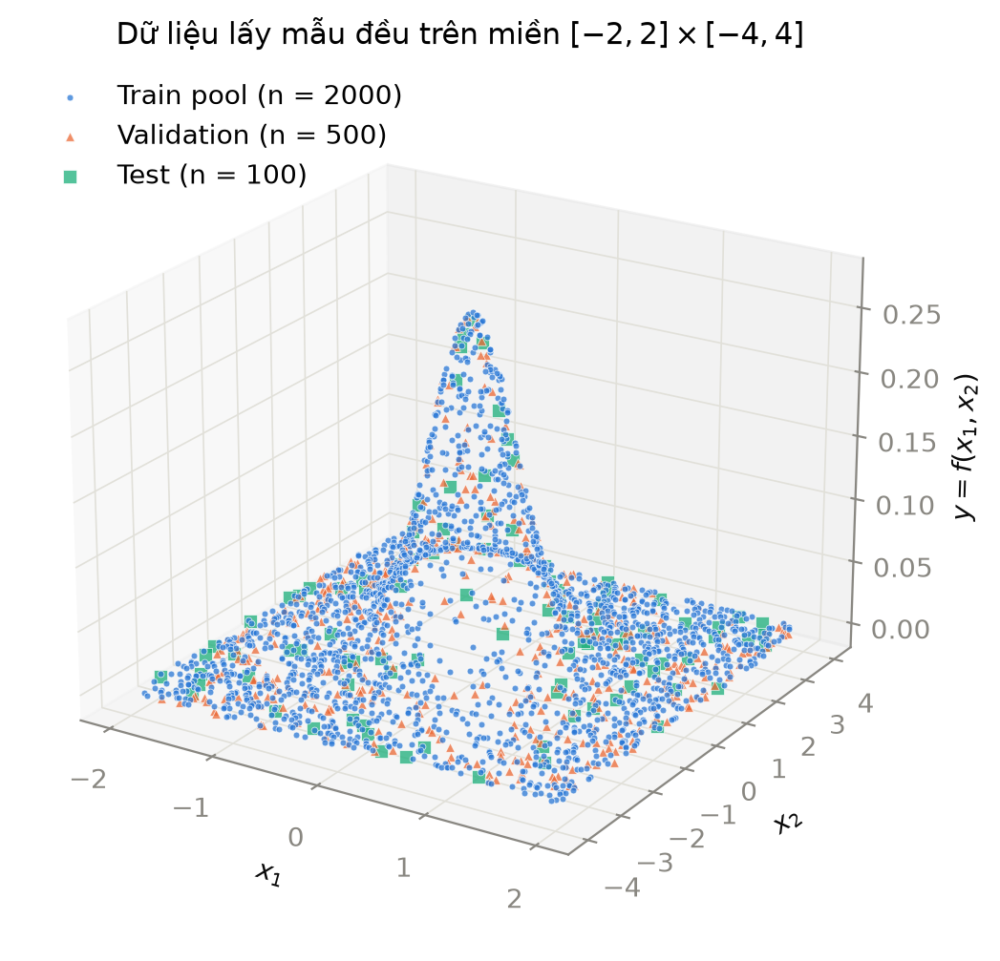
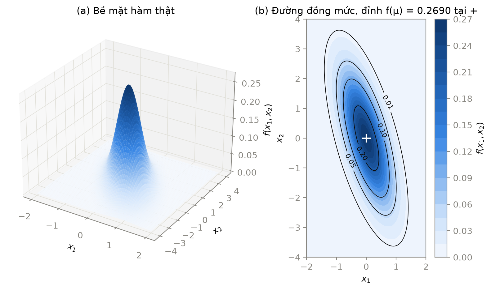
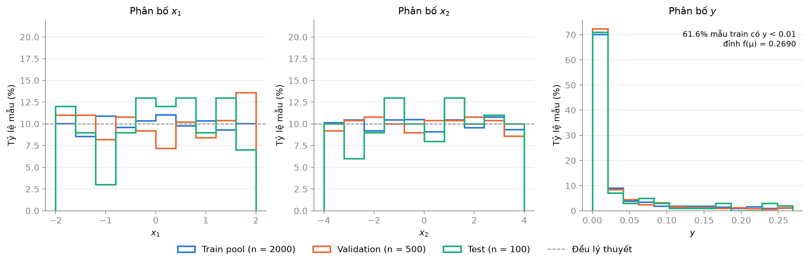

# 2. Dữ liệu

Nháp ngày 31/10/2026, người viết: Huỳnh Ngọc Trúc. Mọi số trong mục này lấy từ `data/stats.csv` và các hình trong `report/figures/`, sinh lại bằng `python -m src.data` rồi `python -m scripts.plot_data`.

## 2.1. Hàm mục tiêu

Nhãn y là giá trị của hàm mật độ Gaussian hai chiều tại điểm x = (x₁, x₂):

$$
f(\mathbf{x}) = \frac{1}{2\pi\sqrt{\det C}} \exp\left(-\tfrac{1}{2}(\mathbf{x}-\boldsymbol{\mu})^T C^{-1} (\mathbf{x}-\boldsymbol{\mu})\right),
\quad \boldsymbol{\mu} = \begin{bmatrix}0\\0\end{bmatrix},\;
C = \begin{bmatrix}0.3 & -0.5\\ -0.5 & 2\end{bmatrix}
$$

Với ma trận C của đề, det C = 0.3 · 2 − 0.5² = 0.35 và

$$
C^{-1} = \frac{1}{0.35}\begin{bmatrix}2 & 0.5\\ 0.5 & 0.3\end{bmatrix} = \begin{bmatrix}5.714 & 1.429\\ 1.429 & 0.857\end{bmatrix}.
$$

Hàm đạt cực đại tại μ = (0, 0) với f(μ) = 1 / (2π√0.35) ≈ 0.2690. Đây là giá trị lớn nhất y có thể nhận, nên nhóm dùng nó làm mốc để đọc RMSE ở mục 4.

Hệ số tương quan giữa x₁ và x₂ trong C là ρ = −0.5 / √(0.3 · 2) ≈ −0.645. Dấu âm làm các đường đồng mức là elip nghiêng: đi lên theo x₂ thì tâm elip lệch sang phía x₁ âm. Hai trị riêng của C là 0.164 và 2.136, ứng với độ lệch chuẩn 0.405 theo trục ngắn và 1.462 theo trục dài. Trục dài có hướng (−0.263, 0.965), lệch khoảng 15° so với trục x₂. Hình 2.2b cho thấy đúng hình dạng này.

Nhóm tự viết hàm `gaussian_2d` trong `src/data.py` theo công thức trên bằng NumPy, không gọi `scipy.stats.multivariate_normal`. Dạng toàn phương (x − μ)ᵀC⁻¹(x − μ) được tính cho cả n điểm một lúc bằng `np.einsum("ni,ij,nj->n", d, C⁻¹, d)`. Để kiểm tra, nhóm tính tay tại điểm (1, 1): dạng toàn phương bằng 3.3 / 0.35 = 9.4286, f = e^(−4.7143) / (2π√0.35) = 0.0024121140460877. Hàm trả về 0.002412114046087728, khớp đến chữ số thứ 15.

## 2.2. Lấy mẫu và chia tập

x₁ lấy đều trong [−2, 2], x₂ lấy đều trong [−4, 4], độc lập với nhau, rồi gắn nhãn y = f(x₁, x₂). Dữ liệu không có nhiễu, nên sai số của mô hình chỉ đến từ việc xấp xỉ chưa đúng hàm.

Toàn bộ dữ liệu sinh một lần với seed 42 và lưu thành CSV. Từ seed này, `np.random.default_rng(42).spawn(3)` tách ra ba bộ sinh số ngẫu nhiên độc lập, mỗi tập dùng một bộ. Nhờ vậy, nếu sau này đổi kích thước pool train thì tập validation và test vẫn giữ nguyên từng điểm, và kết quả các lần chạy vẫn so được với nhau. Các tham số (seed, miền, μ, C, số mẫu) đọc từ `configs/baseline.yaml`, code không ghi cứng giá trị nào.

Bảng 2.1. Ba tập dữ liệu và vai trò.

| Tập | File | Số mẫu | Vai trò |
| --- | --- | --- | --- |
| Train pool | `data/train_pool.csv` | 2000 | Cập nhật trọng số. Thực nghiệm A lấy n dòng đầu (n = 200, 400, ..., 2000), B và C lấy 1000 dòng đầu |
| Validation | `data/val.csv` | 500 | Early stopping, chọn checkpoint, so sánh và chọn cấu hình |
| Test | `data/test.csv` | 100 | Chỉ đánh giá mô hình cuối cùng, không tham gia bất kỳ lựa chọn nào |

Thực nghiệm A lấy tiền tố của cùng một pool, nên tập 200 mẫu nằm trọn trong tập 400 mẫu, tập 400 nằm trọn trong tập 600, và cứ thế. Hai cấu hình A liền nhau chỉ khác nhau ở số mẫu thêm vào, phần dữ liệu chung giữ nguyên. Validation và test cố định cho mọi cấu hình của cả A, B, C.

Trước khi ghi file, hàm `check()` dừng chương trình nếu một trong các điều kiện sau sai:

- mỗi tập có đúng số mẫu khai báo trong yaml,
- mọi x₁ nằm trong [−2, 2] và mọi x₂ nằm trong [−4, 4],
- 0 < y ≤ f(μ) với mọi mẫu,
- không có điểm (x₁, x₂) nào xuất hiện ở hai tập khác nhau.

Điều kiện cuối bảo đảm không có mẫu test hay validation nào lọt vào train. Chạy `python -m src.data` hai lần cho ra bốn file CSV giống nhau từng byte.

## 2.3. Trực quan hóa

Hình 2.1. Scatter 3D của 2600 mẫu: train pool (chấm tròn xanh dương), validation (tam giác cam), test (ô vuông xanh lục).

Hình 2.2. Hàm thật f(x₁, x₂) trên lưới đều 201 × 201 điểm phủ toàn miền. (a) Bề mặt 3D. (b) Đường đồng mức tại các mức 0.01, 0.05, 0.10, 0.20, dấu + là đỉnh tại μ.

Hình 2.3. Phân bố x₁, x₂, y của từng tập. Trục tung là phần trăm số mẫu của chính tập đó, để so được các tập có kích thước khác nhau. Đường đứt nét ở hai hình đầu là mức 10% mỗi khoảng của phân bố đều.

Ở Hình 2.1, các mẫu phủ kín miền chữ nhật và ba tập trộn lẫn nhau, không tập nào dồn vào một vùng riêng. Phần lớn điểm nằm sát mặt phẳng y = 0, chỉ một dải hẹp quanh gốc tọa độ nhô lên thành đỉnh. Hình 2.2 cho thấy rõ hơn rằng đỉnh này hẹp theo x₁ và dài theo x₂: đường mức 0.01 trải từ x₂ ≈ −3.6 đến 3.6, còn trên đường x₂ = 0 nó chỉ chiếm x₁ từ −1.07 đến 1.07.

## 2.4. Thống kê mô tả

Bảng 2.2. Thống kê x₁, x₂, y của từng tập (trích từ `data/stats.csv`).

| Tập | Cột | Trung bình | Độ lệch chuẩn | Min | Trung vị | Max |
| --- | --- | --- | --- | --- | --- | --- |
| Train pool | x₁ | 0.008 | 1.144 | −1.999 | 0.020 | 1.998 |
| | x₂ | −0.017 | 2.310 | −3.999 | −0.080 | 4.000 |
| | y | 0.0318 | 0.0587 | 3.5e−13 | 0.0031 | 0.2685 |
| Validation | x₁ | 0.034 | 1.227 | −1.995 | −0.050 | 1.990 |
| | x₂ | 0.001 | 2.268 | −3.989 | 0.052 | 4.000 |
| | y | 0.0277 | 0.0540 | 7.6e−13 | 0.0032 | 0.2663 |
| Test | x₁ | 0.041 | 1.142 | −1.986 | 0.115 | 1.988 |
| | x₂ | 0.160 | 2.292 | −3.927 | 0.464 | 3.913 |
| | y | 0.0332 | 0.0636 | 4.7e−12 | 0.0039 | 0.2558 |

Bảng 2.3. Tỷ lệ mẫu theo mức giá trị của y.

| Tập | y < 0.01 | y > 0.10 | y > 0.20 |
| --- | --- | --- | --- |
| Train pool | 61.6% | 12.1% | 3.9% |
| Validation | 65.2% | 9.8% | 2.8% |
| Test | 65.0% | 11.0% | 5.0% |

Với phân bố đều trên đoạn dài L, độ lệch chuẩn lý thuyết là L/√12, tức 1.155 cho x₁ và 2.309 cho x₂. Train pool cho 1.144 và 2.310, gần như trùng. Validation có độ lệch chuẩn x₁ là 1.227, cao hơn lý thuyết khoảng 6%, do khoảng x₁ ∈ [1.6, 2] chứa 13.6% số mẫu validation thay vì 10% (Hình 2.3). Tập test chỉ có 100 mẫu nên các cột histogram dao động mạnh nhất, có khoảng chỉ chứa 3% mẫu. Ba tập vẫn phủ hết miền và có trung bình x gần 0, nên nhóm giữ nguyên cách chia, không sinh lại.

Phân bố của y lệch hẳn về 0. Trung vị chỉ khoảng 0.003, trong khi giá trị lớn nhất là 0.27. Hơn 60% mẫu ở mọi tập có y < 0.01, và chỉ 2.8% đến 5% số mẫu có y > 0.2. Hệ quả cho các mục sau:

1. MSE sẽ rất nhỏ (dự kiến cỡ 10⁻⁵ hoặc thấp hơn), nên các bảng kết quả ghi số dạng mũ và báo thêm RMSE, đơn vị giống y, để đọc được tương đối so với đỉnh 0.269.
2. Vùng đỉnh, nơi hàm thay đổi nhanh nhất, lại có ít mẫu nhất. Nhóm dự đoán sai số lớn nhất của mô hình sẽ nằm quanh μ và sẽ kiểm tra dự đoán này bằng bề mặt xấp xỉ và đồ thị y–ŷ ở mục 4.
3. Một mô hình luôn dự đoán ŷ = 0 vẫn có MSE trên test bằng trung bình của y², tức khoảng 0.005. Mô hình nào không thấp hơn mức này nhiều thì chưa học được hàm.

Nhóm không chuẩn hóa y (`normalize_y: false` trong yaml) vì Adam tự điều chỉnh bước cập nhật theo độ lớn gradient, và giữ y gốc thì MSE, MAE, RMSE trong báo cáo tính thẳng trên thang của đề, không cần đổi ngược.
