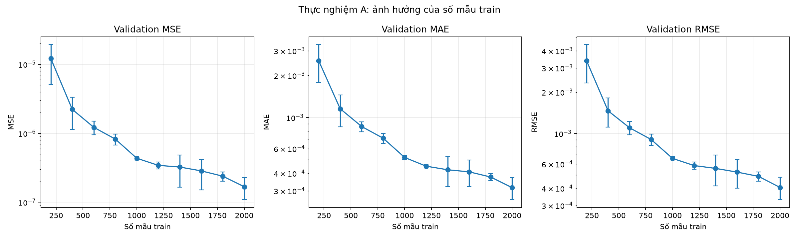
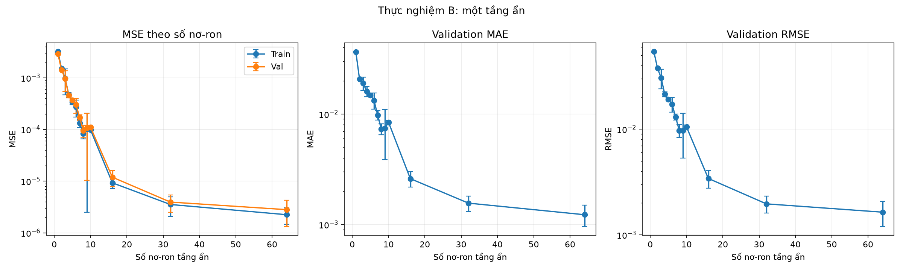

# 4.2. Kết quả thực nghiệm A và B

Nháp ngày 03/11/2026, phần phụ trách của Tạ Quang Trung. Số liệu được tổng hợp từ các log theo seed trong `results/A/logs/` và `results/B/logs/`; bảng summary và hình được sinh bởi runner tương ứng. Các số trong bảng là trung bình ± độ lệch chuẩn mẫu qua ba seed (0, 1, 2). Metric được tính trên checkpoint có validation loss tốt nhất của từng lượt; RMSE được tính riêng từng lượt rồi mới tổng hợp.

## 4.2.1. Thiết lập thực nghiệm

Hai nhóm A và B dùng chung pool train 2000 mẫu, validation cố định 500 mẫu và baseline đã chốt. Thực nghiệm A thay đổi số mẫu lấy từ đầu pool train; thực nghiệm B thay đổi số nơ-ron của một tầng ẩn. Các tham số khác giữ nguyên để so sánh tác động của biến đang khảo sát.

| Thành phần | Thực nghiệm A | Thực nghiệm B |
| --- | --- | --- |
| Biến khảo sát | Số mẫu train: 200, 400, …, 2000 | Số nơ-ron tầng ẩn: 1–10, 16, 32, 64 |
| Số mẫu train | Thay đổi theo cấu hình | 1000 |
| Validation | Cố định 500 mẫu | Cố định 500 mẫu |
| Kiến trúc | 2 tầng ẩn × 16 nơ-ron | 1 tầng ẩn có độ rộng đang khảo sát |
| Activation | Tanh | Tanh |
| Optimizer, learning rate | Adam, 1e-3 | Adam, 1e-3 |
| Batch size | 32 | 32 |
| Dừng | Tối đa 1000 epoch; patience 100 theo validation loss | Tối đa 1000 epoch; patience 100 theo validation loss |
| Seed | 0, 1, 2 cho mỗi cấu hình | 0, 1, 2 cho mỗi cấu hình |

Tập test không được dùng để huấn luyện, chọn cấu hình hoặc tính các bảng A/B trong mục này. Việc lựa chọn cấu hình dựa trên validation.

## 4.2.2. Thực nghiệm A: ảnh hưởng của số mẫu huấn luyện

Mỗi cấu hình A dùng tiền tố của cùng một train pool. Do đó, tập nhỏ hơn là tập con của tập lớn hơn gần nhất; validation được giữ cố định. Bảng sau ghi metric trên cả train và validation.

**Bảng 4.2.1.** MSE, MAE và RMSE theo số mẫu train, trung bình ± độ lệch chuẩn mẫu qua ba seed.

| Số mẫu | Train MSE | Validation MSE | Train MAE | Validation MAE | Train RMSE | Validation RMSE |
| ---: | ---: | ---: | ---: | ---: | ---: | ---: |
| 200 | 7.712946e-06 ± 4.706737e-06 | 1.219636e-05 ± 7.144094e-06 | 2.053294e-03 ± 6.390774e-04 | 2.546581e-03 ± 7.726254e-04 | 2.683707e-03 ± 8.752088e-04 | 3.385741e-03 ± 1.048656e-03 |
| 400 | 1.844667e-06 ± 7.553443e-07 | 2.224003e-06 ± 1.091532e-06 | 1.051431e-03 ± 2.142605e-04 | 1.156012e-03 ± 2.964135e-04 | 1.340648e-03 ± 2.664492e-04 | 1.463840e-03 ± 3.489457e-04 |
| 600 | 1.066023e-06 ± 1.870374e-07 | 1.222356e-06 ± 2.747918e-07 | 8.116353e-04 ± 6.307199e-05 | 8.631181e-04 ± 7.129252e-05 | 1.029898e-03 ± 8.944437e-05 | 1.101152e-03 ± 1.213651e-04 |
| 800 | 7.843614e-07 ± 1.310996e-07 | 8.253509e-07 ± 1.502634e-07 | 6.892376e-04 ± 5.262632e-05 | 7.118723e-04 ± 5.907894e-05 | 8.835112e-04 ± 7.519391e-05 | 9.058272e-04 ± 8.510009e-05 |
| 1000 | 4.135533e-07 ± 4.025497e-08 | 4.350544e-07 ± 2.451342e-08 | 5.034436e-04 ± 2.551392e-05 | 5.186514e-04 ± 1.900515e-05 | 6.425849e-04 ± 3.093425e-05 | 6.594145e-04 ± 1.845216e-05 |
| 1200 | 3.235656e-07 ± 6.060769e-08 | 3.433571e-07 ± 4.001068e-08 | 4.374302e-04 ± 2.514330e-05 | 4.496245e-04 ± 1.375970e-05 | 5.671234e-04 ± 5.389766e-05 | 5.852797e-04 ± 3.474428e-05 |
| 1400 | 3.028161e-07 ± 1.336736e-07 | 3.244289e-07 ± 1.587016e-07 | 4.131174e-04 ± 8.817706e-05 | 4.237320e-04 ± 1.022751e-04 | 5.409648e-04 ± 1.235304e-04 | 5.578067e-04 ± 1.411410e-04 |
| 1600 | 2.841730e-07 ± 1.440429e-07 | 2.853109e-07 ± 1.335988e-07 | 4.037220e-04 ± 1.009342e-04 | 4.095061e-04 ± 8.762454e-05 | 5.211626e-04 ± 1.372730e-04 | 5.244132e-04 ± 1.243082e-04 |
| 1800 | 2.417506e-07 ± 4.151653e-08 | 2.391381e-07 ± 3.670003e-08 | 3.806191e-04 ± 2.371782e-05 | 3.762189e-04 ± 2.092622e-05 | 4.904291e-04 ± 4.295100e-05 | 4.880664e-04 ± 3.733507e-05 |
| 2000 | 1.696409e-07 ± 6.641334e-08 | 1.681281e-07 ± 5.886715e-08 | 3.127952e-04 ± 6.424442e-05 | 3.157274e-04 ± 5.642614e-05 | 4.062875e-04 ± 8.280690e-05 | 4.054550e-04 ± 7.484338e-05 |

Validation MSE trung bình giảm từ 1.219636e-05 ở 200 mẫu xuống 1.681281e-07 ở 2000 mẫu, tức giảm khoảng 72.5 lần trong thiết lập này. Các sai số train và validation cùng giảm rõ khi tăng số mẫu. Ở 1400–1600 mẫu, độ lệch chuẩn tương đối lớn hơn một số cấu hình lân cận; vì vậy nên đọc xu hướng cùng với biến động qua seed, không diễn giải đường giảm là hoàn toàn đều.

**Hình 4.2.1.** MSE, MAE và RMSE validation theo số mẫu train; điểm là mean, thanh sai số là độ lệch chuẩn mẫu qua ba seed. Hình chỉ thể hiện metric validation; Bảng 4.2.1 có thêm metric train.

## 4.2.3. Thực nghiệm B: ảnh hưởng của độ rộng tầng ẩn

Thực nghiệm B giữ nguyên một tầng ẩn và 1000 mẫu train, chỉ thay đổi số nơ-ron. Bảng dưới trình bày metric train và validation. Giá trị 16, 32, 64 được thêm vào dãy 1–10 theo baseline để khảo sát các mạng rộng hơn.

**Bảng 4.2.2.** MSE, MAE và RMSE theo số nơ-ron, trung bình ± độ lệch chuẩn mẫu qua ba seed.

| Nơ-ron | Train MSE | Validation MSE | Train MAE | Validation MAE | Train RMSE | Validation RMSE |
| ---: | ---: | ---: | ---: | ---: | ---: | ---: |
| 1 | 3.194696e-03 ± 1.644269e-06 | 2.915716e-03 ± 9.510978e-07 | 3.786341e-02 ± 2.693032e-04 | 3.645343e-02 ± 2.528033e-04 | 5.652164e-02 ± 1.454556e-05 | 5.399737e-02 ± 8.806721e-06 |
| 2 | 1.523689e-03 ± 1.009789e-05 | 1.425589e-03 ± 7.845172e-07 | 2.178589e-02 ± 1.455755e-04 | 2.075444e-02 ± 5.332999e-05 | 3.903431e-02 ± 1.294020e-04 | 3.775697e-02 ± 1.038930e-05 |
| 3 | 9.739749e-04 ± 5.071009e-04 | 9.597027e-04 ± 4.176711e-04 | 1.907490e-02 ± 3.699991e-03 | 1.900816e-02 ± 2.542335e-03 | 3.055238e-02 ± 7.796806e-03 | 3.052771e-02 ± 6.453084e-03 |
| 4 | 4.688371e-04 ± 4.850432e-05 | 4.581120e-04 ± 4.936266e-05 | 1.593490e-02 ± 1.752025e-03 | 1.601929e-02 ± 1.707849e-03 | 2.163289e-02 ± 1.132634e-03 | 2.138230e-02 ± 1.167910e-03 |
| 5 | 3.421323e-04 ± 3.891569e-05 | 3.676638e-04 ± 2.614009e-05 | 1.426709e-02 ± 3.475523e-04 | 1.484398e-02 ± 5.276612e-04 | 1.847670e-02 ± 1.056255e-03 | 1.916631e-02 ± 6.890118e-04 |
| 6 | 2.724247e-04 ± 9.911491e-05 | 3.003678e-04 ± 9.401193e-05 | 1.238154e-02 ± 2.149723e-03 | 1.328608e-02 ± 2.248759e-03 | 1.632437e-02 ± 2.984906e-03 | 1.719137e-02 ± 2.690172e-03 |
| 7 | 1.325110e-04 ± 2.409745e-05 | 1.702886e-04 ± 2.100770e-05 | 8.644296e-03 ± 9.646280e-04 | 9.788611e-03 ± 9.679302e-04 | 1.147791e-02 ± 1.073788e-03 | 1.303225e-02 ± 8.207179e-04 |
| 8 | 8.285447e-05 ± 1.715374e-05 | 9.535581e-05 ± 2.581063e-05 | 6.848969e-03 ± 6.224495e-04 | 7.328694e-03 ± 8.509872e-04 | 9.070457e-03 ± 9.337615e-04 | 9.704418e-03 ± 1.330457e-03 |
| 9 | 1.033432e-04 ± 1.008419e-04 | 1.073820e-04 ± 9.703880e-05 | 7.359300e-03 ± 3.747294e-03 | 7.440686e-03 ± 3.570063e-03 | 9.418557e-03 ± 4.685193e-03 | 9.715284e-03 ± 4.415070e-03 |
| 10 | 9.787021e-05 ± 1.468985e-06 | 1.099850e-04 ± 9.745668e-06 | 7.761887e-03 ± 9.488073e-05 | 8.423320e-03 ± 3.275956e-04 | 9.892751e-03 ± 7.436398e-05 | 1.048042e-02 ± 4.675235e-04 |
| 16 | 9.281447e-06 ± 2.091271e-06 | 1.193230e-05 ± 4.160529e-06 | 2.396883e-03 ± 3.044031e-04 | 2.601272e-03 ± 4.188875e-04 | 3.032622e-03 ± 3.563352e-04 | 3.414008e-03 ± 6.444212e-04 |
| 32 | 3.535831e-06 ± 1.470906e-06 | 3.936774e-06 ± 1.442151e-06 | 1.470694e-03 ± 2.717834e-04 | 1.561799e-03 ± 2.486514e-04 | 1.855336e-03 ± 3.746172e-04 | 1.963094e-03 ± 3.529227e-04 |
| 64 | 2.244774e-06 ± 7.893289e-07 | 2.810769e-06 ± 1.480155e-06 | 1.147553e-03 ± 1.744648e-04 | 1.226480e-03 ± 2.657540e-04 | 1.483636e-03 ± 2.557327e-04 | 1.638064e-03 ± 4.373448e-04 |

Validation MSE giảm rõ từ 2.915716e-03 ở width 1 xuống 2.810769e-06 ở width 64. Width 1 có sai số lớn trên cả train và validation, phù hợp với hiện tượng thiếu khả năng biểu diễn của tầng ẩn quá hẹp. Với các width 16, 32 và 64, metric tiếp tục cải thiện trong nhóm cấu hình đã thử.

Trong khoảng width 1–10, xu hướng không đơn điệu: validation MSE tăng từ width 8 sang width 9 và 10. Các lượt width 9 có độ lệch chuẩn lớn giữa seed; do đó không nên kết luận biến động này là quá khớp chỉ từ một bảng. Train MSE của width 9 và 10 cũng không thấp hơn width 8, nên dữ liệu hiện tại chưa cho thấy mẫu hình điển hình “train error giảm nhưng validation error tăng”. Nên mô tả đây là biến động theo seed/huấn luyện và tránh khẳng định quá khớp nếu chưa có thêm bằng chứng.

**Hình 4.2.2.** MSE train/validation, validation MAE và validation RMSE theo số nơ-ron; điểm là mean, thanh sai số là độ lệch chuẩn mẫu qua ba seed. Hình dùng validation để so cấu hình, không dùng test.

## Nguồn số liệu và khả năng tái lập

- Cấu hình: [baseline.yaml](../configs/baseline.yaml); runner [run_A.py](../experiments/run_A.py), [run_B.py](../experiments/run_B.py).
- Summary: [A](../results/A/summary.csv), [B](../results/B/summary.csv).
- Log theo từng seed: [logs A](../results/A/logs/), [logs B](../results/B/logs/).
- Hình: [A](../results/A/figures/A_validation_metrics.png), [B](../results/B/figures/B_metrics_vs_neurons.png).
- Chạy lại lần lượt từ thư mục project bằng `python -m experiments.run_A` và `python -m experiments.run_B`.

Số liệu trong hai bảng được tổng hợp từ log của ba seed, không phải lấy một seed đại diện. Độ lệch chuẩn là sample std (`ddof=1`). Thời gian chạy thay đổi theo tải máy nên không dùng làm căn cứ so sánh trong mục này.
