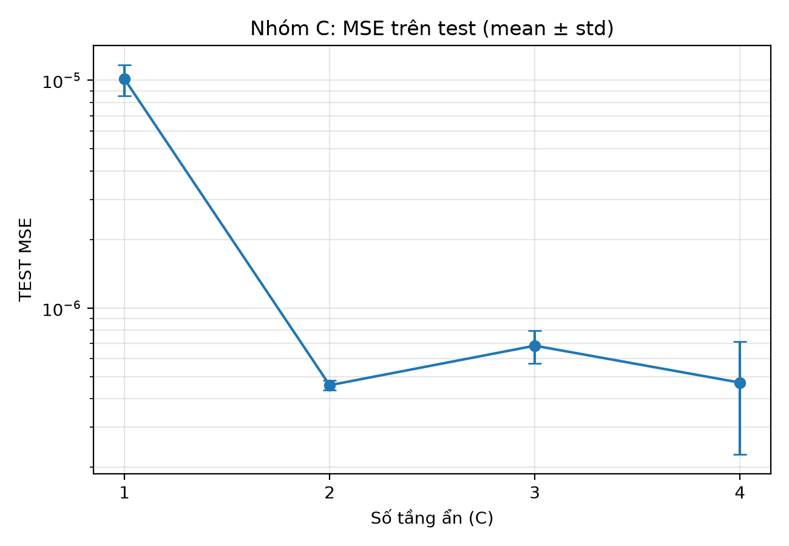
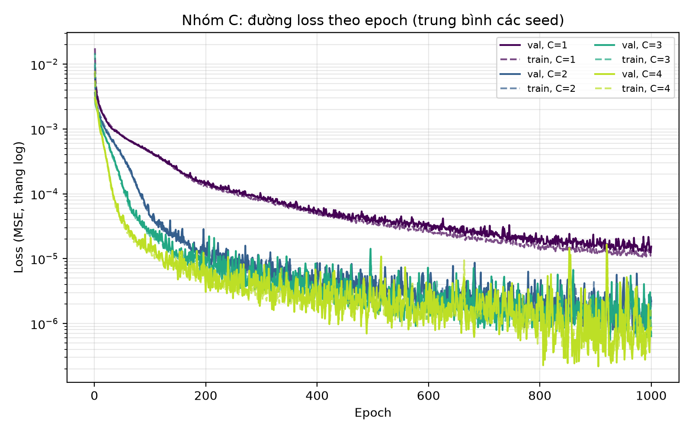
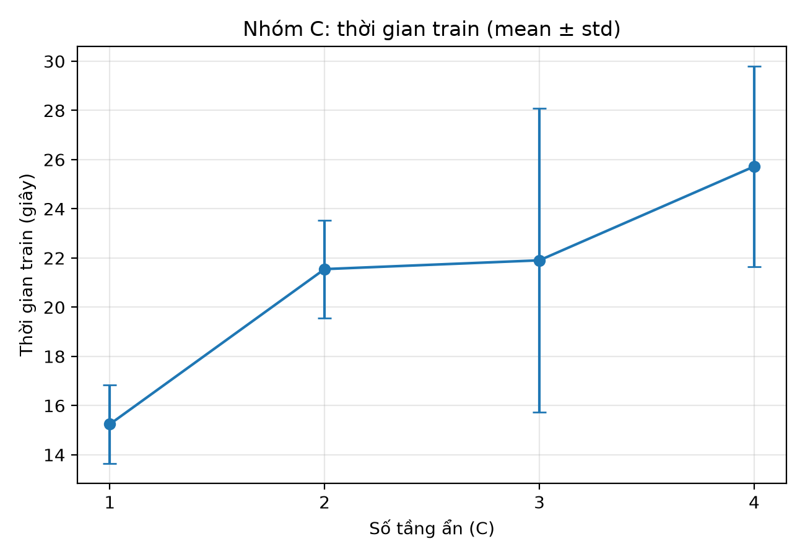

# 4.3. Kết quả thực nghiệm C: ảnh hưởng của số tầng ẩn

Bảng kết quả đầy đủ và liên kết tới 12 log nằm ở `results/C/table_C_mean_std.md`.

## 4.3.1. Thiết lập thực nghiệm

Thực nghiệm C khảo sát mạng MLP có 1, 2, 3 và 4 tầng ẩn, mỗi tầng 16 nơ-ron. Mục tiêu là quan sát sự thay đổi của sai số xấp xỉ hàm Gaussian hai chiều, quá trình hội tụ và chi phí huấn luyện khi tăng độ sâu. Mỗi cấu hình được chạy với ba seed 0, 1, 2, tổng cộng 12 lượt. Các tham số còn lại giữ theo baseline đã chốt.

**Bảng 4.3.1.** Thiết lập dùng chung cho thực nghiệm C.

| Thành phần | Thiết lập |
| --- | --- |
| Dữ liệu | 1000 dòng đầu của pool train; validation 500 mẫu; test 100 mẫu; seed dữ liệu 42 |
| Kiến trúc | 2 đầu vào, C tầng ẩn × 16 nơ-ron, 1 đầu ra tuyến tính |
| Hàm kích hoạt tầng ẩn | Tanh |
| Tối ưu và hàm mất mát | Adam, learning rate 1e-3; MSELoss |
| Batch size | 32 |
| Điều kiện dừng | Tối đa 1000 epoch; patience 100 theo validation MSE |
| Checkpoint đánh giá | Trọng số tại epoch có validation loss thấp nhất |
| Thang đo y | Giá trị gốc, không chuẩn hóa |
| Seed huấn luyện | 0, 1, 2 |

Số tham số của bốn mạng lần lượt là 65, 337, 609 và 881, tính cả bias. Vì giữ nguyên độ rộng, việc thêm tầng đồng thời làm tăng số tham số; kết quả phản ánh ảnh hưởng của việc tăng độ sâu trong thiết lập này, chưa tách riêng tác động của độ sâu và số tham số.

MSE, MAE và RMSE được tính lại trên mô hình đã khôi phục checkpoint tốt nhất. Trong các bảng, mỗi ô ghi trung bình ± độ lệch chuẩn mẫu qua ba seed, với mẫu số n−1. RMSE được tính riêng cho từng lượt rồi mới lấy trung bình; do đó mean RMSE không nhất thiết bằng căn bậc hai của mean MSE.

## 4.3.2. Sai số trên train, validation và test

**Bảng 4.3.2.** MSE theo số tầng ẩn, trung bình ± độ lệch chuẩn qua ba seed.

| Số tầng ẩn | Train MSE | Validation MSE | Test MSE |
| ---: | ---: | ---: | ---: |
| 1 | 9.281447e-06 ± 2.091271e-06 | 1.193230e-05 ± 4.160528e-06 | 1.013326e-05 ± 1.566264e-06 |
| 2 | 4.135533e-07 ± 4.025497e-08 | 4.350545e-07 ± 2.451342e-08 | 4.585057e-07 ± 2.212564e-08 |
| 3 | 5.520759e-07 ± 1.436262e-07 | 5.502185e-07 ± 1.332506e-07 | 6.837284e-07 ± 1.103983e-07 |
| 4 | 3.983979e-07 ± 1.559558e-07 | 4.098433e-07 ± 1.852259e-07 | 4.708029e-07 ± 2.427884e-07 |

Tăng từ một lên hai tầng làm MSE giảm rõ rệt trên cả ba tập. MSE test trung bình chuyển từ mức 1e-5 xuống mức 1e-7. Mạng một tầng có sai số train và validation đều cao hơn các mạng còn lại, cho thấy trong giới hạn độ rộng và thời gian tối ưu đã đặt, cấu hình này xấp xỉ hàm mục tiêu kém hơn.

Từ hai đến bốn tầng, sai số không giảm đơn điệu. Mạng ba tầng có MSE trung bình cao hơn mạng hai tầng trên cả train, validation và test. Mạng bốn tầng có validation MSE trung bình thấp nhất trong bốn cấu hình, nhưng độ lệch chuẩn lớn hơn mạng hai tầng. Cụ thể, validation MSE của C=4 dao động qua ba seed từ 2.171946e-07 đến 5.866257e-07; C=2 dao động từ 4.175624e-07 đến 4.630730e-07. Vì chỉ có ba seed, chưa thể khẳng định chênh lệch trung bình nhỏ giữa C=2 và C=4 có ý nghĩa thống kê.

**Hình 4.3.1.** MSE test trung bình theo số tầng ẩn. Thanh sai số biểu diễn độ lệch chuẩn mẫu qua ba seed. Trục y dùng thang log.

**Bảng 4.3.3.** MAE và RMSE trên test, trung bình ± độ lệch chuẩn qua ba seed.

| Số tầng ẩn | Test MAE | Test RMSE |
| ---: | ---: | ---: |
| 1 | 2.459928e-03 ± 3.591795e-04 | 3.176605e-03 ± 2.523098e-04 |
| 2 | 5.408598e-04 ± 1.305674e-05 | 6.770003e-04 ± 1.626063e-05 |
| 3 | 6.790123e-04 ± 7.207988e-05 | 8.250776e-04 ± 6.680604e-05 |
| 4 | 5.200208e-04 ± 1.470775e-04 | 6.687152e-04 ± 1.882400e-04 |

MAE và RMSE xác nhận khoảng cách lớn giữa C=1 và các mạng sâu hơn. Thứ hạng theo mean RMSE có thể khác thứ hạng theo mean MSE: C=4 có mean RMSE hơi thấp hơn C=2, trong khi mean MSE của C=2 thấp hơn. Đây là hệ quả của việc lấy trung bình sau phép biến đổi phi tuyến căn bậc hai cùng mức dao động khác nhau giữa seed, không phải hai bảng mâu thuẫn.

## 4.3.3. Quá trình hội tụ

**Hình 4.3.2.** Đường train loss (nét đứt) và validation loss (nét liền), trung bình các seed ở từng epoch. Trục y dùng thang log, không làm trơn số liệu.

Trong giai đoạn đầu, các mạng nhiều tầng giảm loss nhanh hơn theo số epoch; đường C=1 giảm chậm hơn và vẫn ở mức loss cao hơn vào cuối lượt chạy. Các đường C=2, C=3 và C=4 về sau có dao động, nên checkpoint tốt nhất không nhất thiết nằm ở epoch cuối. Mạng được đánh giá bằng trọng số có validation loss thấp nhất, tránh sử dụng một epoch cuối có sai số cao hơn.

Cả ba seed của C=1 và C=2 đều chạy đủ 1000 epoch. C=3 dừng ở 537, 1000, 973 epoch cho seed 0, 1, 2; C=4 dừng ở 1000, 759, 803 epoch. Các lượt kết thúc trước 1000 epoch phù hợp với điều kiện dừng sau 100 epoch không cải thiện validation loss. Ví dụ, C=3 seed 0 có best epoch 437 và dừng tại epoch 537.

Khi một seed dừng sớm, đường trung bình ở các epoch tiếp theo chỉ dùng những seed còn log. Vì vậy, đoạn cuối của các đường C=3/C=4 không luôn là trung bình đủ ba seed. Ngoài ra, train loss trong log được tích lũy khi trọng số thay đổi theo mini-batch; nó khác train MSE trong Bảng 4.3.2, vốn được tính lại trên checkpoint cố định sau huấn luyện.

## 4.3.4. Thời gian huấn luyện

**Bảng 4.3.4.** Thời gian vòng huấn luyện và best epoch, trung bình ± độ lệch chuẩn qua ba seed.

| Số tầng ẩn | Thời gian train (giây) | Best epoch |
| ---: | ---: | ---: |
| 1 | 15.24 ± 1.60 | 994.33 ± 8.08 |
| 2 | 21.55 ± 1.98 | 988.00 ± 18.19 |
| 3 | 21.90 ± 6.17 | 745.33 ± 268.34 |
| 4 | 25.72 ± 4.08 | 755.67 ± 131.18 |

**Hình 4.3.3.** Thời gian train trung bình và độ lệch chuẩn theo số tầng ẩn.

Thời gian trung bình tăng từ 15.24 giây ở C=1 lên 25.72 giây ở C=4 trong lượt đo này. C=3 và C=2 có thời gian trung bình gần nhau, dù mạng ba tầng có nhiều phép tính hơn mỗi epoch. Điều này phù hợp với việc một số lượt C=3 dừng sớm. Không thể dùng riêng tổng thời gian để kết luận chi phí mỗi epoch hoặc tốc độ hội tụ trên máy khác.

Thời gian được đo bằng `time.perf_counter()` quanh vòng train, gồm đánh giá validation mỗi epoch và lưu bản sao trọng số tốt nhất trong bộ nhớ; không gồm ghi CSV, lưu file checkpoint hoặc vẽ hình. Đây là số đo của lượt chạy đã lưu trên cùng máy và thiết lập CPU, không phải benchmark giữa các phần cứng.

## 4.3.5. Nhận xét và phạm vi kết luận

Kết quả cho thấy thêm tầng từ C=1 lên C=2 cải thiện mạnh khả năng xấp xỉ trong baseline đang xét. Tăng thêm độ sâu không bảo đảm giảm sai số: C=3 kém hơn C=2 ở các sai số trung bình, còn C=4 có validation MSE trung bình thấp hơn nhưng biến động lớn hơn. C=2 là cấu hình có độ dao động thấp trong ba seed và thời gian trung bình thấp hơn C=4; C=4 cần được cân nhắc cùng độ ổn định và chi phí khi nhóm chọn mô hình bằng validation.

Các số liệu hiện có chưa cho thấy bằng chứng rõ ràng về quá khớp tăng đều theo độ sâu. Số tham số tăng cùng độ sâu, số seed ít và early stopping làm số epoch khác nhau. Nhóm đã chọn cấu hình A với 2000 mẫu train theo validation MSE. Đánh giá mô hình cuối nằm ở [mục 5.3](section_5_final_model_evaluation.md).

Test đã được đánh giá cho cả 12 lượt để báo cáo thực nghiệm C. Vì kết quả test đã được xem, tập test hiện tại không phải tập hoàn toàn chưa từng được xem trước bước đánh giá mô hình cuối. Muốn có đánh giá cuối độc lập hơn thì cần một protocol riêng, định trước khi thực hiện.

## Nguồn số liệu để ghép báo cáo

- Thiết lập: [baseline.yaml](../configs/baseline.yaml); runner [run_C.py](../experiments/run_C.py).
- Metric và thời gian từng lượt: [summary.csv](../results/C/summary.csv).
- Bảng mean/std đầy đủ: [table_C_mean_std.csv](../results/C/table_C_mean_std.csv), tính lại bằng `python -m experiments.export_C`.
- Log loss, config và best epoch: [bảng liên kết 12 log](../results/C/table_C_mean_std.md#đối-chiếu-log). Mỗi dòng cấu hình trong các bảng tổng hợp từ ba file `C_<tầng>_seed0.csv`, `C_<tầng>_seed1.csv`, `C_<tầng>_seed2.csv`.
- Hình bổ sung: [test RMSE](../results/C/figures/C_test_rmse.png), [RMSE và thời gian](../results/C/figures/C_error_and_time.png).

Đã đối chiếu config và best validation epoch trong log, tính lại mean/std từ summary. Các lượt C gốc không lưu dự đoán/checkpoint từng mô hình, nên metric train/test trong summary chưa được tính lại độc lập từ trọng số.
