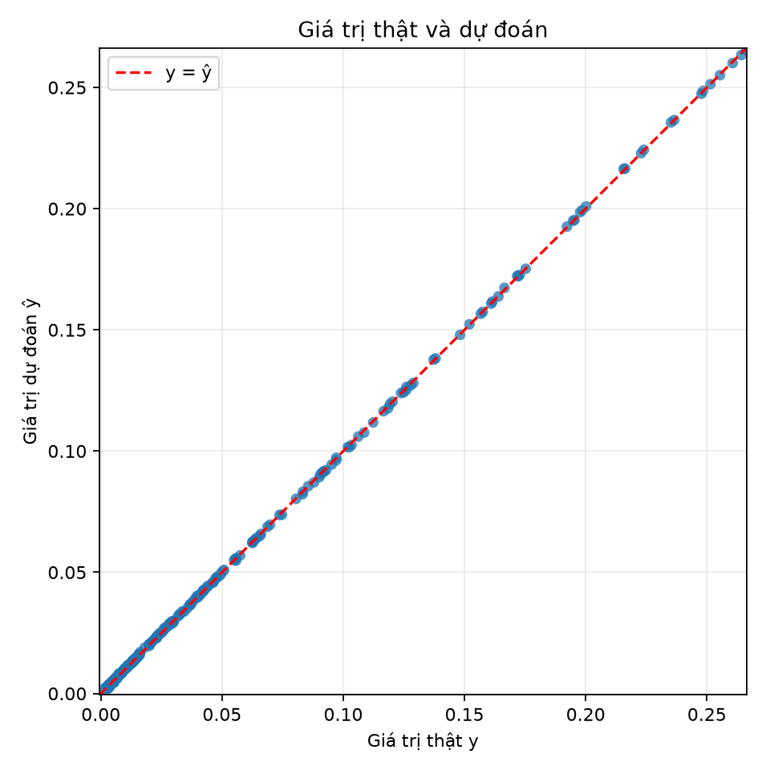
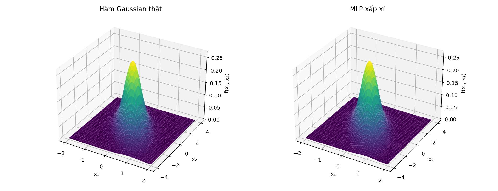

# Đánh giá chung mô hình cuối

Phần này dùng checkpoint đã chọn theo validation: A với 2000 mẫu train, MLP hai tầng ẩn `[16, 16]`, `tanh`, seed 1; checkpoint lưu trọng số tại epoch 980. Hai hình được tạo từ checkpoint đã nạp lại. Đồ thị \(y\)–\(\hat y\) dùng 500 điểm validation; bề mặt được so sánh trên lưới đều \(80\times80\) phủ miền \(x_1\in[-2,2]\), \(x_2\in[-4,4]\), giữa hàm Gaussian theo đề và dự đoán của MLP.

## Đồ thị giá trị thật và dự đoán



**Hình 5.1.** Giá trị dự đoán nằm sát đường tham chiếu \(y=\hat y\). Các điểm có giá trị nhỏ tập trung gần gốc tọa độ do phần lớn nhãn trong miền khảo sát có mật độ thấp; mật độ điểm trên hình vì thế không đều. Cần đọc hình cùng các chỉ số trên toàn bộ validation, không chỉ quan sát các điểm ở vùng đỉnh.

| Tập validation (500 điểm) | MSE | MAE | RMSE |
|---|---:|---:|---:|
| Checkpoint cuối | \(1.08195385\times10^{-7}\) | \(2.45049751\times10^{-4}\) | \(3.28930669\times10^{-4}\) |

Sai số tuyệt đối trung bình và RMSE nhỏ so với giá trị đỉnh của hàm (xấp xỉ 0.269). Tuy nhiên, RMSE bị ảnh hưởng nhiều hơn MAE bởi các sai số lớn do phép bình phương. Đây là số liệu trên validation của checkpoint đã chọn, không phải kết quả trung bình qua ba seed.

## So sánh bề mặt



**Hình 5.2.** Bề mặt bên trái là hàm Gaussian được tính trực tiếp từ \(\mu,C\) của đề; bên phải là MLP được đánh giá tại cùng các tọa độ trên lưới. Hình cho thấy đỉnh gần tâm và phần suy giảm về các biên của miền được tái hiện tương tự. Hai bề mặt có cùng thang trục đứng, giúp so sánh hình dạng tổng thể; sai khác nhỏ khó thấy rõ bằng phối cảnh 3D.

Để có phép so sánh số trên đúng lưới dùng để vẽ, sai số giữa MLP và hàm Gaussian tại 6400 tọa độ là:

| Chẩn đoán trên lưới giải tích \(80\times80\) | MSE | MAE | RMSE |
|---|---:|---:|---:|
| Toàn miền được vẽ | \(1.10056953\times10^{-7}\) | \(2.49988858\times10^{-4}\) | \(3.31748327\times10^{-4}\) |

Đây là chẩn đoán trên lưới đều so với hàm sinh nhãn đã biết, không phải một tập dữ liệu độc lập và không thay thế validation/test. Nó bổ sung cho hình bề mặt bằng cách tính sai số tại nhiều vị trí trong toàn miền.

## Kết luận và giới hạn

Trên dữ liệu validation, đồ thị phân tán gần đường \(y=\hat y\); bề mặt MLP cũng gần với bề mặt Gaussian trên miền khảo sát. Các metric validation và chẩn đoán trên lưới giải tích nhất quán với quan sát trực quan. Kết luận chỉ áp dụng cho hàm, miền đầu vào và cấu hình thí nghiệm của bài này; chưa chứng minh chất lượng ngoài miền hoặc với phân phối dữ liệu khác.

Thực nghiệm C đã tính metric test cho 12 lượt trước khi chọn cấu hình cuối. Vì vậy, test hiện tại đã được truy vấn; mọi kết quả test của checkpoint cuối phải được trình bày kèm giới hạn này, không gọi là ước lượng độc lập từ một test set hoàn toàn chưa từng xem. Việc chọn checkpoint vẫn dựa trên validation, không dựa vào test.

## Tái tạo hình

Từ thư mục `BTL01 - Function Approximation`, nạp môi trường rồi chạy:

```powershell
conda activate btl01
python -m scripts.plot_final_evaluation
```

Script chỉ đọc checkpoint, cấu hình và validation; nó không nạp test. Hình được ghi vào `results/final/figures/`.
