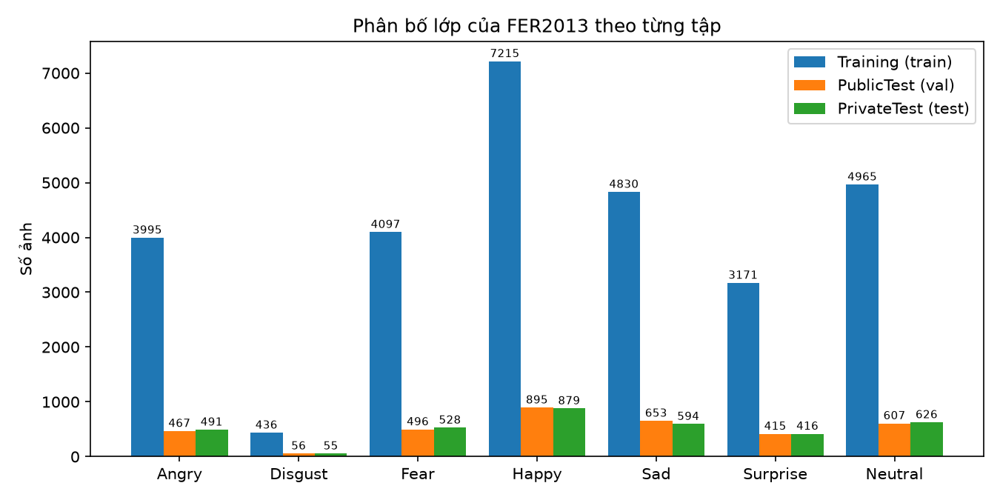
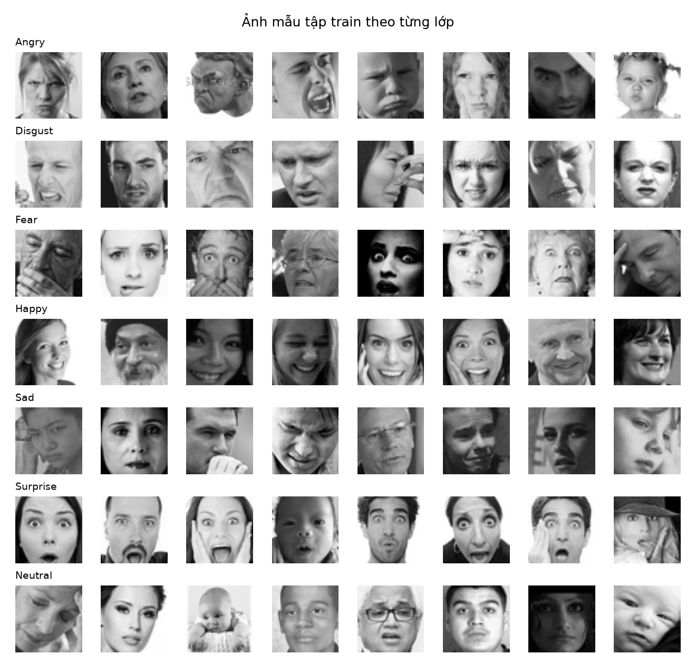
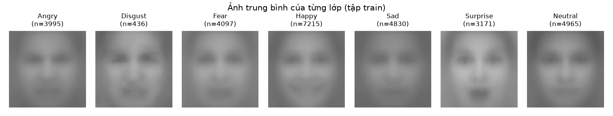

# 1. Giới thiệu bài toán và dữ liệu

Người viết: Huỳnh Ngọc Trúc

## 1.1. Bài toán

Nhận dạng cảm xúc khuôn mặt (Facial Expression Recognition, FER) là bài toán phân loại ảnh: cho một ảnh khuôn mặt, mô hình phải cho biết người trong ảnh đang thể hiện cảm xúc nào. Đề bài yêu cầu dùng mạng nơ-ron tích chập (Convolutional Neural Network, CNN) viết bằng PyTorch, đầu vào là ảnh xám 48×48, đầu ra là vector 7 chiều ứng với 7 cảm xúc: 0 Angry, 1 Disgust, 2 Fear, 3 Happy, 4 Sad, 5 Surprise, 6 Neutral.

Đề nêu ba hướng cải thiện: thiết kế mạng (Conv, MaxPooling, Dropout, FC), kỹ thuật huấn luyện (thuật toán tối ưu, tăng cường dữ liệu) và hàm kích hoạt (ReLU, sigmoid). Báo cáo phải có bốn phần: tóm tắt mã nguồn, kết quả nhiều thực nghiệm với tham số khác nhau, hình các filter của lớp tích chập cuối, và phân tích kết quả theo cách hiểu của nhóm. Mục 2 trình bày mã nguồn, mục 3 các thực nghiệm, mục 4 filter và các hình phân tích, mục 5 mô hình cuối.

Mốc so sánh: đề ghi mô hình tốt nhất thế giới đạt khoảng 69% trên PublicTest và 71% trên PrivateTest. Báo cáo mẫu của thầy (Keras) đạt val_acc 0.64 đến 0.67 với bốn kiến trúc CNN từ nhỏ đến lớn.

## 1.2. Bộ dữ liệu FER2013

FER2013 được công bố trong cuộc thi "Challenges in Representation Learning: Facial Expression Recognition Challenge" trên Kaggle năm 2013 [1]. Ảnh được thu thập tự động qua công cụ tìm kiếm ảnh, cắt quanh khuôn mặt, chuyển sang ảnh xám 48×48. Nhóm dùng file `fer2013.csv` (301 MB) gồm 35887 dòng và 3 cột:

- `emotion`: nhãn 0 đến 6;
- `pixels`: 2304 số nguyên 0 đến 255 cách nhau bởi dấu cách, là 48×48 pixel của ảnh;
- `Usage`: ảnh thuộc phần nào của cuộc thi (`Training`, `PublicTest`, `PrivateTest`).

Nhóm giữ nguyên cách chia của cuộc thi theo cột `Usage` (Bảng 1.1). PublicTest đóng vai trò tập validation: mọi lựa chọn về cấu hình, epoch dừng và checkpoint đều dựa trên tập này. PrivateTest là tập test, chỉ được đánh giá một lần ở mô hình cuối (mục 5), sau khi cấu hình đã chốt. Cách chia này giống cách cuộc thi chấm điểm và giữ PrivateTest hoàn toàn chưa được nhìn thấy cho đến bước cuối.

Bảng 1.1. Ba tập dữ liệu theo cột `Usage`.

| Tập trong báo cáo | Giá trị `Usage` | Số ảnh | Vai trò |
| --- | --- | --- | --- |
| Train | Training | 28709 | Cập nhật trọng số |
| Validation | PublicTest | 3589 | Early stopping, chọn checkpoint, so sánh các thực nghiệm, chọn cấu hình cuối |
| Test | PrivateTest | 3589 | Đánh giá một lần duy nhất ở mô hình cuối |

Số ảnh của cả ba tập khớp đúng số chuẩn của FER2013; hàm `check_counts` trong `src/data.py` kiểm tra điều này mỗi lần chạy EDA.

## 1.3. Phân bố lớp

Bảng 1.2 và Hình 1.1 cho thấy dữ liệu lệch lớp mạnh. Happy chiếm 25.13% tập train (7215 ảnh), trong khi Disgust chỉ chiếm 1.52% (436 ảnh); lớp nhiều nhất gấp 16.55 lần lớp ít nhất. Ba tập có tỷ lệ lớp gần như nhau: Happy chiếm 24.94% validation và 24.49% test, Disgust chiếm 1.56% và 1.53%.

Bảng 1.2. Số ảnh mỗi lớp và trọng số lớp dùng ở thực nghiệm E6-3.

| Lớp | Train | % train | Validation | Test | Trọng số lớp w_c |
| --- | ---: | ---: | ---: | ---: | ---: |
| 0 Angry | 3995 | 13.92 | 467 | 491 | 1.0266 |
| 1 Disgust | 436 | 1.52 | 56 | 55 | 9.4066 |
| 2 Fear | 4097 | 14.27 | 496 | 528 | 1.0010 |
| 3 Happy | 7215 | 25.13 | 895 | 879 | 0.5684 |
| 4 Sad | 4830 | 16.82 | 653 | 594 | 0.8491 |
| 5 Surprise | 3171 | 11.05 | 415 | 416 | 1.2934 |
| 6 Neutral | 4965 | 17.29 | 607 | 626 | 0.8260 |
| Tổng | 28709 | 100 | 3589 | 3589 | |

Hình 1.1. Số ảnh mỗi lớp trong ba tập (trục tung: số ảnh; trục hoành: lớp cảm xúc).

Lệch lớp kéo theo ba hệ quả mà nhóm tính đến khi thiết kế thực nghiệm và đánh giá:

1. Một mô hình đoán mọi ảnh là Happy đã đạt 24.94% accuracy trên validation. Đây là mốc sàn: val_acc quanh 25% nghĩa là mô hình chưa học được gì.
2. Accuracy gần như bỏ qua lớp nhỏ. Đoán sai toàn bộ 56 ảnh Disgust chỉ làm mất 1.56 điểm accuracy. Vì vậy mục 4 và 5 báo thêm precision, recall, F1 từng lớp và macro F1 (trung bình đều 7 lớp).
3. Thực nghiệm E6-3 thử hàm mất mát cross-entropy có trọng số lớp w_c = N / (K · n_c), với N = 28709 ảnh train, K = 7 lớp, n_c là số ảnh của lớp c. Lớp có đúng N/K ảnh nhận trọng số 1; Disgust nhận 9.4066, Happy nhận 0.5684 (cột cuối Bảng 1.2).

## 1.4. Ảnh mẫu và ảnh trung bình

Hình 1.2 là 8 ảnh train chọn ngẫu nhiên (seed 0) cho mỗi lớp. Ảnh đa dạng về tuổi, giới, hướng mặt, ánh sáng; nhiều ảnh có tay che mặt, đeo kính, mặt nghiêng, có ảnh dính chữ watermark. Một số ảnh khó phân biệt ngay cả với người: Fear và Surprise đều mở to mắt, Sad và Neutral đều ít biểu cảm.

Hình 1.2. Ảnh mẫu của tập train, mỗi hàng một lớp.

Hình 1.3 là ảnh trung bình (trung bình pixel của toàn bộ ảnh train cùng lớp). Surprise khác rõ nhất với miệng há tròn và lông mày nhướng; Happy có vệt miệng cười rộng. Angry, Fear, Sad và Neutral có ảnh trung bình gần giống nhau, chủ yếu khác ở vùng mắt và lông mày. Nhóm dự đoán bốn lớp này sẽ hay bị nhầm lẫn với nhau; mục 4 kiểm chứng bằng confusion matrix.

Hình 1.3. Ảnh trung bình của từng lớp trên tập train (n là số ảnh của lớp).

## 1.5. Chất lượng dữ liệu: ảnh trùng, nhãn mâu thuẫn, ảnh không có mặt người

Nhóm so khớp pixel của toàn bộ 35887 ảnh bằng mã băm MD5 (hàm `duplicate_stats` trong `src/data.py`). Bảng 1.3 ghi kết quả.

Bảng 1.3. Ảnh trùng pixel trong và giữa các tập.

| Chỉ số | Giá trị |
| --- | ---: |
| Số ảnh khác nhau trong cả bộ | 34034 / 35887 |
| Ảnh train là bản lặp của một ảnh train khác | 1236 (4.31% train) |
| Ảnh validation trùng với một ảnh train | 280 (7.80% validation) |
| Ảnh test trùng với một ảnh train | 288 (8.02% test) |
| Ảnh test trùng với một ảnh validation | 44 (1.23% test) |
| Nhóm ảnh trùng pixel nhưng mang nhãn khác nhau | 57 |
| Ảnh một màu (mọi pixel bằng nhau) | 11 train, 1 validation, 0 test |

Có ba điểm cần lưu ý khi đọc kết quả ở các mục sau:

- Khoảng 8% ảnh validation và test đã có y hệt trong tập train. Mô hình dễ đoán đúng những ảnh này hơn ảnh mới, nên accuracy đo trên FER2013 cao hơn một chút so với ảnh hoàn toàn chưa thấy. Đây là đặc điểm có sẵn của bộ dữ liệu; nhóm không xóa ảnh trùng để kết quả so sánh được với báo cáo mẫu và với các công bố khác dùng cùng cách chia.
- 57 nhóm ảnh giống hệt nhau mà nhãn khác nhau cho thấy nhãn FER2013 có nhiễu. Với những ảnh này, không mô hình nào đoán đúng được tất cả các bản sao.
- Ngoài 12 ảnh một màu, khi xem ảnh validation (các ca đoán sai và các ảnh kích hoạt mạnh filter), nhóm còn gặp ảnh không phải khuôn mặt, ví dụ ảnh biển cảnh báo và biểu tượng máy ảnh. Đây là quan sát bằng mắt, nhóm không đếm được tự động; các ảnh này vẫn mang một nhãn cảm xúc như mọi ảnh khác.

## 1.6. Tiền xử lý

Mỗi ảnh được chia cho 255 để đưa pixel về [0, 1], rồi chuẩn hóa (x − μ) / σ với μ = 0.5077 và σ = 0.2550 là trung bình và độ lệch chuẩn pixel của **riêng tập train**. Validation và test dùng đúng μ, σ của train, giống khi đưa một ảnh mới vào mô hình đã huấn luyện; tính μ, σ trên cả ba tập là để thông tin của tập đánh giá lọt vào lúc huấn luyện. Tăng cường dữ liệu (data augmentation) chỉ áp dụng cho tập train và được trình bày ở mục 2.2.

Nhóm giữ thứ tự nhãn gốc 0 đến 6 của FER2013 trong toàn bộ mã nguồn và hình vẽ. Code mẫu dùng `LabelEncoder` nên thứ tự lớp theo bảng chữ cái (Neutral đứng trước Sad và Surprise); khi so confusion matrix với báo cáo mẫu cần để ý điểm khác này.

### Nguồn số liệu

- Yêu cầu đề và mốc 69% / 71%: `Yêu cầu/Emotion_Recognition.pdf`. Mốc val_acc 0.64 đến 0.67 của báo cáo mẫu: `Yêu cầu/demo_report.pdf`.
- Số ảnh, tỷ lệ lớp, trọng số lớp, μ, σ, thống kê ảnh trùng: `results/eda/class_counts.csv`, `results/eda/stats.json`.
- Hình 1.1 đến 1.3: `results/eda/class_distribution.png`, `samples_per_class.png`, `mean_face_per_class.png`.
- Tạo lại toàn bộ: `python -m src.data` (đứng ở thư mục BTL02, cần `data/fer2013.csv`).
- Tỷ lệ Happy và Disgust trên validation, test tính từ `class_counts.csv`: 895/3589, 879/3589, 56/3589, 55/3589.
