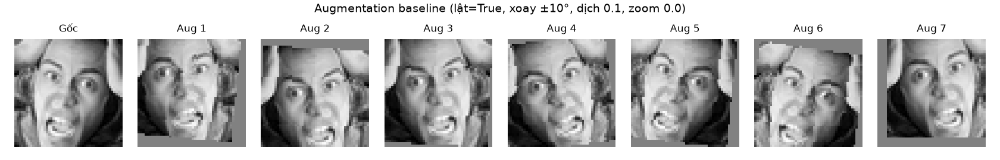

# 2. Tóm tắt mã nguồn

Người viết: Huỳnh Ngọc Trúc

Toàn bộ mã nguồn viết bằng PyTorch [2]. Code mẫu của thầy (Keras/TensorFlow 1.14) chỉ được tham khảo cách tổ chức: bốn kiến trúc từ nhỏ đến lớn, các callback, cách trình bày confusion matrix và ca đúng, ca sai. Mô hình, vòng huấn luyện và phần đánh giá đều viết lại.

## 2.1. Tổ chức và luồng chạy

Bảng 2.1 liệt kê các file, việc của từng file và người phụ trách (dòng `Phụ trách:` ở đầu mỗi file khớp bảng này).

Bảng 2.1. Các file mã nguồn.

| File | Việc chính | Phụ trách |
| --- | --- | --- |
| `src/paths.py` | Đường dẫn tương đối theo thư mục bài, tên 7 lớp | Trúc |
| `src/data.py` | Đọc CSV, chia tập, chuẩn hóa, Dataset/DataLoader, augmentation, trọng số lớp, EDA | Trúc |
| `src/models.py` | 4 kiến trúc CNN, tùy chọn BatchNorm, hàm kích hoạt, dropout; khởi tạo trọng số | Khang |
| `src/train.py` | Đọc cấu hình, đặt seed, vòng train/validation, checkpoint, early stopping, ghi log | Trúc |
| `src/evaluate.py` | Accuracy, precision/recall/F1, confusion matrix, ca đúng/sai, đánh giá mô hình cuối | Trúc (confusion matrix, ca đúng/sai: Trung) |
| `src/visualize.py` | Filter lớp conv cuối, feature map, Grad-CAM | Khang (filter, feature map), Nhân (Grad-CAM) |
| `configs/baseline.yaml` | Cấu hình baseline, mọi thực nghiệm đổi so với file này | Trúc |
| `experiments/run_E1.py` … `run_E6.py` | Khai báo các run của từng nhóm thực nghiệm | Khang (E1, E2), Trung (E3, E4), Nhân (E5, E6) |
| `experiments/common.py` | Chạy một nhóm run, bỏ qua run đã có, bảng tóm tắt, đồ thị nhóm | Trúc |
| `configs/final.yaml`, `experiments/run_final.py` | Cấu hình và quy trình mô hình cuối (3 seed, test một lần) | Trúc |
| `experiments/chay_colab_kaggle.ipynb` | Chạy toàn bộ trên GPU Kaggle/Colab | Trúc |

Luồng xử lý gồm năm bước:

```
fer2013.csv
  -> src/data.py       chia theo Usage, chuẩn hóa bằng μ, σ của train, augmentation cho train
  -> src/models.py     CNN theo khối model của cấu hình
  -> src/train.py      train trên Training, early stopping + checkpoint theo val_loss trên PublicTest
                       -> results/<nhóm>/logs, checkpoints, configs, summary.csv
  -> src/evaluate.py   chỉ số và hình trên PublicTest; PrivateTest một lần cho mô hình cuối
  -> src/visualize.py  filter conv cuối, feature map, Grad-CAM (ảnh PublicTest)
```

Mọi lệnh chạy dạng module từ thư mục bài, ví dụ `python -m src.train --run BASE`, `python -m experiments.run_E1`, `python -m experiments.run_final`. Đường dẫn tính từ vị trí file `src/paths.py`, không có đường dẫn tuyệt đối, nên cùng một mã chạy được trên máy cá nhân (CPU) và trên GPU Kaggle mà không sửa. Thiết bị chọn tự động: `cuda` nếu có, ngược lại `cpu`.

## 2.2. Dữ liệu: `src/data.py`

**Đọc và chia tập.** Hàm `load_fer2013` đọc CSV từng dòng bằng module `csv`, đổi ngay chuỗi pixel thành ảnh `uint8` 48×48 và xếp vào tập theo cột `Usage`. Nhóm không dùng `pandas.read_csv` vì hàm này giữ toàn bộ khoảng 300 MB chuỗi pixel trong bộ nhớ và đã báo hết bộ nhớ trên máy của nhóm; cách đọc từng dòng chỉ giữ khoảng 83 MB ảnh. Hàm mặc định chỉ đọc train và validation; muốn có PrivateTest phải ghi rõ `splits=("train", "val", "test")`, và chỉ phần đánh giá mô hình cuối làm vậy.

**Chuẩn hóa.** `compute_mean_std` tính μ, σ trên tập train theo từng khối 4096 ảnh (cộng dồn tổng và tổng bình phương), tránh tạo một mảng số thực lớn cùng lúc. Kết quả μ = 0.5077, σ = 0.2550 được dùng cho cả ba tập (mục 1.6).

**Dataset.** `FERDataset` giữ ảnh dạng `uint8` và chỉ đổi sang số thực khi lấy từng ảnh, theo thứ tự: chia 255, augmentation (nếu có), chuẩn hóa. Mỗi phần tử trả về tensor 1×48×48 và nhãn.

**Tăng cường dữ liệu.** `build_train_transform` dựng phép biến đổi ngẫu nhiên từ khối `augmentation` của cấu hình, tương ứng với `ImageDataGenerator` của code mẫu (Bảng 2.2). Augmentation chỉ áp cho tập train; validation và test giữ nguyên ảnh gốc để số đánh giá phản ánh dữ liệu thật.

Bảng 2.2. Tăng cường dữ liệu: code mẫu Keras và cài đặt PyTorch của nhóm.

| Keras (`ImageDataGenerator`) | PyTorch (`torchvision.transforms`) | Baseline của nhóm |
| --- | --- | --- |
| `horizontal_flip=True` | `RandomHorizontalFlip(p=0.5)` | Có |
| `rotation_range=10` | `RandomAffine(degrees=10)` | ±10° |
| `width_shift_range`, `height_shift_range=0.1` | `RandomAffine(translate=(0.1, 0.1))` | 10% |
| `zoom_range=0.1` | `RandomAffine(scale=(0.9, 1.1))` | Không (thử ở E4-3) |
| `fill_mode='nearest'` | `RandomAffine(fill=μ)` | Viền trống điền bằng μ |

Sau khi xoay hoặc dịch, ảnh có phần viền trống. Nếu điền 0 (màu đen) thì sau chuẩn hóa viền thành (0 − 0.5077) / 0.2550 ≈ −1.99, một dải giá trị bất thường mà mạng có thể học nhầm như một đặc trưng. Nhóm điền bằng μ để viền thành đúng 0 sau chuẩn hóa, tức là "không mang thông tin". Hình 2.1 là một ảnh train và 7 phiên bản sau augmentation baseline.



Hình 2.1. Một ảnh train (trái) và 7 phiên bản sau augmentation của baseline: lật ngang, xoay ±10°, dịch 10%, viền điền màu trung bình.

**DataLoader.** `get_dataloaders` trả về loader cho train (xáo trộn) và validation (không xáo), kèm μ, σ, số ảnh mỗi lớp và trọng số lớp w_c (mục 1.3). Bộ sinh số ngẫu nhiên của loader được đặt theo seed của run, nên thứ tự xáo trộn lặp lại được.

## 2.3. Mô hình: `src/models.py`

**Kiến trúc.** Lớp `EmotionCNN` dựng mạng kiểu VGG [3] gồm các khối, mỗi khối là k lớp [Conv 3×3 (+ BatchNorm) + hàm kích hoạt], rồi MaxPooling 2×2 và Dropout. Sau các khối là Flatten, một lớp FC, hàm kích hoạt, Dropout và lớp FC ra 7 giá trị. Bốn kiến trúc lấy đúng cấu trúc `SMALL_CNN`, `MEDIUM_CNN`, `MEDIUM1_CNN`, `LARGE_CNN` của code mẫu (Bảng 2.3). Conv dùng `padding=1` (tương đương `padding='same'` của Keras) nên chỉ MaxPooling làm ảnh nhỏ lại: 48 → 24 → 12 → 6 → 3.

Bảng 2.3. Bốn kiến trúc và số tham số (không BatchNorm).

| Kiến trúc | Số filter từng conv theo khối | Số conv | Kích thước sau Flatten | FC | Tham số FC đầu | Tổng tham số |
| --- | --- | ---: | ---: | ---: | ---: | ---: |
| small | [64, 64] [128, 128, 256, 256] | 6 | 36864 | 1024 | 37749760 | 38901191 |
| medium (baseline) | [64 × 2] [128 × 3] [256 × 3] | 8 | 9216 | 1024 | 9438208 | 11327303 |
| medium_01 | [64 × 3] [128 × 4] [256 × 4] | 11 | 9216 | 1024 | 9438208 | 12101895 |
| large | [64 × 4] [128 × 4] [256 × 4] [512 × 4] | 16 | 4608 | 2048 | 9439232 | 20406599 |

Small có ít lớp nhất nhưng nhiều tham số nhất (38.9 triệu). Lý do: Small chỉ pool 2 lần, ảnh vào lớp FC còn 12×12×256 = 36864 chiều, riêng lớp FC đầu đã có 37.7 triệu tham số. Medium pool 3 lần nên Flatten còn 9216 chiều. Ở cả bốn mạng, phần lớn tham số nằm ở lớp FC đầu, không nằm ở các lớp conv.

**Tùy chọn cho thực nghiệm.** Khối `model` của cấu hình chọn `arch`, `activation` (relu, leaky_relu, elu, sigmoid; áp cho mọi conv và lớp FC ẩn), `batchnorm`, `dropout_block`, `dropout_fc`. Khi có BatchNorm, conv bỏ tham số bias vì tham số dịch β của BatchNorm [4] đã làm việc đó. Lớp cuối trả về logits, không qua softmax, vì `nn.CrossEntropyLoss` đã gồm log-softmax; khi dự đoán chỉ cần lấy `argmax`.

**Khởi tạo trọng số.** Mọi lớp Conv và FC được khởi tạo theo He (Kaiming) [5]: trọng số phân phối chuẩn với phương sai 2 / fan_in, bias bằng 0. Nhóm chọn cách này sau khi baseline chạy thử đứng yên ở mức đoán mọi ảnh là Happy. Bảng 2.4 so khởi tạo mặc định của PyTorch (phương sai 1 / (3 · fan_in)) với khởi tạo He trên mạng Medium, với đầu vào là một batch 64 ảnh nhiễu chuẩn N(0, 1).

Bảng 2.4. Độ lệch chuẩn đầu ra sau các lớp ReLU và độ lớn gradient ở conv đầu tiên, mạng Medium.

| Khởi tạo | Sau ReLU 1 | Sau ReLU 5 | Sau ReLU 9 | Logits | Gradient conv 1 (trung bình trị tuyệt đối) |
| --- | ---: | ---: | ---: | ---: | ---: |
| Mặc định PyTorch | 0.3437 | 0.0205 | 0.0051 | 0.0194 | 4.97 × 10⁻⁶ |
| He (Kaiming) | 0.8181 | 1.0387 | 1.5366 | 2.6902 | 2.76 × 10⁻² |

Với khởi tạo mặc định, mỗi lớp ReLU làm phương sai tín hiệu giảm khoảng fan_in · Var(w) / 2 = 1/6 lần. Qua 9 lớp, độ lệch chuẩn giảm từ 0.3437 xuống 0.0051, logits gần như bằng nhau cho mọi lớp, và gradient ở lớp đầu nhỏ hơn khoảng 5500 lần so với khởi tạo He. Khởi tạo He giữ độ lệch chuẩn quanh 1 qua cả 9 lớp. Cách khởi tạo dùng chung cho mọi run nên không phải là một biến thực nghiệm.

## 2.4. Huấn luyện: `src/train.py`

**Cấu hình.** `load_config` đọc `configs/baseline.yaml` (Bảng 2.5) rồi ghi đè các khóa dạng `"train.lr"`. Khóa không có trong baseline thì báo lỗi ngay, để một lỗi gõ tên khóa không âm thầm biến run thành bản sao của baseline. Mỗi thực nghiệm E1 đến E6 chỉ đổi một biến so với baseline (mục 3).

Bảng 2.5. Cấu hình baseline (`configs/baseline.yaml`).

| Nhóm | Tham số | Giá trị |
| --- | --- | --- |
| Mô hình | Kiến trúc, kích hoạt, BatchNorm | medium, ReLU, không |
| Mô hình | Dropout sau mỗi khối, sau FC | 0.2, 0.5 |
| Huấn luyện | Optimizer, learning rate | Adam [6], 1 × 10⁻⁴ |
| Huấn luyện | Batch size, số epoch tối đa | 64, 60 |
| Huấn luyện | Early stopping | Dừng khi val_loss 10 epoch liền không giảm |
| Huấn luyện | Scheduler, trọng số lớp | Không, không |
| Dữ liệu | Augmentation | Lật ngang, xoay ±10°, dịch 10% |
| Khác | Seed | 0 |

Learning rate 1 × 10⁻⁴ và kiên nhẫn 10 epoch lấy theo code mẫu (`demo_code.html`: Adam lr 1e-4, patience 10). Trong báo cáo mẫu, ba trong bốn mô hình ghi epoch tốt nhất là 31, 53 và 31, nên nhóm đặt tối đa 60 epoch để early stopping có chỗ tác dụng.

**Tính lặp lại.** `set_seed` đặt seed cho `random`, NumPy, PyTorch (CPU và GPU) và tắt chế độ tự chọn thuật toán của cuDNN. Hàm được gọi trước khi tạo DataLoader và mô hình, nên khởi tạo trọng số, thứ tự xáo trộn, augmentation và dropout đều lặp lại được. Nhóm đã kiểm bằng các lần chạy thử ngắn trên CPU: hai lần chạy cùng seed cho file log giống hệt nhau. Có thể tự kiểm lại bằng cách chạy `python -m src.train --run BASE --thu` hai lần rồi so hai file `logs/BASE.csv` trong `results/_thu/`.

**Vòng huấn luyện.** `run_epoch` dùng chung cho train và validation:

- Có optimizer: `model.train()`, tính loss, `backward()`, cập nhật trọng số.
- Không có optimizer: `model.eval()` trong `torch.no_grad()`, dropout tắt, không tính gradient.
- Loss của epoch là trung bình theo ảnh (mỗi batch nhân với số ảnh của batch, vì batch cuối nhỏ hơn).
- train_acc tính ngay trong lúc huấn luyện, khi còn dropout và augmentation, giống cách Keras báo `acc`. Vì vậy train_acc có thể thấp hơn val_acc ở các epoch đầu.

Hàm `train` lặp các epoch. Sau mỗi epoch:

1. Ghi một dòng log `epoch, train_loss, train_acc, val_loss, val_acc, lr, epoch_time_s` và ghi ngay xuống đĩa.
2. Nếu val_loss nhỏ hơn mức tốt nhất trước đó: lưu checkpoint (trọng số, cấu hình, μ, σ), đặt lại bộ đếm. Nếu không: tăng bộ đếm.
3. Nếu dùng scheduler ReduceLROnPlateau (thực nghiệm E3-3): giảm learning rate 10 lần khi val_loss 2 epoch liền không giảm, giống code mẫu.
4. Bộ đếm đạt 10 thì dừng sớm (early stopping).

Hết run, hàm thêm một dòng vào `summary.csv` của nhóm: `best_epoch`, `best_val_loss`, `val_acc_at_best`, `train_acc_at_best`, `epochs_ran`, `train_time_s`, `n_params`. **Nhóm so sánh các cấu hình bằng val_acc tại epoch có val_loss nhỏ nhất**, không lấy val_acc lớn nhất trong các epoch: lấy giá trị lớn nhất là chọn epoch theo chính con số đang báo cáo.

**Kết quả của một run** nằm ở `results/<nhóm>/`: `logs/<mã run>.csv`, `checkpoints/<mã run>.pt`, `configs/<mã run>.json` (cấu hình đầy đủ, tên GPU, μ, σ) và một dòng trong `summary.csv`. Hàm từ chối ghi đè log đã có; chạy lại một run thì đặt mã mới có hậu tố `_r2`.

## 2.5. Chạy thực nghiệm: `experiments/`

Mỗi file `run_E*.py` chỉ khai báo danh sách run dạng {mã run: (các khóa ghi đè, mô tả)}, ví dụ E5-3 là `{"model.activation": "sigmoid"}`. `common.py` chạy lần lượt các run, bỏ qua run đã có log (nên chạy lại lệnh sau khi bị ngắt là tiếp tục từ run còn thiếu), in bảng tóm tắt và vẽ đồ thị val_loss, val_acc của cả nhóm kèm đường baseline. `run_E2.py` tự đọc `results/E1/summary.csv` để lấy kiến trúc tốt nhất rồi thêm BatchNorm.

Các thực nghiệm chạy trên GPU NVIDIA Tesla T4 của Kaggle qua notebook `chay_colab_kaggle.ipynb`. Notebook lấy mã nguồn từ kho GitHub của nhóm và gọi lại đúng các lệnh trên. Kaggle cấp 2 GPU, nên notebook chạy hai chuỗi song song, mỗi chuỗi một GPU: E1, E2, E3 trên GPU 0 và E4, E5, E6 trên GPU 1. Mỗi run vẫn là một tiến trình riêng với seed riêng, nên chạy song song không làm đổi kết quả.

## 2.6. Đánh giá: `src/evaluate.py`

**Chỉ số.** `split_metrics` tính accuracy, precision, recall, F1 từng lớp, macro F1 và weighted F1. Macro F1 lấy trung bình đều 7 lớp nên Disgust có trọng lượng ngang Happy; nhóm báo cả accuracy và macro F1 để thấy mô hình có bỏ qua lớp hiếm hay không.

**Hình.**

- Confusion matrix của validation và test đặt cạnh nhau. Màu tô theo tỷ lệ trên mỗi hàng (recall của lớp thật) để hàng Disgust vẫn đọc được; mỗi ô ghi cả số ảnh lẫn phần trăm. Nhãn theo thứ tự gốc 0 đến 6.
- Ca đoán đúng: mỗi lớp 5 ảnh chọn ngẫu nhiên. Ca đoán sai: mỗi lớp 5 ảnh mà mô hình tự tin nhất nhưng vẫn sai, là các ca đáng phân tích nhất. Ảnh luôn lấy từ đúng tập đang đánh giá.
- Đường loss, accuracy theo epoch của các seed.

**Hai chế độ.** Chạy từ dòng lệnh (`python -m src.evaluate --ckpt …`) chỉ đánh giá trên validation; dòng lệnh không có tùy chọn nào để đọc PrivateTest. Mô hình cuối dùng hàm `evaluate_final`, theo thứ tự:

1. Đọc `summary.csv` của ba run F-0, F-1, F-2 (seed 0, 1, 2), tính val_acc trung bình ± độ lệch chuẩn mẫu.
2. Chọn seed có val_loss nhỏ nhất, chỉ dựa trên validation, và lấy checkpoint đó làm mô hình cuối.
3. Đánh giá mô hình cuối trên validation và PrivateTest, ghi `final_metrics.json` ngay khi có số test, rồi mới vẽ hình.
4. Nếu `final_metrics.json` đã có, hàm báo lỗi và dừng: đó sẽ là lần đánh giá test thứ hai.

Như vậy PrivateTest không tham gia bất kỳ lựa chọn nào: cấu hình, epoch dừng, checkpoint và seed đều được chọn trên validation trước khi test được đọc.

## 2.7. Nhìn vào bên trong mạng: `src/visualize.py`

Phần này chỉ dùng ảnh validation. Mọi đầu ra của lớp bên trong được lấy bằng forward hook gắn tạm thời, không sửa mã mô hình.

**Filter lớp conv cuối.** Lớp conv cuối của Medium có 256 filter, mỗi filter là một khối trọng số 256 kênh × 3 × 3, không vẽ trực tiếp thành ảnh nhìn được. Nhóm thể hiện filter bằng ba cách:

1. Tối đa hóa kích hoạt (activation maximization) [7]: giữ nguyên trọng số, bắt đầu từ ảnh nhiễu nhỏ và cập nhật **ảnh đầu vào** bằng gradient (Adam, 150 bước) để trung bình đầu ra của một filter lớn nhất. Ảnh thu được là mẫu hình mà filter đó "tìm kiếm". Để ảnh không thành nhiễu tần số cao, mỗi bước ảnh được dịch ngẫu nhiên tối đa 2 pixel, phạt độ lớn L2, và cứ 4 bước làm mờ bằng bộ lọc Gaussian 3×3. Mục tiêu tối ưu là đầu ra conv trước hàm kích hoạt, vì sau ReLU một filter đang bằng 0 có gradient bằng 0.
2. Ảnh validation thật làm mỗi filter kích hoạt mạnh nhất: dễ diễn giải nhất, ví dụ filter phản ứng với miệng mở hay với vùng tối.
3. Trọng số 3×3 lấy trung bình theo 256 kênh vào.

Chỉ 64 filter hoạt động mạnh nhất trên validation được vẽ; số filter không bao giờ kích hoạt (luôn bằng 0 sau ReLU) được in ra để báo cáo.

**Feature map.** Một ảnh validation đi qua mạng; vẽ 8 kênh mạnh nhất ở đầu ra lớp conv cuối của mỗi khối (48×48, 24×24, 12×12).

**Grad-CAM** [8]. Với ảnh x, lớp đích c và feature map A tại một lớp conv (sau hàm kích hoạt), trọng số của kênh k là α_k = trung bình theo không gian của ∂y_c / ∂A_k, và bản đồ nhiệt là ReLU(Σ_k α_k · A_k), phóng về 48×48. Vùng sáng là vùng làm điểm của lớp c tăng. Nhóm vẽ Grad-CAM tại conv đầu, conv giữa và conv cuối; mỗi cảm xúc một ảnh validation được đoán đúng với xác suất cao nhất.

## 2.8. Khác biệt so với code mẫu

Bảng 2.6 tóm tắt những điểm mã nguồn của nhóm khác code mẫu Keras và lý do. Phần lớn khác biệt nhằm hai việc: giữ PrivateTest chỉ dùng một lần, và để mọi số trong báo cáo truy được về file kết quả.

Bảng 2.6. Những điểm mã nguồn của nhóm khác code mẫu Keras.

| Nội dung | Code mẫu | Mã của nhóm | Lý do |
| --- | --- | --- | --- |
| Thư viện | Keras, TensorFlow 1.14 | PyTorch | Đề yêu cầu |
| Chia tập | PublicTest làm validation, PrivateTest làm test | Giống mẫu, thêm cơ chế khóa: dòng lệnh không đọc được PrivateTest, `evaluate_final` từ chối đánh giá test lần hai | Bảo đảm test chỉ dùng một lần |
| Augmentation | Có zoom 10% | Baseline không zoom; zoom 10% thử ở E4-3 | Tách riêng tác dụng của zoom |
| Thứ tự nhãn | `LabelEncoder`, theo bảng chữ cái | Thứ tự gốc 0 đến 6 | Khớp đề và mô tả của FER2013 |
| Khởi tạo trọng số | Glorot (mặc định Keras) | He | Mạng ReLU 9 lớp không học được với khởi tạo mặc định của PyTorch (Bảng 2.4) |
| Lớp ra | softmax + `categorical_crossentropy` | logits + `CrossEntropyLoss` | Tương đương về toán, ổn định số học hơn |
| Batch size | 128 | 64 | Theo kế hoạch của nhóm |
| Viền sau augmentation | `fill_mode='nearest'` | Điền μ của train | `RandomAffine` của torchvision chỉ điền hằng số; μ thành 0 sau chuẩn hóa |
| Đọc dữ liệu | Toàn bộ vào bộ nhớ | Đọc từng dòng, giữ `uint8` | Máy của nhóm thiếu bộ nhớ |
| Hình ảnh validation ở phần khám phá dữ liệu | Hình "Validating Images" vẽ `x_train[valid_idx]` (ảnh train) kèm nhãn của `y_valid` | Mọi hình lấy ảnh và nhãn từ cùng một tập | Sửa lỗi của code mẫu |
| Số liệu | In trong notebook | Log CSV mỗi epoch, `summary.csv`, cấu hình mỗi run lưu kèm | Mọi số trong báo cáo truy được về file |

### Nguồn số liệu

- Bảng 2.3: `results/models/params.csv`. Bảng 2.4: `results/models/init_check.csv`. Tạo lại: `python -m src.models`.
- μ, σ và giá trị viền −1.99 (tính từ μ, σ): `results/eda/stats.json`. Hình 2.1: `results/eda/augmentation_examples.png` (`python -m src.data`).
- Bảng 2.5: `configs/baseline.yaml`. Các tham số của code mẫu (Adam lr 1e-4, patience 10, batch 128, zoom 10%, `fill_mode='nearest'`, PublicTest/PrivateTest, `LabelEncoder`, hình "Validating Images" vẽ `x_train[valid_idx]`): `Yêu cầu/demo_code.html`. Epoch tốt nhất 31, 53, 31 của báo cáo mẫu: `Yêu cầu/demo_report.pdf`.
- Bảng 2.1: dòng `Phụ trách:` đầu mỗi file và `docs/Kế hoạch.md` mục 8.
- Các hằng số mô tả trong văn lấy từ mã nguồn: 4096 ảnh mỗi khối khi tính μ, σ (`src/data.py`); factor 0.1, patience 2 của ReduceLROnPlateau (`src/train.py`); 5 ảnh mỗi lớp cho ca đúng/sai (`src/evaluate.py`); 150 bước, dịch ±2 pixel, làm mờ mỗi 4 bước, 64 filter, 8 kênh mỗi khối (`src/visualize.py`); hai chuỗi chạy trên 2 GPU (`experiments/chay_colab_kaggle.ipynb`).
- 83 MB ảnh: 35887 ảnh × 2304 byte ≈ 82.7 MB. 300 MB chuỗi pixel: kích thước `data/fer2013.csv` (301072766 byte).
