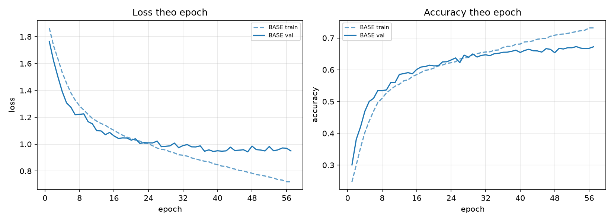
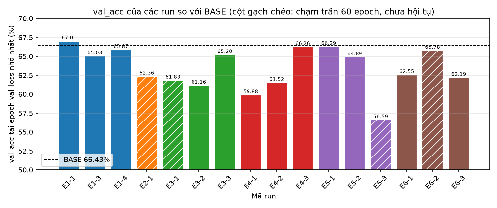
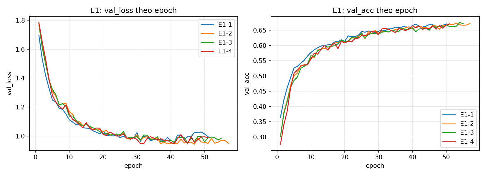
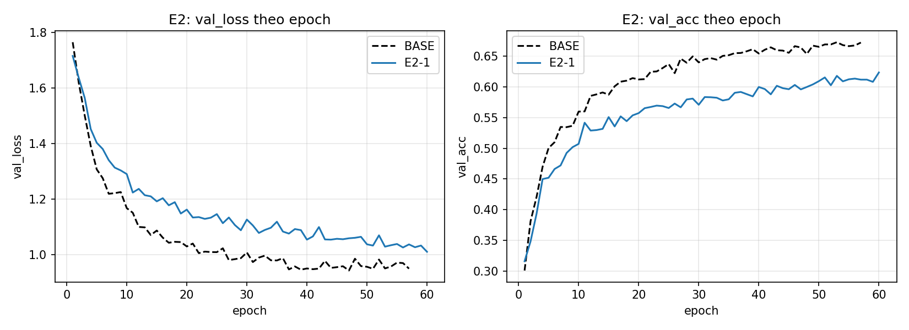
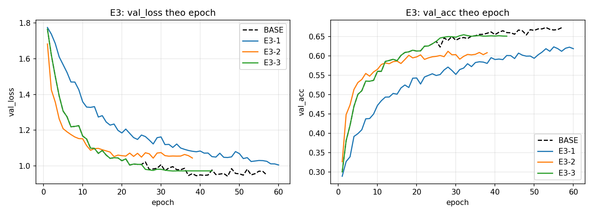
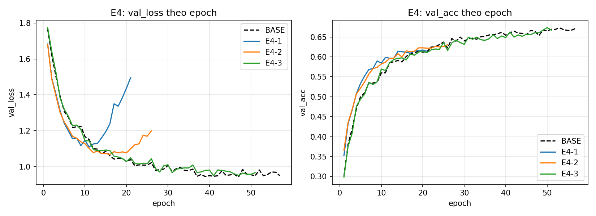
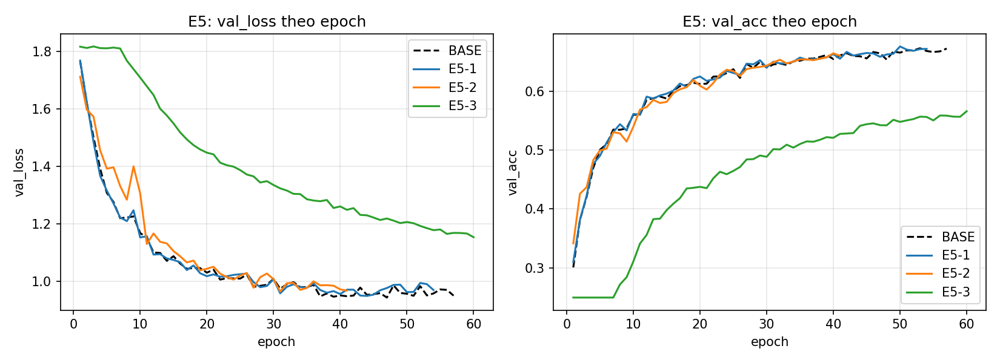
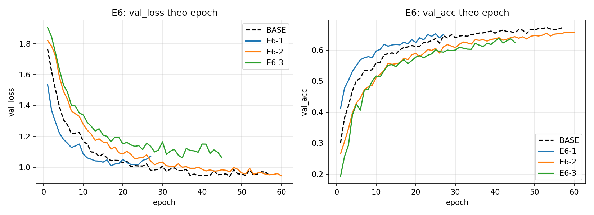

# 3. Thực nghiệm

Người viết: Huỳnh Ngọc Trúc (3.0, 3.7), Phạm Trần Minh Khang (3.1, 3.2), Tạ Quang Trung (3.3, 3.4), Ngô Nguyễn Thành Nhân (3.5, 3.6)

## 3.0. Thiết lập chung

**Nguyên tắc.** Mỗi run chỉ đổi một biến so với baseline (Bảng 2.5), để mọi chênh lệch kết quả quy được về đúng biến đó. Một "biến" có thể gồm vài khóa cấu hình cùng ý nghĩa: E4-1 tắt cả lật, xoay và dịch; E6-1 bỏ cả hai lớp dropout; E3-1 đổi optimizer kèm learning rate thường dùng với nó. Riêng E2-1 thêm BatchNorm vào kiến trúc tốt nhất của E1 nên được so với run E1 tương ứng.

**Cách chạy.** Mọi run dùng seed 0 và chạy trên GPU Tesla T4 của Kaggle ngày 25/11/2026. Một run dừng khi val_loss 10 epoch liền không giảm, hoặc khi đủ 60 epoch.

**Cách so sánh.** Mỗi run được đại diện bằng **val_acc tại epoch có val_loss nhỏ nhất**, cũng là epoch được lưu checkpoint (mục 2.4). Nhóm không lấy val_acc lớn nhất trong các epoch, vì như vậy là chọn epoch theo chính con số đang báo cáo. Chênh lệch giữa hai run ghi bằng "điểm" (điểm phần trăm). Cột train − val là train_acc trừ val_acc tại cùng epoch đó; giá trị dương lớn là dấu hiệu quá khớp (overfitting). train_acc đo lúc còn dropout và augmentation, nên có thể thấp hơn val_acc.

**Tính lặp lại.** E1-2 có cấu hình giống hệt baseline và được chạy lại trong một phiên GPU khác. Log của E1-2 trùng khít log của BASE ở cả 57 epoch, trừ cột thời gian. Như vậy chênh lệch giữa các run là do biến thực nghiệm, không do ngẫu nhiên giữa các lần chạy.

**Baseline.** Hình 3.1 là đường học của BASE. Val_loss nhỏ nhất bằng 0.9429 ở epoch 47, tại đó val_acc là 66.43%, ngang báo cáo mẫu (0.64 đến 0.67); run dừng ở epoch 57. train_loss thấp hơn val_loss lần đầu ở epoch 21 và liên tục từ epoch 23; train_acc vượt val_acc lần đầu ở epoch 26 và liên tục từ epoch 30. Sau đó train_loss tiếp tục giảm (0.7194 ở epoch 57) trong khi val_loss đi ngang quanh 0.95. Tại epoch tốt nhất, train_acc cao hơn val_acc 4.11 điểm: baseline đã bắt đầu quá khớp nhẹ.

Hình 3.1. Loss (trái) và accuracy (phải) theo epoch của BASE; nét đứt là train, nét liền là validation.

**Tổng quan.** Bảng 3.1 và Hình 3.2 tóm tắt 18 run. Chỉ E1-1 có val_acc cao hơn BASE; không run nào có val_loss thấp hơn BASE. Bốn run chạm trần 60 epoch (E2-1, E3-1, E5-3, E6-2): val_loss có xu hướng giảm đến cuối và epoch 60 là epoch có val_loss thấp nhất, nên kết quả của bốn cấu hình này có thể chưa phải tốt nhất của chúng.

Bảng 3.1. Kết quả mọi run trên validation (PublicTest). Dấu * đánh dấu run chạm trần 60 epoch.

| Run | Thay đổi so với baseline | Epoch tốt nhất / đã chạy | val_loss | val_acc | train_acc | train − val | So với BASE | Thời gian (s) |
| --- | --- | ---: | ---: | ---: | ---: | ---: | ---: | ---: |
| BASE | (baseline) | 47 / 57 | 0.9429 | 66.43% | 70.54% | +4.11 | 0.00 | 1127 |
| E1-1 | Kiến trúc Small | 41 / 51 | 0.9552 | 67.01% | 71.17% | +4.16 | +0.59 | 1476 |
| E1-2 | Kiến trúc Medium (= baseline) | 47 / 57 | 0.9429 | 66.43% | 70.54% | +4.11 | 0.00 | 1127 |
| E1-3 | Kiến trúc Medium_01 | 45 / 55 | 0.9495 | 65.03% | 71.04% | +6.00 | −1.39 | 1536 |
| E1-4 | Kiến trúc Large | 41 / 51 | 0.9464 | 65.87% | 71.01% | +5.14 | −0.56 | 2124 |
| E2-1* | Small + BatchNorm | 60 / 60 | 1.0104 | 62.36% | 56.12% | −6.24 | −4.07 | 1869 |
| E3-1* | SGD momentum 0.9, lr 1e-3 | 60 / 60 | 1.0060 | 61.83% | 61.25% | −0.58 | −4.60 | 1146 |
| E3-2 | Adam lr 1e-3 | 28 / 38 | 1.0442 | 61.16% | 59.10% | −2.06 | −5.27 | 735 |
| E3-3 | Adam lr 1e-4 + ReduceLROnPlateau | 33 / 43 | 0.9723 | 65.20% | 65.77% | +0.57 | −1.23 | 851 |
| E4-1 | Không augmentation | 11 / 21 | 1.1096 | 59.88% | 68.50% | +8.62 | −6.55 | 416 |
| E4-2 | Chỉ lật ngang | 16 / 26 | 1.0688 | 61.52% | 68.66% | +7.14 | −4.90 | 515 |
| E4-3 | Lật + xoay + dịch + zoom 10% | 41 / 51 | 0.9506 | 66.26% | 67.68% | +1.42 | −0.17 | 1010 |
| E5-1 | LeakyReLU | 44 / 54 | 0.9486 | 66.29% | 70.04% | +3.75 | −0.14 | 1087 |
| E5-2 | ELU | 31 / 41 | 0.9643 | 64.89% | 64.78% | −0.11 | −1.53 | 827 |
| E5-3* | Sigmoid | 60 / 60 | 1.1531 | 56.59% | 55.24% | −1.35 | −9.84 | 1205 |
| E6-1 | Không dropout | 17 / 27 | 1.0102 | 62.55% | 66.59% | +4.03 | −3.87 | 533 |
| E6-2* | Dropout sau khối 0.4 | 60 / 60 | 0.9466 | 65.78% | 67.08% | +1.30 | −0.64 | 1185 |
| E6-3 | CE có trọng số lớp | 35 / 45 | 1.0618 | 62.19% | 61.05% | −1.14 | −4.24 | 892 |

Hình 3.2. val_acc tại epoch val_loss nhỏ nhất của các run (trục tung, %); nét đứt là BASE; cột gạch chéo là run chạm trần 60 epoch. E1-2 trùng BASE nên không vẽ.

Mỗi mục 3.1 đến 3.6 có một hình val_loss và val_acc theo epoch của các run trong nhóm; đường nét đứt màu đen là BASE (riêng Hình 3.3 không vẽ BASE vì E1-2 chính là BASE).

## 3.1. Kiến trúc mạng (E1)

Người viết: Phạm Trần Minh Khang

**Mục đích.** So bốn kiến trúc của code mẫu (Bảng 2.3) với mọi tham số khác giữ như baseline: mạng sâu hơn hoặc rộng hơn có tốt hơn không. Bảng 3.2 ghi kết quả, Hình 3.3 là đường val_loss và val_acc.

Bảng 3.2. Thực nghiệm E1: kiến trúc.

| Run | Kiến trúc | Số conv | Tham số | Epoch tốt nhất / đã chạy | val_loss | val_acc | train − val | Thời gian (s) |
| --- | --- | ---: | ---: | ---: | ---: | ---: | ---: | ---: |
| E1-1 | Small | 6 | 38901191 | 41 / 51 | 0.9552 | 67.01% | +4.16 | 1476 |
| E1-2 | Medium (= baseline) | 8 | 11327303 | 47 / 57 | 0.9429 | 66.43% | +4.11 | 1127 |
| E1-3 | Medium_01 | 11 | 12101895 | 45 / 55 | 0.9495 | 65.03% | +6.00 | 1536 |
| E1-4 | Large | 16 | 20406599 | 41 / 51 | 0.9464 | 65.87% | +5.14 | 2124 |

Hình 3.3. val_loss (trái) và val_acc (phải) theo epoch của bốn kiến trúc.

**Nhận xét.**

- Bốn kiến trúc cho kết quả rất gần nhau: val_acc nằm trong khoảng 65.03% đến 67.01% (chênh 1.98 điểm), val_loss trong khoảng 0.9429 đến 0.9552. Đường val_loss của bốn mạng gần như chồng lên nhau trong Hình 3.3.
- Small có val_acc cao nhất (67.01%, hơn Medium 0.59 điểm) nhưng val_loss cao nhất (0.9552). Hai chỉ số không cùng xếp hạng, và mỗi run chỉ một seed, nên chênh lệch dưới 1 điểm chưa đủ để kết luận Small thật sự tốt hơn. Nhóm vẫn chọn Small cho E2 và mô hình cuối theo đúng quy tắc đã định trước (val_acc tại epoch val_loss nhỏ nhất), và dùng 3 seed ở mô hình cuối để đo độ dao động.
- Mạng sâu hơn không giúp ích: Medium_01 (11 conv) và Large (16 conv) đều thấp hơn Medium, và có khoảng cách train − val lớn hơn (6.00 và 5.14 điểm so với 4.11). Với 28709 ảnh 48×48, thêm lớp conv làm mô hình khớp tập train tốt hơn mà không tổng quát tốt hơn.
- Số tham số không quyết định kết quả. Small có nhiều tham số nhất (38.9 triệu, gấp 3.4 lần Medium) vì lớp FC đầu nhận 36864 chiều (mục 2.3), nhưng khoảng cách train − val của nó (4.16) xấp xỉ Medium.
- Chi phí tăng theo độ sâu: Large mất 2124 s, gấp 1.9 lần Medium (1127 s), mà val_acc thấp hơn 0.56 điểm.
- Ví dụ về quy tắc chọn epoch: val_acc lớn nhất của Medium_01 qua các epoch là 67.57% ở epoch 54, cao hơn Small, nhưng epoch có val_loss nhỏ nhất của nó là epoch 45. Nếu chọn theo val_acc lớn nhất, kết luận của E1 sẽ khác.

Nguồn: `results/E1/summary.csv`, `results/E1/logs/`, `results/models/params.csv`; Hình 3.3: `results/E1/figures/curves.png`.

## 3.2. BatchNorm (E2)

Người viết: Phạm Trần Minh Khang

**Mục đích.** Thêm BatchNorm [4] sau mỗi lớp Conv của kiến trúc tốt nhất E1 (Small), các tham số khác giữ nguyên. E2-1 được so với E1-1, hai run chỉ khác nhau ở BatchNorm (Bảng 3.3). Hình 3.4 là đường val_loss, val_acc của E2-1 kèm BASE.

Bảng 3.3. Thực nghiệm E2: BatchNorm trên kiến trúc Small.

| Run | Cấu hình | Epoch tốt nhất / đã chạy | val_loss | val_acc | train_acc | train − val |
| --- | --- | ---: | ---: | ---: | ---: | ---: |
| E1-1 | Small | 41 / 51 | 0.9552 | 67.01% | 71.17% | +4.16 |
| E2-1* | Small + BatchNorm | 60 / 60 | 1.0104 | 62.36% | 56.12% | −6.24 |

Hình 3.4. val_loss (trái) và val_acc (phải) theo epoch của E2-1; nét đứt là BASE.

**Nhận xét.**

- Thêm BatchNorm làm val_acc giảm 4.65 điểm so với E1-1 (62.36% so với 67.01%). So ở cùng epoch 41 (epoch tốt nhất của E1-1), E2-1 chỉ đạt 59.65% so với 67.01%.
- E2-1 chưa hội tụ: chạm trần 60 epoch, val_loss dao động quanh 1.03 ở các epoch 51 đến 59 rồi đạt thấp nhất 1.0104 ở epoch 60 (epoch 50 là 1.0373); val_acc tăng từ 60.94% (epoch 50) lên 62.36%.
- train_acc của E2-1 thấp hơn val_acc ở cả 60 epoch (56.12% so với 62.36% ở epoch 60; 53.93% so với 59.65% ở epoch 41). E1-1 thì có train_acc vượt val_acc liên tục từ epoch 22 (71.17% so với 67.01% ở epoch tốt nhất). Một phần là do cách đo: khi train, BatchNorm chuẩn hóa bằng thống kê của từng batch 64 ảnh, còn khi đánh giá thì dùng thống kê trung bình tích lũy, nên mạng chạy ở hai chế độ khác nhau.
- Kết quả này trái với tác dụng thường thấy của BatchNorm là giúp hội tụ nhanh hơn. Nhóm chưa xác định chắc nguyên nhân. Một giả thuyết là dùng BatchNorm cùng dropout (0.2 sau mỗi khối, 0.5 sau FC) gây lệch phương sai giữa lúc train và lúc đánh giá [9], cộng với learning rate 1e-4 vốn chọn cho mạng không có BatchNorm. Kiểm tra giả thuyết này cần thêm run (BatchNorm không dropout, hoặc learning rate lớn hơn), nằm ngoài khuôn khổ đổi một biến của E2.
- Kết luận: với cấu hình này, BatchNorm không được đưa vào mô hình cuối.

Nguồn: `results/E2/summary.csv`, `results/E2/logs/E2-1.csv`, `results/E1/logs/E1-1.csv`; Hình 3.4: `results/E2/figures/curves.png`.

## 3.3. Optimizer và learning rate (E3)

Người viết: Tạ Quang Trung

**Mục đích.** So optimizer và learning rate với baseline Adam [6] lr 1e-4 không scheduler. Bảng 3.4 ghi kết quả, Hình 3.5 là đường val_loss, val_acc.

Bảng 3.4. Thực nghiệm E3: optimizer và learning rate.

| Run | Cấu hình | Epoch tốt nhất / đã chạy | val_loss | val_acc | train − val | So với BASE |
| --- | --- | ---: | ---: | ---: | ---: | ---: |
| BASE | Adam lr 1e-4 | 47 / 57 | 0.9429 | 66.43% | +4.11 | 0.00 |
| E3-1* | SGD momentum 0.9, lr 1e-3 | 60 / 60 | 1.0060 | 61.83% | −0.58 | −4.60 |
| E3-2 | Adam lr 1e-3 | 28 / 38 | 1.0442 | 61.16% | −2.06 | −5.27 |
| E3-3 | Adam lr 1e-4 + ReduceLROnPlateau | 33 / 43 | 0.9723 | 65.20% | +0.57 | −1.23 |

Hình 3.5. val_loss (trái) và val_acc (phải) theo epoch của nhóm E3; nét đứt là BASE.

**Nhận xét.**

- Baseline Adam lr 1e-4 tốt nhất nhóm. Cả ba thay đổi đều làm giảm val_acc, từ 1.23 đến 5.27 điểm.
- Learning rate lớn gấp 10 lần (E3-2) cho kết quả kém nhất: val_loss nhỏ nhất chỉ đạt 1.0442 ở epoch 28, rồi không giảm thêm nên dừng ở epoch 38. Bước cập nhật lớn làm mạng dao động quanh vùng tốt thay vì đi sâu vào đó.
- SGD với momentum (E3-1) học chậm hơn Adam: sau 60 epoch val_acc mới 61.83% và vẫn đang tăng (val_loss giảm từ 1.0694 ở epoch 50 xuống 1.0060 ở epoch 60). Adam tự điều chỉnh bước cho từng tham số nên tiến nhanh hơn trong cùng số epoch; với thêm epoch, SGD có thể thu hẹp khoảng cách.
- ReduceLROnPlateau (E3-3, factor 0.1, patience 2, theo code mẫu) giảm learning rate quá sớm. Learning rate giảm còn 1e-5 ở epoch 26 khi val_acc mới 64.59%, còn 1e-6 ở epoch 32, còn 1e-7 ở epoch 37. Từ đó mạng gần như ngừng học và dừng ở epoch 43 với 65.20%. Val_loss của baseline dao động lên xuống từ epoch này sang epoch khác (Hình 3.1), nên 2 epoch không giảm thường chỉ là nhiễu, chưa phải đã chững lại; patience 2 quá ngắn cho dữ liệu này.

Nguồn: `results/E3/summary.csv`, `results/E3/logs/` (cột `lr` cho các mốc giảm learning rate của E3-3); Hình 3.5: `results/E3/figures/curves.png`.

## 3.4. Tăng cường dữ liệu (E4)

Người viết: Tạ Quang Trung

**Mục đích.** Đổi mức tăng cường dữ liệu: không augmentation, chỉ lật ngang, baseline (lật, xoay ±10°, dịch 10%), baseline thêm zoom 10%. Bảng 3.5 ghi kết quả, Hình 3.6 là đường val_loss, val_acc.

Bảng 3.5. Thực nghiệm E4: tăng cường dữ liệu.

| Run | Augmentation | Epoch tốt nhất / đã chạy | val_loss | val_acc | train_acc | train − val | So với BASE |
| --- | --- | ---: | ---: | ---: | ---: | ---: | ---: |
| E4-1 | Không | 11 / 21 | 1.1096 | 59.88% | 68.50% | +8.62 | −6.55 |
| E4-2 | Lật ngang | 16 / 26 | 1.0688 | 61.52% | 68.66% | +7.14 | −4.90 |
| BASE | Lật + xoay + dịch | 47 / 57 | 0.9429 | 66.43% | 70.54% | +4.11 | 0.00 |
| E4-3 | Lật + xoay + dịch + zoom 10% | 41 / 51 | 0.9506 | 66.26% | 67.68% | +1.42 | −0.17 |

Hình 3.6. val_loss (trái) và val_acc (phải) theo epoch của nhóm E4; nét đứt là BASE.

**Nhận xét.**

- Tăng cường dữ liệu là yếu tố có tác dụng rõ nhất trong các yếu tố đã thử. Từ không augmentation lên augmentation của baseline, val_acc tăng 6.55 điểm (59.88% lên 66.43%).
- Không augmentation, mạng quá khớp rất nhanh: val_loss nhỏ nhất ở epoch 11, sau đó tăng vọt lên 1.4957 ở epoch 21 (Hình 3.6), khoảng cách train − val 8.62 điểm. Mỗi ảnh train được thấy y hệt ở mọi epoch, nên mạng dễ nhớ ảnh thay vì học đặc trưng.
- Chỉ lật ngang giúp một phần (61.52%, khoảng cách 7.14 điểm, dừng ở epoch 26). Thêm xoay và dịch (baseline) kéo dài thời gian học hữu ích lên 47 epoch và giảm khoảng cách còn 4.11 điểm.
- Thêm zoom 10% (E4-3) giảm khoảng cách train − val còn 1.42 điểm, nhưng val_acc gần như không đổi (66.26%, −0.17 điểm). Zoom làm bài toán trên tập train khó hơn (train_acc giảm từ 70.54% xuống 67.68%) mà chưa làm val_acc tăng trong 60 epoch với một seed.
- Khoảng cách train − val giảm dần đúng theo mức augmentation tăng dần: 8.62, 7.14, 4.11, 1.42 điểm. Kết quả này phù hợp với vai trò chống quá khớp của augmentation; mỗi mức chỉ chạy một seed nên nhóm chưa coi đây là kết luận chắc chắn.

Nguồn: `results/E4/summary.csv`, `results/E4/logs/`; Hình 3.6: `results/E4/figures/curves.png`.

## 3.5. Hàm kích hoạt (E5)

Người viết: Ngô Nguyễn Thành Nhân

**Mục đích.** Thay ReLU bằng LeakyReLU (độ dốc âm 0.01), ELU và Sigmoid cho mọi lớp conv và lớp FC ẩn. Bảng 3.6 ghi kết quả, Hình 3.7 là đường val_loss, val_acc.

Bảng 3.6. Thực nghiệm E5: hàm kích hoạt.

| Run | Hàm kích hoạt | Epoch tốt nhất / đã chạy | val_loss | val_acc | train − val | So với BASE |
| --- | --- | ---: | ---: | ---: | ---: | ---: |
| BASE | ReLU | 47 / 57 | 0.9429 | 66.43% | +4.11 | 0.00 |
| E5-1 | LeakyReLU | 44 / 54 | 0.9486 | 66.29% | +3.75 | −0.14 |
| E5-2 | ELU | 31 / 41 | 0.9643 | 64.89% | −0.11 | −1.53 |
| E5-3* | Sigmoid | 60 / 60 | 1.1531 | 56.59% | −1.35 | −9.84 |

Hình 3.7. val_loss (trái) và val_acc (phải) theo epoch của nhóm E5; nét đứt là BASE.

**Nhận xét.**

- ReLU và LeakyReLU cho kết quả gần như nhau (66.43% và 66.29%, chênh 0.14 điểm); đường học của hai hàm chồng lên nhau trong Hình 3.7. Với khởi tạo He và dữ liệu đã chuẩn hóa, ít nơ-ron ReLU bị "chết" hẳn, nên phần độ dốc âm của LeakyReLU không tạo khác biệt.
- ELU thấp hơn 1.53 điểm và dừng sớm hơn (epoch 41), với train_acc xấp xỉ val_acc (−0.11 điểm).
- Sigmoid kém nhất trong mọi run: 56.59%, thấp hơn ReLU 9.84 điểm. Trong 7 epoch đầu, val_acc đứng yên ở 24.94%, đúng bằng tỷ lệ Happy trong validation (mạng đoán mọi ảnh là Happy); đến epoch 8 mới bắt đầu tăng. Sau 60 epoch, mạng vẫn đang học (val_loss giảm từ 1.2060 ở epoch 50 xuống 1.1531 ở epoch 60).
- Giải thích: đạo hàm của sigmoid lớn nhất chỉ 0.25 và gần 0 khi đầu vào lớn về trị tuyệt đối (bão hòa). Gradient đi ngược qua 9 lớp sigmoid bị nhân với các hệ số nhỏ này nên tới các lớp đầu rất nhỏ (hiện tượng gradient biến mất), mạng học chậm. Đầu ra của sigmoid luôn dương, không đối xứng quanh 0, cũng làm cập nhật kém hiệu quả.
- Hạn chế của so sánh: khởi tạo He (mục 2.3) được thiết kế cho họ ReLU và dùng chung cho mọi run. Nó giữ đúng nguyên tắc đổi một biến, nhưng không phải khởi tạo phù hợp nhất cho sigmoid; với khởi tạo Glorot, sigmoid có thể kém ít hơn.

Nguồn: `results/E5/summary.csv`, `results/E5/logs/` (val_acc 0.24937 ở epoch 1 đến 7 của E5-3), tỷ lệ Happy 895/3589 từ `results/eda/class_counts.csv`; Hình 3.7: `results/E5/figures/curves.png`.

## 3.6. Regularization (E6)

Người viết: Ngô Nguyễn Thành Nhân

**Mục đích.** Đổi mức dropout và thử hàm mất mát có trọng số lớp. Baseline dùng dropout 0.2 sau mỗi khối conv và 0.5 sau lớp FC. Bảng 3.7 ghi kết quả, Hình 3.8 là đường val_loss, val_acc.

Bảng 3.7. Thực nghiệm E6: dropout và trọng số lớp.

| Run | Cấu hình | Epoch tốt nhất / đã chạy | val_loss | val_acc | train − val | So với BASE |
| --- | --- | ---: | ---: | ---: | ---: | ---: |
| BASE | Dropout 0.2 sau khối, 0.5 sau FC | 47 / 57 | 0.9429 | 66.43% | +4.11 | 0.00 |
| E6-1 | Không dropout | 17 / 27 | 1.0102 | 62.55% | +4.03 | −3.87 |
| E6-2* | Dropout sau khối 0.4 | 60 / 60 | 0.9466 | 65.78% | +1.30 | −0.64 |
| E6-3 | Cross-entropy có trọng số lớp | 35 / 45 | 1.0618 | 62.19% | −1.14 | −4.24 |

Hình 3.8. val_loss (trái) và val_acc (phải) theo epoch của nhóm E6; nét đứt là BASE.

**Nhận xét.**

- Bỏ dropout (E6-1) làm mạng quá khớp sớm: val_loss nhỏ nhất ở epoch 17 rồi tăng dần lên 1.0722 ở epoch 27, val_acc thấp hơn BASE 3.87 điểm. Khoảng cách train − val tại epoch tốt nhất (4.03 điểm) chưa lớn chỉ vì run dừng sớm; dấu hiệu quá khớp nằm ở đường val_loss đi lên.
- Dropout mạnh hơn sau mỗi khối (0.4, E6-2) giảm khoảng cách train − val còn 1.30 điểm, nhưng làm mạng học chậm hơn: chạm trần 60 epoch, val_loss dao động quanh 0.96 ở các epoch 51 đến 59 rồi đạt thấp nhất 0.9466 ở epoch 60 (epoch 50 là 0.9645). Val_acc thấp hơn BASE 0.64 điểm sau 60 epoch; với nhiều epoch hơn, cấu hình này có thể đuổi kịp BASE.
- Cross-entropy có trọng số lớp (E6-3, trọng số ở Bảng 1.2) làm accuracy giảm 4.24 điểm. Điều này phù hợp với mục đích của nó: trọng số đẩy mô hình đoán các lớp hiếm như Disgust (trọng số 9.4066) nhiều hơn, đổi lại đoán sai một phần ảnh của lớp đông như Happy (trọng số 0.5684), mà accuracy thì bị lớp đông chi phối.
- Hạn chế: để đánh giá đủ E6-3 cần recall và F1 từng lớp. Các run E1 đến E6 chỉ lưu log accuracy và loss; checkpoint của chúng không được tải về từ Kaggle, nên F1 từng lớp chỉ có cho mô hình cuối (mục 5).

Nguồn: `results/E6/summary.csv`, `results/E6/logs/`, trọng số lớp từ `results/eda/stats.json`; Hình 3.8: `results/E6/figures/curves.png`.

## 3.7. Tổng kết thực nghiệm

Người viết: Huỳnh Ngọc Trúc

Bảng 3.8 xếp các nhóm theo mức ảnh hưởng, đo bằng chênh lệch val_acc giữa run tốt nhất và kém nhất trong nhóm, tính cả BASE.

Bảng 3.8. Mức ảnh hưởng của từng nhóm thực nghiệm.

| Nhóm | Run kém nhất | Run tốt nhất | Chênh lệch (điểm) | Kết luận |
| --- | --- | --- | ---: | --- |
| E5 Kích hoạt | E5-3 Sigmoid 56.59% | BASE ReLU 66.43% | 9.84 | Họ ReLU vượt trội sigmoid |
| E4 Augmentation | E4-1 Không 59.88% | BASE 66.43% | 6.55 | Yếu tố chống quá khớp quan trọng nhất |
| E3 Optimizer | E3-2 Adam lr 1e-3 61.16% | BASE 66.43% | 5.27 | Giữ Adam lr 1e-4 |
| E2 BatchNorm | E2-1 62.36% | E1-1 67.01% | 4.65 | Không dùng BatchNorm |
| E6 Regularization | E6-3 62.19% | BASE 66.43% | 4.24 | Giữ dropout của baseline |
| E1 Kiến trúc | E1-3 Medium_01 65.03% | E1-1 Small 67.01% | 1.98 | Kiến trúc ít ảnh hưởng; chọn Small |

**Cấu hình mô hình cuối.** Chỉ một thay đổi có val_acc cao hơn baseline là kiến trúc Small (E1-1, +0.59 điểm). Mọi thay đổi khác đều thấp hơn baseline, nên không được gộp vào. Mô hình cuối vì vậy là baseline với kiến trúc Small (`configs/final.yaml`), chạy với 3 seed để biết mức dao động (mục 5).

**Hạn chế của các thực nghiệm.**

- Mỗi run chỉ một seed. Ba seed của mô hình cuối dao động với độ lệch chuẩn 0.57 điểm (mục 5.2), nên chênh lệch dưới khoảng 1 điểm (E1-1, E4-3, E5-1) chưa đủ để kết luận một cấu hình tốt hơn hay kém hơn baseline.
- Bốn run chạm trần 60 epoch (E2-1, E3-1, E5-3, E6-2) chưa hội tụ; kết quả của chúng là cận dưới.
- F1 từng lớp chỉ có cho mô hình cuối, nên E6-3 chưa được đánh giá đúng mục tiêu của nó.
- E7 (VGG16 ảnh 128×128, có và không có trọng số pretrained) chưa chạy; theo kế hoạch dự phòng, đây là phần bỏ trước tiên khi thiếu thời gian.

### Nguồn số liệu

- Bảng 3.1 đến 3.8: `results/tong_hop.csv` (tạo bằng `python -m experiments.tong_hop` từ `results/<nhóm>/summary.csv` và `logs/`), khớp `NhatKyThucNghiem.md`. Accuracy được tính lại từ số ảnh đoán đúng (accuracy × 3589 với validation, × 28709 với train, làm tròn thành số nguyên) để tránh sai số làm tròn của log.
- Hình 3.1: `results/BASE/figures/curves.png` (`python -m experiments.tong_hop`). Hình 3.2: `results/figures/tong_hop_val_acc.png`. Hình 3.3 đến 3.8: `results/E1/figures/curves.png` … `results/E6/figures/curves.png` (vẽ khi chạy `python -m experiments.run_E*`).
- Các mốc theo epoch (epoch 21, 26 của BASE; epoch 26, 32, 37 của E3-3; epoch 1 đến 7 của E5-3; giá trị ở epoch 41, 50, 60) đọc từ `results/<nhóm>/logs/<run>.csv`.
- Tham số, số conv: `results/models/params.csv`. Trọng số lớp: `results/eda/stats.json`.
- val_acc lớn nhất qua các epoch của E1-3 (67.57% ở epoch 54): `results/E1/logs/E1-3.csv`.
- Mức 0.64 đến 0.67 của báo cáo mẫu: `Yêu cầu/demo_report.pdf` (cũng ghi ở `docs/Kế hoạch.md` mục 1). Tỷ lệ Happy 24.94% = 895/3589: `results/eda/class_counts.csv`.
