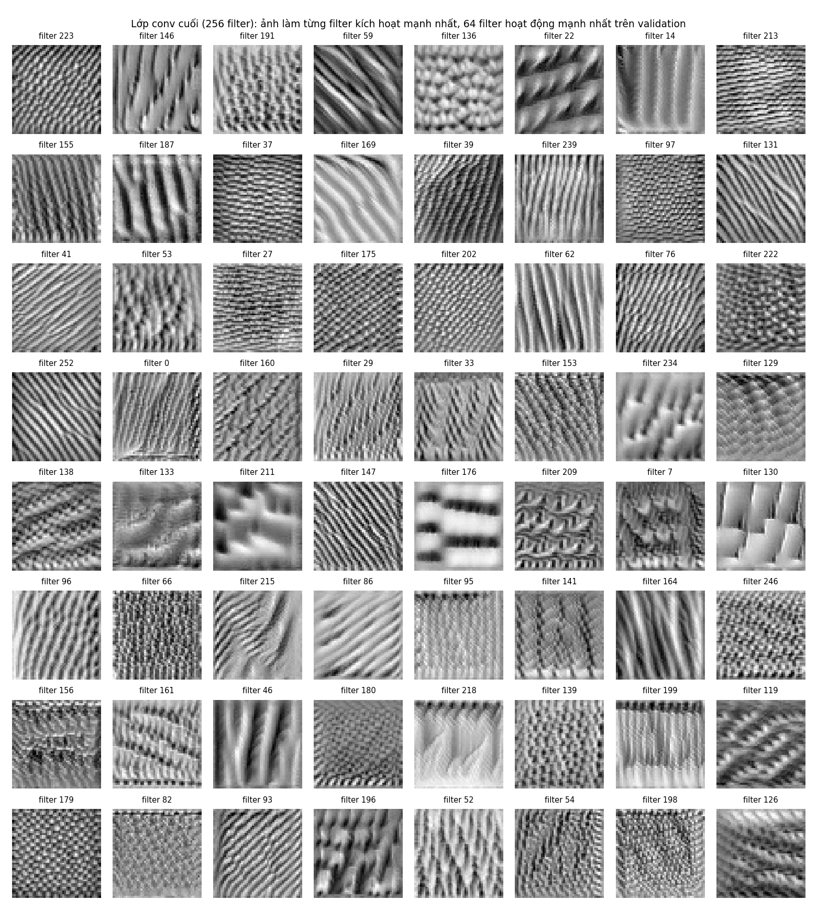
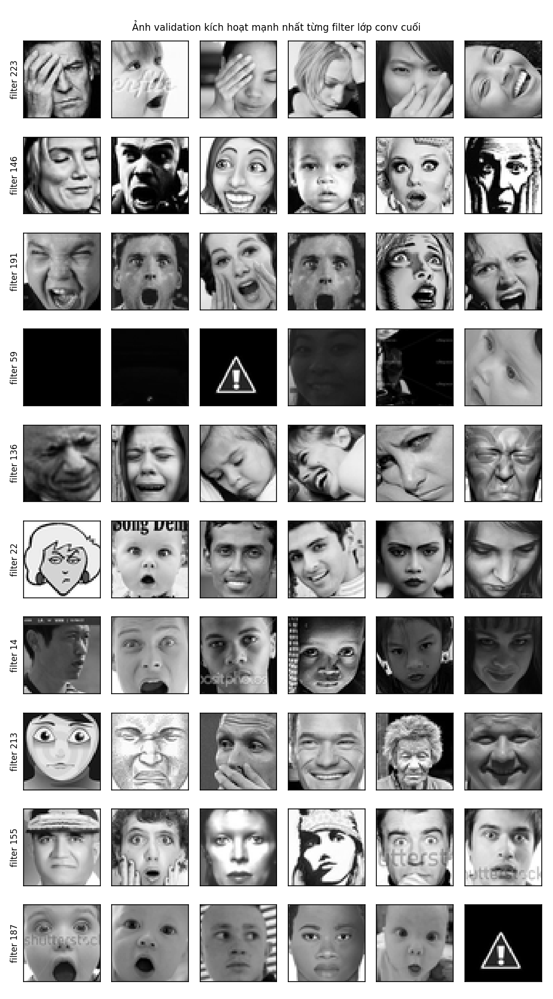
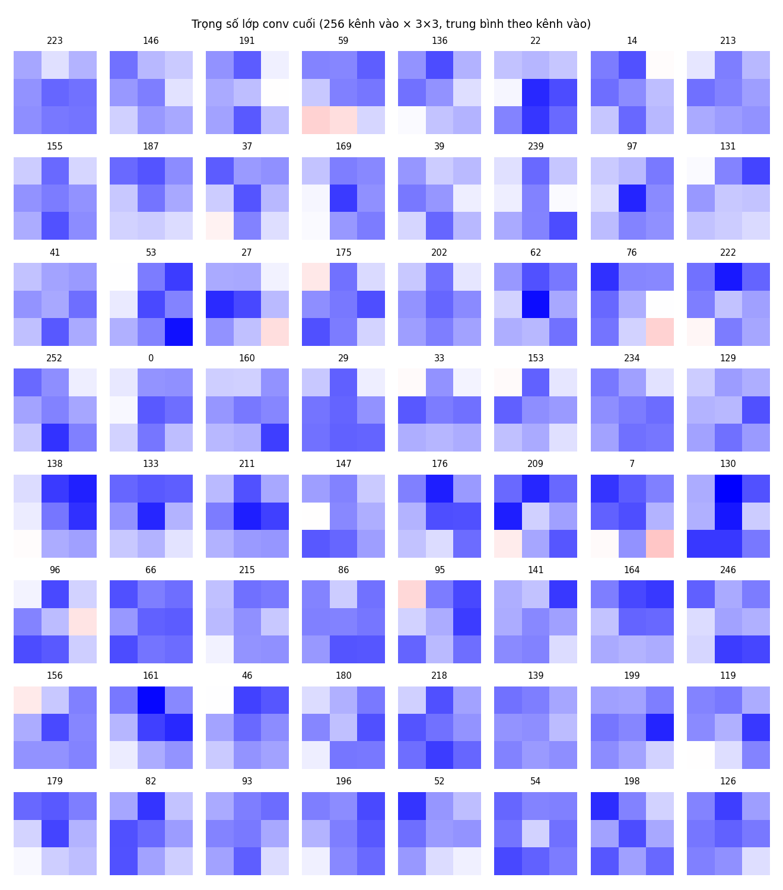
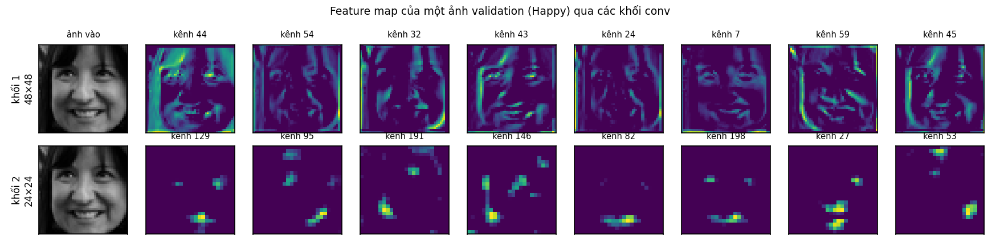
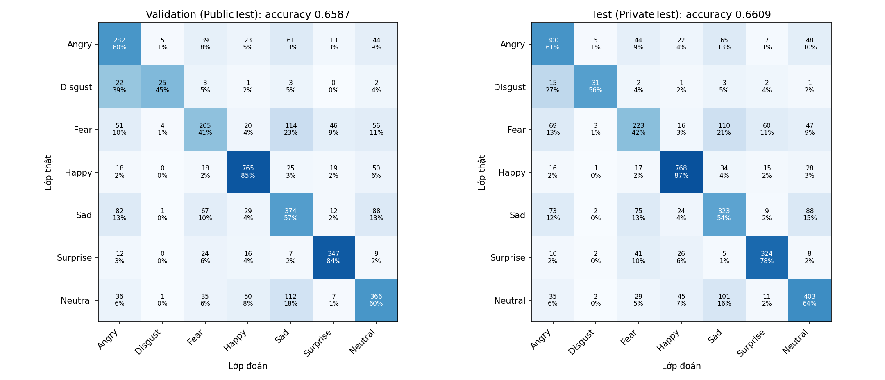
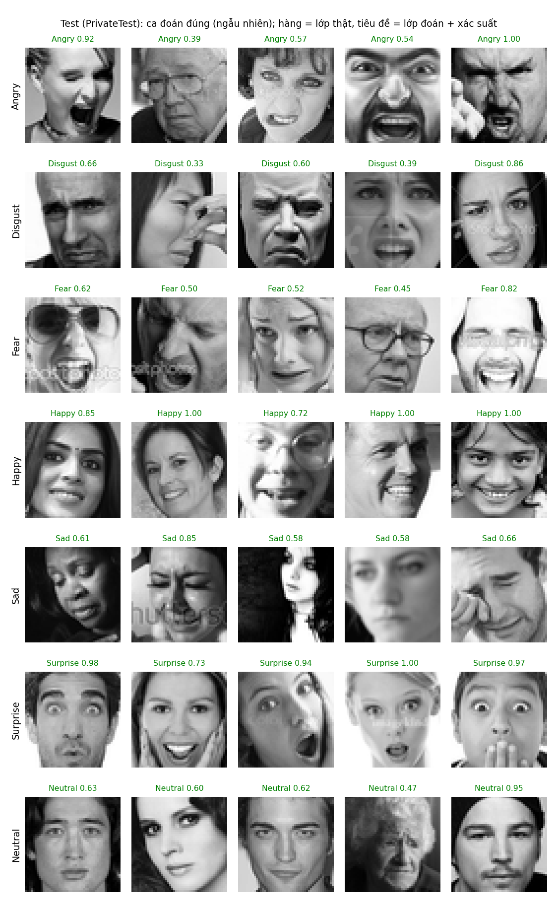
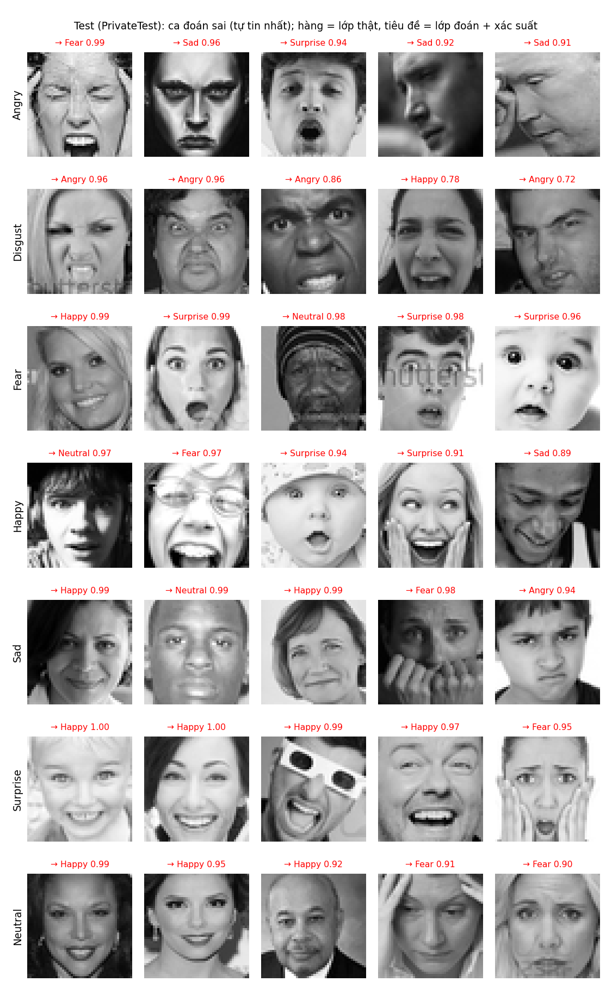
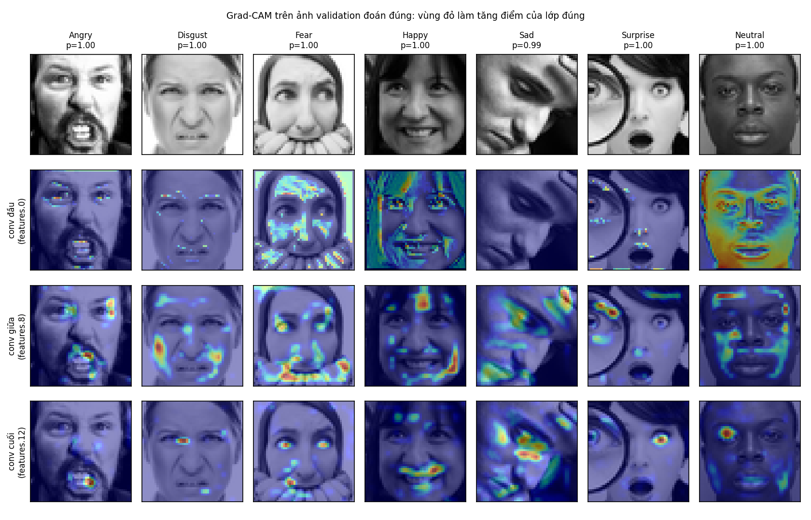

# 4. Nhìn vào bên trong mô hình và phân tích lỗi

Người viết: Phạm Trần Minh Khang (4.1), Tạ Quang Trung (4.2), Ngô Nguyễn Thành Nhân (4.3)

Mục này phân tích mô hình cuối F-1: kiến trúc Small, seed 1, checkpoint ở epoch 32, được chọn theo val_loss trên validation (mục 5.1). Small có 6 lớp conv chia hai khối: khối 1 gồm `features.0`, `features.2` (64 filter), khối 2 gồm `features.6`, `features.8` (128 filter) và `features.10`, `features.12` (256 filter). Filter, feature map và Grad-CAM (mục 4.1, 4.3) chỉ dùng ảnh validation. Confusion matrix và các ca đúng, ca sai trên test (mục 4.2) được vẽ từ chính lần đánh giá PrivateTest duy nhất ở mục 5, sau khi mô hình đã chốt, nên không ảnh hưởng tới bất kỳ lựa chọn nào.

## 4.1. Filter lớp conv cuối và feature map

Người viết: Phạm Trần Minh Khang

**Lớp conv cuối** là `features.12`: 256 filter, mỗi filter có trọng số 256 kênh vào × 3 × 3. Trên 3589 ảnh validation, 17 filter không kích hoạt ở ảnh nào (luôn bằng 0 sau ReLU). Tính cả 17 filter này, 40 filter kích hoạt ở dưới 1% số ảnh (một filter được coi là kích hoạt ở một ảnh nếu trung bình đầu ra của nó trên ảnh đó lớn hơn 0); 216 filter còn lại kích hoạt thường xuyên hơn. Nhóm thể hiện filter bằng ba cách đã nêu ở mục 2.7.

**Ảnh làm filter kích hoạt mạnh nhất.** Hình 4.1 là ảnh đầu vào được tối ưu để từng filter trong 64 filter hoạt động mạnh nhất cho đầu ra lớn nhất. Đa số filter "tìm" các mẫu hình lặp lại: sọc song song theo nhiều hướng (filter 223, 59, 131, 252), lưới và ô bàn cờ (191, 175, 179), vân tổ ong (136, 139). Một số ít filter thích các mảng lớn hơn (211, 176, 130).

Mẫu hình lặp đều khắp ảnh vì hai lý do. Thứ nhất, vùng ảnh mà một vị trí trên lớp conv cuối "nhìn thấy" (receptive field) chỉ khoảng 22 × 22 pixel: hai conv 3 × 3 ở khối 1 cho vùng 5 × 5, MaxPool 2 × 2 nâng lên 6 × 6 với bước nhảy 2, bốn conv 3 × 3 ở khối 2 cộng thêm 4 × 4 = 16 pixel. Thứ hai, mục tiêu tối ưu là trung bình đầu ra trên mọi vị trí, nên cách tốt nhất là lặp lại mẫu hình ưa thích ở khắp ảnh. Vì vậy Hình 4.1 cho biết **loại** cấu trúc cục bộ mỗi filter phản ứng (cạnh xiên, chấm, sọc dày hay mỏng), không cho biết filter nhìn vào **vị trí** nào trên mặt.

Hình 4.1. Ảnh đầu vào tổng hợp làm từng filter của lớp conv cuối kích hoạt mạnh nhất (64 trong 256 filter, xếp theo mức hoạt động trung bình trên validation).

**Ảnh thật kích hoạt mạnh nhất.** Hình 4.2 nối mẫu hình trừu tượng với ảnh thật: mỗi hàng là 6 ảnh validation làm một filter kích hoạt mạnh nhất. Nhiều filter mang ý nghĩa rõ ràng:

- filter 191: miệng há to (ảnh la hét, ngạc nhiên, sợ hãi);
- filter 155 và 187: mắt mở to, lông mày nhướng (ảnh ngạc nhiên);
- filter 223: bàn tay che một phần khuôn mặt;
- filter 136: mắt nhắm hoặc nheo, mặt nhăn (ảnh khóc, cau có);
- filter 213: vùng má và nếp nhăn quanh miệng cười;
- filter 59: ảnh rất tối, trong đó có ảnh biển cảnh báo (ảnh không có mặt người, mục 1.5).

Như vậy lớp conv cuối đã học các bộ phận và trạng thái của khuôn mặt (miệng há, mắt mở to, mắt nhắm, tay che mặt) mà các lớp phân loại phía sau dùng để quyết định cảm xúc. Filter 59 cho thấy mạng cũng học cả những đặc trưng không liên quan đến biểu cảm như độ sáng tổng thể.

Hình 4.2. Mỗi hàng: 6 ảnh validation kích hoạt mạnh nhất một filter của lớp conv cuối (10 filter hoạt động mạnh nhất).

**Trọng số.** Hình 4.3 vẽ thẳng trọng số 3 × 3 của 64 filter, lấy trung bình theo 256 kênh vào. Các ô trọng số không cho thấy cấu trúc nào đọc được bằng mắt: mỗi filter của lớp sâu là tổ hợp của 256 bản đồ đặc trưng, không phải bộ lọc trên ảnh gốc. Đây là lý do nhóm dùng hai cách ở Hình 4.1 và 4.2 để thể hiện filter lớp cuối.

Hình 4.3. Trọng số 3 × 3 của 64 filter lớp conv cuối, trung bình theo 256 kênh vào (đỏ: dương, xanh: âm).

**Feature map.** Hình 4.4 cho một ảnh Happy đi qua mạng, mỗi hàng là 8 kênh hoạt động mạnh nhất ở cuối một khối. Ở khối 1 (48 × 48), các kênh còn giữ rõ hình khuôn mặt: đường viền mặt, mắt, lông mày, khóe miệng, răng. Một số kênh (kênh 59, 24) sáng ở mép ảnh, là dấu vết của phần đệm 0 (zero padding) của conv. Ở khối 2 (24 × 24), kích hoạt trở nên thưa và tập trung vào vài vị trí: kênh 82 và 198 sáng đúng ở miệng cười, kênh 129 và 191 sáng ở khóe miệng và mắt. Càng vào sâu, mạng càng bỏ chi tiết pixel và chỉ giữ lại "ở đâu có đặc trưng gì".

Hình 4.4. Feature map của một ảnh validation (Happy) ở cuối khối 1 (48 × 48) và khối 2 (24 × 24); mỗi hàng 8 kênh hoạt động mạnh nhất.

## 4.2. Confusion matrix và phân tích lỗi

Người viết: Tạ Quang Trung

**Chỉ số từng lớp.** Bảng 4.1 ghi precision, recall và F1 của từng lớp trên validation và test, tính từ số ảnh đúng trong `predictions_*.csv`. Hai tập cho kết quả rất gần nhau; macro F1 là 0.6284 trên validation và 0.6389 trên test.

Bảng 4.1. Precision, recall, F1 từng lớp của mô hình cuối.

| Lớp | Precision val | Recall val | F1 val | Precision test | Recall test | F1 test | Số ảnh test |
| --- | ---: | ---: | ---: | ---: | ---: | ---: | ---: |
| Angry | 0.5606 | 0.6039 | 0.5814 | 0.5792 | 0.6110 | 0.5946 | 491 |
| Disgust | 0.6944 | 0.4464 | 0.5435 | 0.6739 | 0.5636 | 0.6139 | 55 |
| Fear | 0.5243 | 0.4133 | 0.4622 | 0.5174 | 0.4223 | 0.4651 | 528 |
| Happy | 0.8462 | 0.8547 | 0.8505 | 0.8514 | 0.8737 | 0.8624 | 879 |
| Sad | 0.5374 | 0.5727 | 0.5545 | 0.5039 | 0.5438 | 0.5231 | 594 |
| Surprise | 0.7815 | 0.8361 | 0.8079 | 0.7570 | 0.7788 | 0.7678 | 416 |
| Neutral | 0.5951 | 0.6030 | 0.5990 | 0.6469 | 0.6438 | 0.6453 | 626 |
| Macro F1 | | | 0.6284 | | | 0.6389 | |
| Accuracy | | | 65.87% | | | 66.09% | 3589 |

Hình 4.5 là confusion matrix của validation và test đặt cạnh nhau; màu theo tỷ lệ trên mỗi hàng (recall của lớp thật).

Hình 4.5. Confusion matrix của mô hình cuối trên validation (trái) và test (phải). Hàng: lớp thật; cột: lớp đoán; mỗi ô ghi số ảnh và phần trăm của hàng.

**Nhận xét.**

- **Happy và Surprise dễ nhất**: F1 test 0.8624 và 0.7678, recall 87.37% và 77.88%. Hai lớp này có dấu hiệu rõ và riêng (miệng cười rộng; miệng há tròn, mắt mở to), đúng như ảnh trung bình ở Hình 1.3.
- **Fear khó nhất**: recall test chỉ 42.23%. Fear bị nhầm nhiều nhất thành Sad (110/528 ảnh, 20.83%), sau đó là Angry (69 ảnh) và Surprise (60 ảnh). Fear chia sẻ dấu hiệu với nhiều lớp: mắt mở to như Surprise, mặt nhăn như Angry, mặt cúi như Sad.
- **Nhóm Sad, Neutral, Fear, Angry nhầm lẫn qua lại**: bốn cặp nhầm nhiều nhất trên test đều nằm trong nhóm này: Fear → Sad 110, Neutral → Sad 101, Sad → Neutral 88, Sad → Fear 75. Đây là bốn lớp có ảnh trung bình gần giống nhau ở mục 1.4, khác nhau chủ yếu ở vùng mắt và lông mày.
- **Disgust**: dù chỉ có 436 ảnh train (1.52%), F1 test đạt 0.6139, cao hơn Fear (0.4651) và Sad (0.5231). Precision cao (0.6739) nhưng recall thấp hơn (56.36%): mô hình ít khi đoán Disgust, và khi bỏ sót thì gần như luôn đoán thành Angry (15/55 ảnh test, 27.27%; 22/56 ảnh validation, 39.29%). Disgust và Angry cùng có mũi nhăn, môi trên kéo lên.

**Ca đoán đúng.** Hình 4.6 là 5 ảnh test đoán đúng chọn ngẫu nhiên cho mỗi lớp. Với Happy và Surprise, mô hình thường rất chắc chắn (xác suất 0.72 đến 1.00); với Disgust và Fear, kể cả khi đúng, xác suất chỉ 0.33 đến 0.86. Điều này khớp với F1 thấp hơn của hai lớp này.

Hình 4.6. Ca đoán đúng trên test: mỗi hàng một lớp thật, 5 ảnh chọn ngẫu nhiên; tiêu đề là lớp đoán và xác suất.

**Ca đoán sai.** Hình 4.7 là, với mỗi lớp thật, 5 ảnh test mà mô hình đoán sai với xác suất cao nhất. Trên test có 1217 ảnh đoán sai, trong đó 45 ảnh (3.70% số ca sai) bị đoán sai với xác suất từ 0.9 trở lên. Nhìn các ca sai tự tin nhất, nhóm thấy ba nhóm nguyên nhân:

1. **Nhãn có thể sai.** Nhiều ảnh trông rõ là đang cười nhưng mang nhãn khác: hàng Fear (ảnh 1), hàng Surprise (ảnh 1 đến 4) và hàng Neutral (ảnh 1 đến 3) đều là mặt cười và bị mô hình đoán là Happy với xác suất 0.92 đến 1.00. Ở những ảnh này, dự đoán của mô hình có vẻ hợp lý hơn nhãn. Điều này phù hợp với 57 nhóm ảnh trùng mà khác nhãn đã đếm ở mục 1.5.
2. **Biểu cảm lẫn lộn hoặc mơ hồ.** Ảnh Angry miệng há to bị đoán Surprise hoặc Fear; ảnh Sad tay che miệng bị đoán Fear (0.98); ảnh Disgust nhăn mặt bị đoán Angry (0.96). Ngay cả người xem cũng khó phân định các ảnh này chỉ từ một khung hình xám 48 × 48.
3. **Nhiễu trong ảnh.** Một số ảnh có chữ watermark chạy ngang mặt (hàng Disgust ảnh 1, hàng Fear ảnh 4), một số ảnh tối, mặt nghiêng hoặc bị che một phần.

Hình 4.7. Ca đoán sai trên test: mỗi hàng một lớp thật, 5 ảnh mô hình tự tin nhất mà vẫn sai; tiêu đề là lớp đoán và xác suất.

## 4.3. Grad-CAM

Người viết: Ngô Nguyễn Thành Nhân

Grad-CAM [8] (mục 2.7) cho biết vùng nào của ảnh làm tăng điểm của một lớp. Hình 4.8 có hàng đầu là ảnh gốc; ba hàng sau là bản đồ Grad-CAM của lớp đúng tại conv đầu (`features.0`, 48 × 48), conv giữa (`features.8`, 24 × 24) và conv cuối (`features.12`, 24 × 24). Mỗi cột là một cảm xúc, dùng ảnh validation được đoán đúng với xác suất cao nhất của lớp đó (đều từ 0.99 trở lên).

Hình 4.8. Grad-CAM của mô hình cuối tại conv đầu, giữa và cuối cho 7 cảm xúc (ảnh validation đoán đúng). Vùng đỏ làm tăng điểm của lớp đúng.

**Nhận xét.**

- **Conv đầu** chưa mang thông tin về lớp: vùng sáng rải theo cạnh và đường viền (mép mắt, răng, viền tóc), ở ảnh Neutral thì phủ gần hết khuôn mặt, còn ở ảnh Sad gần như không có vùng sáng. Lớp này chỉ phát hiện cạnh và độ tương phản, giống nhau cho mọi cảm xúc; gradient của điểm lớp phải đi ngược qua cả 5 lớp conv phía sau mới tới đây nên bản đồ nhiễu. Grad-CAM vì vậy thường được đọc ở lớp conv cuối, nơi đặc trưng đã mang ý nghĩa về lớp.
- **Conv giữa** bắt đầu khoanh vùng các bộ phận: mắt và miệng ở Angry, má và khóe miệng ở Disgust, hai bàn tay đặt dưới cằm ở Fear, trán và khóe miệng ở Happy.
- **Conv cuối** tập trung vào vài vùng nhỏ và có ý nghĩa với từng cảm xúc:
  - Angry: miệng há và răng;
  - Happy: miệng cười;
  - Fear: hai mắt, kèm một vùng nhỏ ở miệng và tay;
  - Disgust: quanh mắt;
  - Surprise và Neutral: mắt;
  - Sad: quanh mắt và tay đỡ mặt.
- Các vùng ở conv cuối khớp với khác biệt giữa các ảnh trung bình ở Hình 1.3 (miệng với Happy, mắt và lông mày với các lớp còn lại) và với các filter có ý nghĩa ở Hình 4.2 (miệng há, mắt mở to). Ở conv cuối, vùng nóng nằm trên mắt và miệng chứ không nằm trên nền; ở conv đầu thì vẫn có vùng sáng trên tóc và nền (ảnh Happy, Fear).
- Hạn chế: mỗi cảm xúc chỉ minh họa bằng một ảnh được đoán đúng với độ tự tin cao nhất, nên Hình 4.8 cho thấy cách mô hình làm việc trong trường hợp thuận lợi nhất, không phải trên mọi ảnh. Bản đồ ở conv giữa và conv cuối có độ phân giải 24 × 24, được phóng lên 48 × 48 nên khá thô.

### Nguồn số liệu

- Mô hình phân tích: `results/final/best_model.pt` (F-1, epoch 32; 155.6 MB, vượt giới hạn 100 MB của GitHub nên không có trên kho mã, chỉ có trong file zip nộp); tên và số lớp conv, số filter không kích hoạt (17) và kích hoạt dưới 1% ảnh (40, tính cả 17): `results/final/last_conv_stats.json` (`python -m src.visualize --thong-ke`).
- Hình 4.1 đến 4.4, 4.8: `results/final/figures/last_conv_filters.png`, `last_conv_top_images.png`, `last_conv_weights.png`, `feature_maps.png`, `gradcam.png` (`python -m src.visualize`, chỉ dùng validation).
- Bảng 4.1: tính từ `results/final/predictions_val.csv`, `predictions_test.csv` (khớp `classification_report.csv`, trừ chữ số cuối ở 3 ô vì file đó lưu 5 chữ số rồi mới làm tròn). Hình 4.5 đến 4.7: `results/final/figures/confusion_matrix.png`, `true_cases.png`, `wrong_cases.png` (tạo trong `evaluate_final`).
- Các cặp nhầm lẫn, số ảnh sai và số ảnh sai với xác suất ≥ 0.9 (45/1217): đếm từ `results/final/predictions_test.csv` và `predictions_val.csv`. Phần trăm tính từ số ảnh ở Bảng 4.1 (vd. 110/528 = 20.83%).
- Receptive field 22 × 22 tính từ kiến trúc Small (Bảng 2.3).
