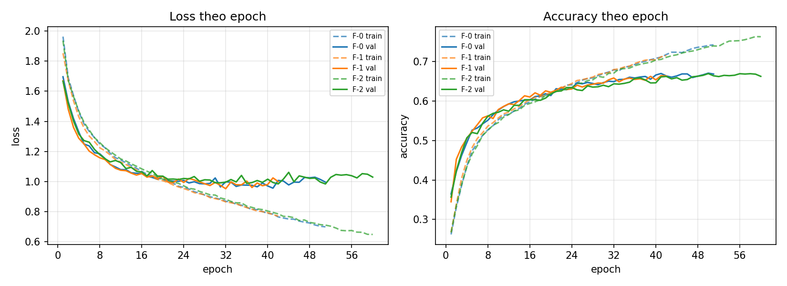

# 5. Mô hình cuối, kết quả trên tập test và kết luận

Người viết: Huỳnh Ngọc Trúc

## 5.1. Cấu hình và quy trình

Theo mục 3.7, mô hình cuối là baseline với kiến trúc Small (`configs/final.yaml`): 6 lớp conv, 38901191 tham số, ReLU, không BatchNorm, dropout 0.2 sau mỗi khối và 0.5 sau lớp FC, Adam lr 1e-4, batch 64, augmentation lật ngang, xoay ±10°, dịch 10%, tối đa 60 epoch, early stopping theo val_loss với patience 10.

Quy trình (`experiments/run_final.py`, mục 2.6) gồm ba bước theo đúng thứ tự:

1. Huấn luyện cùng cấu hình với 3 seed (0, 1, 2), gọi là F-0, F-1, F-2, trên GPU Tesla T4.
2. Chọn seed có val_loss nhỏ nhất trên validation làm mô hình cuối. Bước này hoàn tất trước khi tập test được đọc.
3. Đánh giá mô hình cuối trên PrivateTest **một lần duy nhất** (lúc 03:48:49 ngày 26/11/2026 theo giờ máy chủ Kaggle), ghi `final_metrics.json`, rồi vẽ hình.

## 5.2. Kết quả trên validation với 3 seed

Bảng 5.1 ghi kết quả ba seed, Hình 5.1 là đường học.

Bảng 5.1. Mô hình cuối với 3 seed, trên validation (PublicTest).

| Run | Seed | Epoch tốt nhất / đã chạy | val_loss | val_acc | train_acc | train − val | Thời gian (s) |
| --- | ---: | ---: | ---: | ---: | ---: | ---: | ---: |
| F-0 | 0 | 41 / 51 | 0.9552 | 67.01% | 71.17% | +4.16 | 1492 |
| **F-1** | 1 | 32 / 42 | **0.9515** | 65.87% | 68.00% | +2.14 | 1375 |
| F-2 | 2 | 51 / 60 | 0.9832 | 66.43% | 74.00% | +7.57 | 1736 |
| Trung bình ± độ lệch chuẩn | | | 0.9633 ± 0.0173 | **66.43% ± 0.57** | | | |

Hình 5.1. Loss (trái) và accuracy (phải) theo epoch của F-0, F-1, F-2; nét đứt là train, nét liền là validation.

**Nhận xét.**

- Ba seed cho val_acc 65.87% đến 67.01%, trung bình **66.43% ± 0.57** (độ lệch chuẩn mẫu, n = 3). Trong 30 epoch đầu, val_loss của ba seed bám sát nhau (chênh tối đa 0.060); sau đó các run dừng ở các epoch khác nhau: F-2 tiếp tục chạy đến epoch 60 và quá khớp rõ nhất (train − val 7.57 điểm ở epoch tốt nhất).
- F-0 cho log trùng khít E1-1 ở mọi epoch (cùng cấu hình, cùng seed 0), xác nhận thêm một lần kết quả tái lập được.
- **Trung bình của Small bằng đúng kết quả của baseline Medium** (66.43%, mục 3.0). Mức hơn 0.59 điểm của E1-1 so với baseline vì vậy nhiều khả năng đến từ seed 0 thuận lợi, không phải Small thật sự tốt hơn Medium. Độ lệch chuẩn 0.57 điểm giữa các seed cho thấy chênh lệch dưới khoảng 1 điểm giữa hai run một seed ở mục 3 không đủ để kết luận.
- Quy tắc chọn theo val_loss đã chọn **F-1**, seed có val_loss nhỏ nhất (0.9515) nhưng val_acc thấp nhất (65.87%). Nhóm giữ đúng quy tắc đã định trước thay vì đổi sang chọn theo val_acc sau khi đã thấy kết quả, vì đổi quy tắc sau khi xem số là chọn theo chính con số đang báo cáo. val_loss xét cả độ tự tin của dự đoán trên mọi ảnh, không chỉ đúng hay sai; F-1 cũng là seed quá khớp ít nhất (train − val 2.14 điểm).

## 5.3. Kết quả trên tập test (PrivateTest)

Bảng 5.2 ghi kết quả của mô hình cuối F-1 trên validation và trên test. Chỉ số từng lớp và confusion matrix đã trình bày ở mục 4.2 (Bảng 4.1, Hình 4.5).

Bảng 5.2. Mô hình cuối F-1 trên validation và test.

| Tập | Accuracy | Macro F1 | Weighted F1 |
| --- | ---: | ---: | ---: |
| Validation (PublicTest) | 65.87% | 0.6284 | 0.6557 |
| **Test (PrivateTest, đánh giá 1 lần)** | **66.09%** | **0.6389** | **0.6585** |

- Accuracy trên test (66.09%) cao hơn validation 0.22 điểm, macro F1 cao hơn 0.0104. Hai tập cho kết quả gần nhau.
- Macro F1 (0.6389) thấp hơn accuracy vì các lớp khó (Fear F1 0.4651, Sad 0.5231) kéo trung bình xuống; lớp hiếm Disgust đạt F1 0.6139, không bị mô hình bỏ qua.

## 5.4. So với các mức tham chiếu

Bảng 5.3. So kết quả của nhóm với mức tham chiếu của đề và báo cáo mẫu.

| Mức tham chiếu | Giá trị | Kết quả của nhóm | Chênh lệch |
| --- | ---: | ---: | ---: |
| Tốt nhất thế giới, PrivateTest (đề bài) | 71% | 66.09% (test) | −4.91 điểm |
| Tốt nhất thế giới, PublicTest (đề bài) | 69% | 65.87% (validation, F-1) | −3.13 điểm |
| Báo cáo mẫu, val_acc của 4 CNN | 0.64 đến 0.67 | 66.43% ± 0.57 (validation, 3 seed) | Trong khoảng |

Mô hình của nhóm đạt mức của báo cáo mẫu và kém mô hình tốt nhất thế giới khoảng 5 điểm trên PrivateTest. Nhóm chưa thử một số kỹ thuật có thể thu hẹp khoảng cách này, như ghép nhiều mô hình (ensemble), huấn luyện lâu hơn các cấu hình chưa hội tụ, hoặc dùng mô hình học trước trên dữ liệu lớn; code mẫu của thầy với VGG16 học trước đạt val_acc 0.707 (mục 5.6).

## 5.5. Ảnh hưởng của ảnh trùng giữa train và test

Mục 1.5 đã chỉ ra 288 ảnh test (8.02%) và 280 ảnh validation (7.80%) trùng y hệt một ảnh train. Nhóm tách accuracy của mô hình cuối theo hai phần này (Bảng 5.4). Phép tách dùng lại dự đoán đã lưu của lần đánh giá duy nhất, không chạy lại mô hình trên test.

Bảng 5.4. Accuracy của mô hình cuối trên ảnh trùng với train và trên phần còn lại.

| Tập | Ảnh trùng train | Accuracy trên ảnh trùng | Ảnh còn lại | Accuracy trên ảnh còn lại | Accuracy cả tập |
| --- | ---: | ---: | ---: | ---: | ---: |
| Validation | 280 | 86.07% | 3309 | 64.16% | 65.87% |
| Test | 288 | 83.33% | 3301 | 64.59% | 66.09% |

Mô hình đoán đúng 83.33% số ảnh test đã có trong train, nhưng chỉ 64.59% số ảnh test chưa từng thấy. Nếu loại các ảnh trùng, accuracy test giảm 1.50 điểm, còn 64.59%. Con số 66.09% vì vậy hơi cao so với năng lực thật của mô hình trên ảnh mới. Nhóm vẫn báo 66.09% làm kết quả chính để so được với báo cáo mẫu và với mức 71% (đều dùng nguyên cách chia của FER2013), đồng thời nêu 64.59% như ước lượng thận trọng hơn.

## 5.6. Hạn chế

- **Mỗi thực nghiệm E1 đến E6 chỉ một seed.** Độ lệch chuẩn giữa các seed khoảng 0.57 điểm (mục 5.2), nên các chênh lệch dưới khoảng 1 điểm ở mục 3 chưa đủ tin cậy; chính kiến trúc Small được chọn vì hơn baseline 0.59 điểm ở seed 0, và lợi thế này không còn khi tính trung bình 3 seed.
- **Bốn cấu hình chưa hội tụ** trong 60 epoch (BatchNorm, SGD, sigmoid, dropout 0.4); kết quả của chúng là cận dưới. Riêng dropout 0.4 (E6-2) đã giảm quá khớp rõ (train − val 1.30 điểm) và có thể vượt baseline nếu được huấn luyện lâu hơn.
- **Nhãn nhiễu và ảnh không có mặt người.** FER2013 có 57 nhóm ảnh giống hệt nhau mà nhãn khác nhau, 12 ảnh một màu, và các ảnh như biển cảnh báo (mục 1.5). Nhiều ca sai tự tin nhất trông như nhãn sai (mục 4.2). Mô hình không thể vượt quá giới hạn mà nhãn nhiễu đặt ra.
- **Ảnh trùng giữa train và test** làm accuracy test cao hơn khoảng 1.5 điểm so với ảnh mới (mục 5.5).
- **F1 từng lớp chỉ có cho mô hình cuối.** Checkpoint của các run E không được tải về, nên E6-3 (trọng số lớp) chưa được đánh giá đúng mục tiêu là tăng recall lớp hiếm.
- **Khởi tạo He dùng chung cho mọi run** thuận lợi cho họ ReLU, có thể làm sigmoid (E5-3) kém hơn mức nó có thể đạt.
- **Chưa thử học chuyển giao (E7).** Code mẫu của thầy cho thấy VGG16 trên ảnh phóng 128 × 128 đạt val_acc 0.699 (huấn luyện từ đầu) và 0.707 (khởi tạo từ ImageNet), cao hơn các CNN nhỏ; nhóm bỏ E7 theo phương án dự phòng của kế hoạch vì thời gian.

## 5.7. Kết luận

Nhóm đã xây dựng bằng PyTorch toàn bộ quy trình nhận dạng cảm xúc trên FER2013: đọc và chia dữ liệu theo cách của cuộc thi, bốn kiến trúc CNN theo code mẫu, vòng huấn luyện có early stopping và checkpoint theo val_loss, 18 thực nghiệm mỗi lần đổi một biến, mô hình cuối với 3 seed, và đánh giá PrivateTest đúng một lần.

Các kết quả chính:

1. Mô hình cuối (CNN Small) đạt **66.43% ± 0.57** trên validation (3 seed) và **66.09%** accuracy, macro F1 **0.6389** trên PrivateTest. Kết quả ngang báo cáo mẫu (0.64 đến 0.67) và kém mức tốt nhất thế giới (71%) 4.91 điểm.
2. Trong các yếu tố đã thử, hàm kích hoạt và tăng cường dữ liệu ảnh hưởng mạnh nhất: sigmoid kém ReLU 9.84 điểm vì gradient biến mất; bỏ augmentation mất 6.55 điểm và làm mạng quá khớp từ epoch 11. Kiến trúc ít ảnh hưởng: bốn mạng chỉ chênh 1.98 điểm, và ưu thế của Small biến mất khi tính trung bình 3 seed.
3. Khởi tạo trọng số quyết định việc mạng có học được hay không: với khởi tạo mặc định của PyTorch, gradient ở lớp đầu nhỏ hơn khởi tạo He khoảng 5500 lần và baseline đứng yên ở mức đoán toàn Happy (mục 2.3).
4. Hình filter lớp conv cuối, ảnh kích hoạt mạnh nhất và Grad-CAM cho thấy mô hình dựa vào đúng các bộ phận biểu cảm: miệng há, miệng cười, mắt mở to (mục 4.1, 4.3).
5. Mô hình phân biệt tốt Happy (F1 0.8624) và Surprise (0.7678), nhưng còn nhầm nhiều trong nhóm Fear, Sad, Neutral, Angry; Fear khó nhất (recall 42.23%). Một phần lỗi đến từ nhãn nhiễu của bộ dữ liệu.

**Hướng phát triển.** Huấn luyện lâu hơn các cấu hình chưa hội tụ (dropout 0.4, BatchNorm), thử BatchNorm khi bỏ dropout, dùng mô hình học trước như VGG16 hoặc ResNet (E7), và ghép nhiều mô hình. Mỗi hướng đều phải chọn trên validation; tập PrivateTest đã được dùng một lần nên không dùng để so sánh các hướng này.

### Nguồn số liệu

- Bảng 5.1: `results/final/summary.csv` và `results/final/logs/F-*.csv`, accuracy tính lại từ số ảnh đúng (như mục 3); trung bình ± độ lệch chuẩn: `results/final/final_metrics.json` (`val_acc_mean`, `val_acc_std`, `best_val_loss_mean`, `best_val_loss_std`). Hình 5.1: `results/final/figures/curves.png`.
- Bảng 5.2, thời điểm đánh giá test, seed được chọn: `results/final/final_metrics.json`.
- Bảng 5.3: mức 69% và 71% trong `Yêu cầu/Emotion_Recognition.pdf`; mức 0.64 đến 0.67 trong `Yêu cầu/demo_report.pdf`; val_acc 0.699 và 0.707 của VGG16 trong `Yêu cầu/code/valid_vgg16.html`, `valid_imagenet_vgg16.html` (ghi ở `docs/Kế hoạch.md` mục 12).
- Bảng 5.4: `results/final/duplicate_effect.json` (`python -m src.evaluate --trung-lap results/final`).
- Số liệu của mục 1 đến 4 được dẫn lại từ nguồn ghi ở cuối từng mục.
