# 3. Chuyển từng notebook

Người viết: Huỳnh Ngọc Trúc (3.1, 3.2), Phạm Trần Minh Khang (3.3, 3.6), Tạ Quang Trung (3.4, 3.7, 3.10), Ngô Nguyễn Thành Nhân (3.5, 3.8, 3.9)

Mỗi mục dưới đây có: bài toán và dữ liệu; đoạn Keras gốc đặt cạnh đoạn PyTorch; các điểm khác cần chú ý; bảng số liệu hai bản; đường học (learning curve) và nhận xét. Accuracy trong các bảng đo trên đúng tập mà notebook gốc dùng để đánh giá (tập test của MNIST, tập val của Gender, PublicTest của FER2013).

## 3.1. Xấp xỉ hàm Gauss 2 chiều (Func_apxm_MLP)

Người viết: Huỳnh Ngọc Trúc

**Bài toán.** Mạng `gauss_mlp(B)` gồm 2 đầu vào, B nút ẩn sigmoid và 1 đầu ra sigmoid, học mật độ Gauss 2 chiều trên miền [−3, 3]². Dữ liệu train là lưới 32×32 = 1024 điểm, test là lưới 10×10. Loss MSE, SGD lr 0.01, batch 128. Notebook quét ba siêu tham số: số mẫu A (B = 16, C = 100 epoch), số nút ẩn B (A = 800, C = 100) và số epoch C (A = 800, B = 128).

**Keras gốc và PyTorch:**

```python
# Keras
inp = Input(shape=(2,), name='Input')
x = Dense(units=B, activation='sigmoid', name='fc')(inp)
gauss_out = Dense(units=1, activation='sigmoid', name='gauss_apxm')(x)
model = Model(inputs=inp, outputs=gauss_out, name='gauss_mlp')
model.compile(loss='mean_squared_error', optimizer=SGD(lr=0.01))
model.fit(x_train[sel_indx], y_train[sel_indx], batch_size=128, epochs=C, verbose=0)
```

```python
# PyTorch
class GaussMLP(nn.Module):
    def __init__(self, B=16):
        super().__init__()
        self.fc = nn.Linear(2, B)
        self.gauss_apxm = nn.Linear(B, 1)
    def forward(self, x):
        return torch.sigmoid(self.gauss_apxm(torch.sigmoid(self.fc(x))))

model = init_keras_like(GaussMLP(B)).to(device)
optimizer = torch.optim.SGD(model.parameters(), lr=0.01)
fit(model, train_loader, test_loader, nn.MSELoss(), optimizer, C, verbose=0)
```

**Điểm khác cần chú ý.**

- Nhãn phải có shape `(N, 1)` giống đầu ra. Nếu để `(N,)`, `nn.MSELoss` broadcast thành ma trận N×N và cho loss sai mà không báo lỗi. Keras tự thêm chiều cho nhãn.
- Giữ nguyên cách chọn mẫu của gốc `np.random.choice(range(1, 1001), ...)`: điểm 0 và các điểm 1001–1023 không bao giờ được chọn để train, nhưng vẫn tính trong train error.
- Notebook gốc **chỉ có hình, không in số**. Số Keras trong Bảng 3.1 đọc gần đúng từ hình gốc; trong `so_sanh.csv` cột Keras để trống và số đọc từ hình ghi ở cột ghi chú.

Bảng 3.1. Test MSE ở điểm cuối mỗi vòng quét.

| Vòng quét | Điểm cuối | Tham số | Keras (đọc từ hình) | PyTorch | Thời gian PyTorch (CPU) |
| --- | --- | ---: | ---: | ---: | ---: |
| A: số mẫu | A = 1000 | 65 | ≈ 0.0067 | 0.0086 | 6.8 s |
| B: số nút ẩn | B = 512 | 2.049 | ≈ 0.0014 | 0.0013 | 5.4 s |
| C: số epoch | C = 190 | 513 | ≈ 0.0016 | 0.0015 | 13.8 s |

Hình 3.1 là ba đường quét của bản PyTorch.

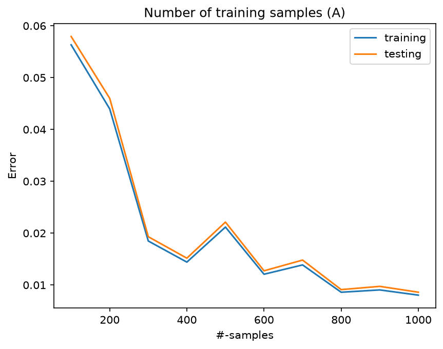{width=32%} 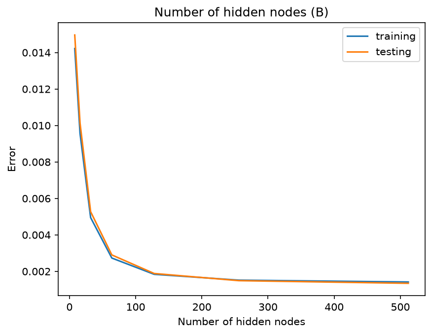{width=32%} 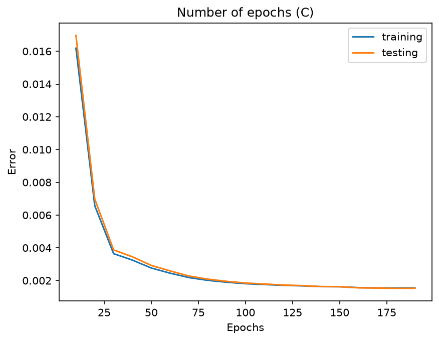{width=32%}

Hình 3.1. Train error và test error (MSE) theo số mẫu A (trái), số nút ẩn B (giữa) và số epoch C (phải), bản PyTorch.

**Nhận xét.** Hình dạng ba đường quét giống hình gốc. Vòng quét B giảm từ 0.0150 (B = 8) xuống 0.0013 (B = 512); vòng quét C giảm từ 0.0170 (C = 10) xuống 0.0015 (C = 190). Gốc tương ứng khoảng 0.0112 → 0.0014 và 0.0175 → 0.0016. Vòng quét A dao động vì mỗi điểm chỉ là một lần huấn luyện với khởi tạo ngẫu nhiên riêng. Cả hai bản đều có một điểm nhảy lên ở A = 500 (PyTorch 0.0221, gốc khoảng 0.020). Điểm cuối A = 1000 của bản PyTorch (0.0086) cao hơn số đọc từ hình gốc (khoảng 0.0067), nằm trong mức dao động đó.

Nguồn số liệu: `results/Func_apxm_MLP/quet_A.csv`, `quet_B.csv`, `quet_C.csv`; `results/so_sanh.csv`; hình gốc trong `Yêu cầu/examples/1. MLP/Func_apxm_MLP.ipynb`.

## 3.2. MNIST bằng MLP (MNIST_MLP)

Người viết: Huỳnh Ngọc Trúc

**Bài toán.** Phân loại chữ số viết tay MNIST (60.000 ảnh train, 10.000 ảnh test, 28×28, chia 255). Mạng: Flatten → FC 512 relu → Dropout 0.2 → FC 512 relu → Dropout 0.2 → FC 10. `categorical_crossentropy`, SGD lr 0.01, batch 128, 30 epoch; validation là tập test.

**Keras gốc và PyTorch:**

```python
# Keras
x = Flatten(name='flatten')(input_image)
x = Dense(units=512, activation='relu', name='fc1')(x)
x = Dropout(rate=0.2, name='dropout1')(x)
x = Dense(units=512, activation='relu', name='fc2')(x)
x = Dropout(rate=0.2, name='dropout2')(x)
output_label = Dense(units=num_classes, activation='softmax', name='fc3_10ways_softmax')(x)
model.compile(loss='categorical_crossentropy', optimizer=SGD(lr=0.01), metrics=['accuracy'])
history = model.fit(x_train, y_train, validation_data=(x_test, y_test), batch_size=128, epochs=30)
```

```python
# PyTorch
class MnistMLP(nn.Module):
    def __init__(self, num_classes=10):
        super().__init__()
        self.flatten = nn.Flatten()
        self.fc1 = nn.Linear(28 * 28, 512)
        self.dropout1 = nn.Dropout(p=0.2)
        self.fc2 = nn.Linear(512, 512)
        self.dropout2 = nn.Dropout(p=0.2)
        self.fc3_10ways_softmax = nn.Linear(512, num_classes)   # trả logits
    def forward(self, x, return_features=False):
        x = self.dropout1(F.relu(self.fc1(self.flatten(x))))
        feat = F.relu(self.fc2(x))                               # = đầu ra lớp 'fc2' của Keras
        logits = self.fc3_10ways_softmax(self.dropout2(feat))
        return (feat, logits) if return_features else logits

loss_fn = nn.CrossEntropyLoss()
optimizer = torch.optim.SGD(model.parameters(), lr=0.01)
history = fit(model, train_loader, test_loader, loss_fn, optimizer, 30, metric=accuracy)
```

**Điểm khác cần chú ý.**

- Lớp cuối trả logits, không softmax. `nn.CrossEntropyLoss` đã gồm `log_softmax`; nếu thêm softmax ở lớp cuối thì softmax bị áp hai lần, gradient rất nhỏ và mô hình học chậm. Khi cần xác suất (ô kiểm `np.sum(y_pred) = 1` của gốc), bản PyTorch gọi `torch.softmax(logits, dim=1)`.
- Nhãn là chỉ số lớp 0–9 thay vì one-hot của `to_categorical`. Giá trị loss như nhau.
- Phần cuối gốc dựng `Model(inputs, [get_layer('fc2').output, model.output])` để lấy đặc trưng 512 chiều. Bản PyTorch gọi `model(x, return_features=True)`; đặc trưng lấy **sau** relu vì `Dense(..., activation='relu')` của Keras gộp cả relu.

Bảng 3.2 đặt số liệu hai bản cạnh nhau.

Bảng 3.2. MNIST_MLP: Keras và PyTorch.

| | Keras gốc | PyTorch |
| --- | ---: | ---: |
| Số tham số | 669.706 | 669.706 |
| Test accuracy | 96.48% | 96.58% |
| Test loss | 0.1143 | 0.1159 |
| Epoch | 30 | 30 |
| Thời gian | 1.13 phút (Colab T4) | 84 s (CPU) |

Hình 3.2 là đường học của bản PyTorch.

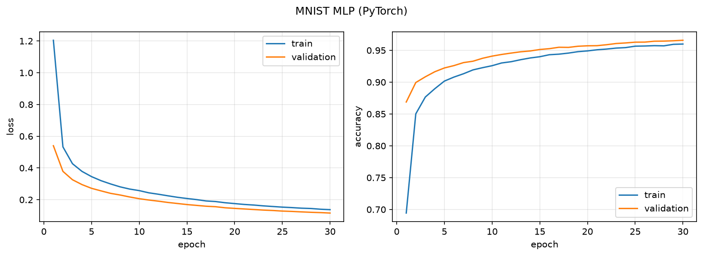{width=85%}

Hình 3.2. Loss (trái) và accuracy (phải) theo epoch của MNIST_MLP, bản PyTorch.

**Nhận xét.** Bản PyTorch đạt 96.58%, cao hơn gốc 0.10 điểm; test loss chênh 0.0016. Train accuracy epoch cuối là 95.99% (gốc 96.12%), thấp hơn test accuracy vì train accuracy đo lúc dropout còn bật. Mạng nhỏ nên CPU chạy 30 epoch hết 84 s, nhanh hơn lần chạy gốc trên GPU T4 (1.13 phút).

Nguồn số liệu: `results/MNIST_MLP/metrics.json`, `history.csv`; `results/so_sanh.csv`.

## 3.3. MNIST bằng CNN và PCA đặc trưng (1_MNIST_CNN)

Người viết: Phạm Trần Minh Khang

**Bài toán.** Cùng dữ liệu MNIST, ảnh `(N, 28, 28, 1)` chia 255. Mạng: 3 khối [Conv 3×3 same + relu → MaxPool 2×2 → Dropout 0.2] với 64, 128, 256 filter (28 → 14 → 7 → 3), rồi FC 512 → FC 512 → FC 10. SGD lr 0.01, batch 128, 30 epoch. Phần phụ: PCA 2 chiều của ảnh gốc, của đặc trưng `fc2` và của `GlobalAveragePooling2D` sau `pool3`.

**Keras gốc và PyTorch** (khối 1 và phần đầu ra; khối 2, 3 giống khối 1):

```python
# Keras
x = Conv2D(filters=64, kernel_size=(3, 3), padding='same', activation='relu', name='conv1')(input_image)
x = MaxPooling2D(pool_size=(2, 2), name='pool1')(x)
x = Dropout(rate=0.2, name='conv_dropout1')(x)
...
x = Flatten(name='flatten')(x)
x = Dense(units=512, activation='relu', name='fc1')(x)

x1 = GlobalAveragePooling2D()(model.get_layer("pool3").output)
model2 = Model(inputs=model.input, outputs=x1)
```

```python
# PyTorch
self.conv1 = nn.Conv2d(1, 64, kernel_size=3, padding=1)        # 'same'
self.pool1 = nn.MaxPool2d(2)
self.conv_dropout1 = nn.Dropout(0.2)
...
self.fc1 = nn.Linear(256 * 3 * 3, 512)                          # tự tính: 256 kênh × 3 × 3

def forward(self, x, return_features=False):                   # x: (N, 1, 28, 28)
    x = self.conv_dropout1(self.pool1(F.relu(self.conv1(x))))  # (N, 64, 14, 14)
    x = self.conv_dropout2(self.pool2(F.relu(self.conv2(x))))  # (N, 128, 7, 7)
    pool3 = self.pool3(F.relu(self.conv3(x)))                  # (N, 256, 3, 3)
    ...
# GlobalAveragePooling2D = trung bình theo hai chiều không gian
feats["pool3"].mean(dim=(2, 3))                                # (N, 256)
```

**Điểm khác cần chú ý.**

- Ảnh PyTorch có dạng `(N, 1, 28, 28)`: kênh đứng sau batch.
- `padding='same'` với kernel 3 là `padding=1`; `nn.MaxPool2d(2)` làm tròn xuống như Keras nên 7 → 3.
- `Flatten` của Keras duỗi theo (H, W, C), của PyTorch theo (C, H, W). Thứ tự phần tử khác nhưng `fc1` vẫn có 2304 × 512 + 512 tham số, khả năng học như nhau.
- Ô `model.get_layer()` của gốc gọi thiếu tham số và báo lỗi; bản PyTorch bỏ ô này và ghi chú.

Bảng 3.3 đặt số liệu hai bản cạnh nhau.

Bảng 3.3. 1_MNIST_CNN: Keras và PyTorch.

| | Keras gốc | PyTorch |
| --- | ---: | ---: |
| Số tham số | 1.817.610 | 1.817.610 |
| Test accuracy | 98.84% | 98.91% |
| Test loss | 0.0339 | 0.0325 |
| Epoch | 30 | 30 |
| Thời gian | 3.39 phút (Colab T4) | 141 s (Kaggle T4) |

Hình 3.3 là đường học; Hình 3.4 so sánh PCA của ảnh gốc và của đặc trưng `fc2`.

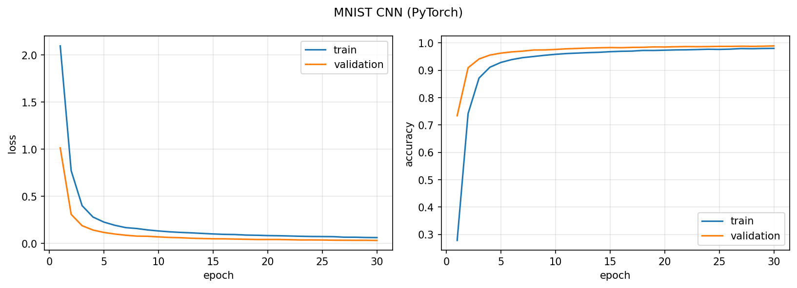{width=85%}

Hình 3.3. Loss và accuracy theo epoch của 1_MNIST_CNN, bản PyTorch.

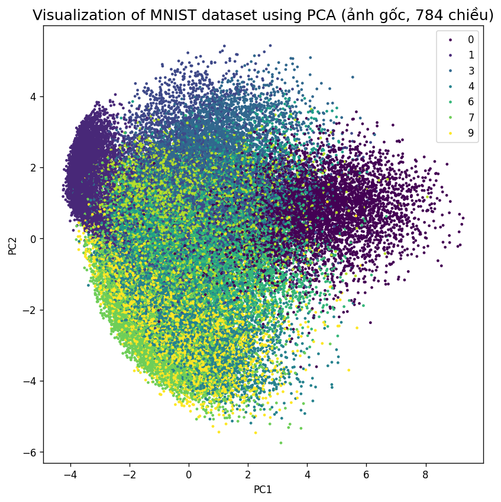{width=32%} 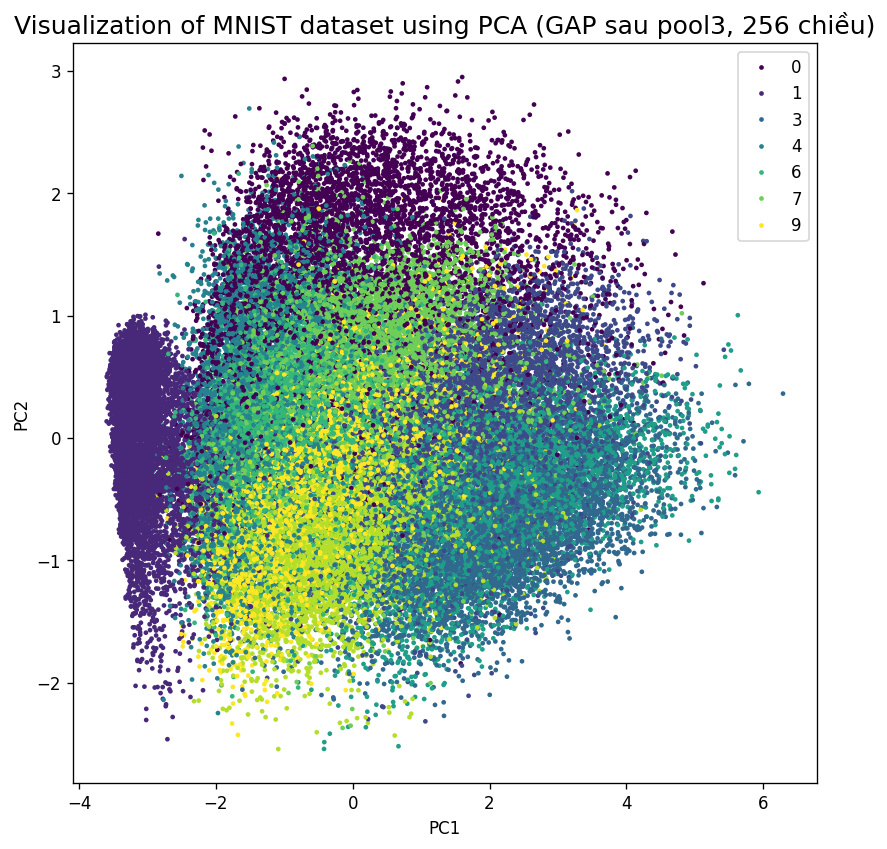{width=32%} 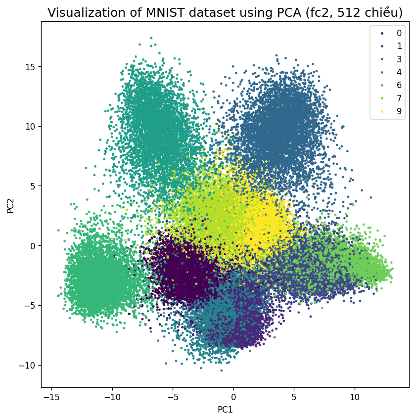{width=32%}

Hình 3.4. PCA 2 chiều của 60.000 ảnh train: ảnh gốc 784 chiều (trái), GlobalAveragePooling sau `pool3` 256 chiều (giữa), đặc trưng `fc2` 512 chiều (phải); màu là nhãn.

**Nhận xét.** Bản PyTorch đạt 98.91%, cao hơn gốc 0.07 điểm, test loss thấp hơn 0.0014. Ở Hình 3.4, PCA của ảnh gốc chỉ tách được chữ số 1 và 0, các chữ số khác chồng lên nhau. Đặc trưng `fc2` cho các cụm riêng theo từng chữ số, đúng với accuracy gần 99%. GlobalAveragePooling sau `pool3` ở giữa: 1 và 0 tách rõ, các chữ số khác còn trộn, cho thấy các lớp FC mới là nơi tách hẳn các lớp.

Nguồn số liệu: `results/1_MNIST_CNN/metrics.json`, `history.csv`, `pca_*.png`; `results/so_sanh.csv`.

## 3.4. Nhận dạng giới tính (2_Human_Gender_CNN)

Người viết: Tạ Quang Trung

**Bài toán.** Ảnh mặt người xám 64×64 của bộ WIKI, nhãn female/male (one-hot, cột 0 là female). 11.938 ảnh train, 5.968 ảnh val. Gốc xoay ảnh bằng `np.rot90(k=3)` và **không chia 255**. Mạng: 5 khối conv 3×3 same (16×2, 32×3, 64×3, 128×3, 256×3), mỗi khối MaxPool + Dropout 0.2 (64 → 2), Flatten 1024 → FC 1024 → FC 1024 → FC 2. Adam lr 1e-4, batch 128, 30 epoch.

**Keras gốc và PyTorch:**

```python
# Keras (khối 2; các khối khác tương tự)
x = Conv2D(filters=32, kernel_size=(3, 3), padding='same', activation='relu', name='conv2_1')(x)
x = Conv2D(filters=32, kernel_size=(3, 3), padding='same', activation='relu', name='conv2_2')(x)
x = Conv2D(filters=32, kernel_size=(3, 3), padding='same', activation='relu', name='conv2_3')(x)
x = MaxPooling2D(pool_size=(2, 2), name='pool2')(x)
x = Dropout(rate=0.2, name='conv_dropout2')(x)
model.compile(loss='categorical_crossentropy', optimizer=Adam(lr=0.0001), metrics=['accuracy'])
```

```python
# PyTorch: một hàm dựng khối, tên lớp giữ như Keras
def khoi_conv(stt, c_in, c_out, so_conv):
    lop = []
    for k in range(1, so_conv + 1):
        lop += [(f"conv{stt}_{k}", nn.Conv2d(c_in if k == 1 else c_out, c_out, 3, padding=1)),
                (f"relu{stt}_{k}", nn.ReLU())]
    lop += [(f"pool{stt}", nn.MaxPool2d(2)), (f"conv_dropout{stt}", nn.Dropout(0.2))]
    return nn.Sequential(OrderedDict(lop))

self.block2 = khoi_conv(2, 16, 32, 3)          # (N, 32, 16, 16)
optimizer = torch.optim.Adam(model.parameters(), lr=0.0001)
```

**Điểm khác cần chú ý.**

- Đọc `.npy` bằng `np.load`, giữ `np.rot90` và giá trị 0–255. Sau `np.rot90`, mảng numpy có bước nhảy (stride) âm nên `torch.as_tensor` báo lỗi; `to_nchw` gọi `np.ascontiguousarray` trước.
- **Dữ liệu xếp theo nhãn**: male trước, female sau (train: vị trí 0–9412 male, 9413–11937 female). `DataLoader(shuffle=True)` xáo lại mỗi epoch, giống `fit` của Keras, nên huấn luyện không bị ảnh hưởng. Khi chạy thử với ít ảnh phải lấy mẫu rải đều cả file.
- Adam của Keras 2.0.9 và PyTorch cùng `betas = (0.9, 0.999)`, `eps = 1e-8`.

Bảng 3.4 đặt số liệu hai bản cạnh nhau.

Bảng 3.4. 2_Human_Gender_CNN: Keras và PyTorch.

| | Keras gốc | PyTorch |
| --- | ---: | ---: |
| Số tham số | 4.063.570 | 4.063.570 |
| Val accuracy | 82.64% | 83.88% |
| Val loss | 0.4602 | 0.4489 |
| Epoch | 30 | 30 |
| Thời gian | 2.94 phút (GTX 1080) | 183 s (Kaggle T4) |

Hình 3.5 là đường học của bản PyTorch.

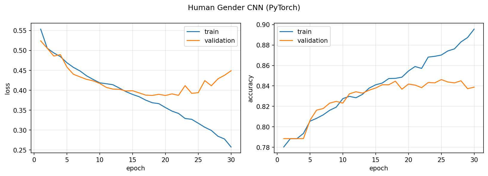{width=85%}

Hình 3.5. Loss và accuracy theo epoch của 2_Human_Gender_CNN, bản PyTorch.

**Nhận xét.** Bản PyTorch đạt 83.88%, cao hơn gốc 1.24 điểm. Cả hai chỉ hơn mốc đoán toàn "male" 78.85% khoảng 4–5 điểm, vì 78.85% ảnh là male ở cả hai tập. Notebook PyTorch tính thêm recall từng lớp: male 96.79% nhưng female chỉ 35.74% (451/1262 ảnh). Cả 662 ảnh val đen hoàn toàn đều bị đoán male. Accuracy chung vì vậy che mất việc mô hình nhận ra female rất kém (mục 5.3).

Nguồn số liệu: `results/2_Human_Gender_CNN/metrics.json`, `history.csv`; output ô cuối notebook (recall, ma trận nhầm lẫn); `results/so_sanh.csv`.

## 3.5. Nhận dạng cảm xúc (3_Emotion_Reg_CNN)

Người viết: Ngô Nguyễn Thành Nhân

**Bài toán.** FER2013: ảnh mặt người xám 48×48, 7 cảm xúc. Train 28.709 ảnh (Usage = Training), validation 3.589 ảnh (PublicTest, gốc gọi là "testing"). Không chia 255. Mạng: Conv64 same, Conv64 valid, Pool, Dropout 0.25; Conv128 same, Conv128 valid, Conv218 same, Conv218 valid, Pool, Dropout 0.25; FC 1024, Dropout 0.5; FC 7. Adam lr 1e-4, batch 128, 15 epoch.

**Keras gốc và PyTorch** (khối thứ hai):

```python
# Keras
x = Conv2D(filters=128, kernel_size=(3, 3), padding='same', activation='relu', name='conv2_1')(x)
x = Conv2D(filters=128, kernel_size=(3, 3), padding='valid', activation='relu', name='conv2_2')(x)
x = Conv2D(filters=218, kernel_size=(3, 3), padding='same', activation='relu', name='conv2_3')(x)
x = Conv2D(filters=218, kernel_size=(3, 3), padding='valid', activation='relu', name='conv2_4')(x)
x = MaxPooling2D(pool_size=(2, 2), name='pool2')(x)
```

```python
# PyTorch
self.conv2_1 = nn.Conv2d(64, 128, 3, padding=1)    # same:  23 -> 23
self.conv2_2 = nn.Conv2d(128, 128, 3, padding=0)   # valid: 23 -> 21
self.conv2_3 = nn.Conv2d(128, 218, 3, padding=1)   # same:  21 -> 21
self.conv2_4 = nn.Conv2d(218, 218, 3, padding=0)   # valid: 21 -> 19
self.pool2 = nn.MaxPool2d(2)                       # 19 -> 9
self.fc1 = nn.Linear(218 * 9 * 9, 1024)            # 17.658 × 1024 + 1024 = 18.082.816
```

**Điểm khác cần chú ý.**

- Gốc đọc `fer2013_training_onehot.csv` và `fer2013_publictest_onehot.csv`. Hai file này là `fer2013.csv` lọc theo cột Usage và đổi nhãn sang one-hot. `load_fer2013` đọc thẳng `fer2013.csv`; đã kiểm cùng số dòng (28.709 / 3.589), cùng giá trị 3 dòng đầu, 3 dòng cuối và nhãn với output gốc.
- Padding `same`/`valid` xen kẽ phải dịch đúng từng lớp (1 / 0); sai một lớp là `fc1` lệch kích thước.
- Gốc dùng 218 filter (không phải 256), giữ nguyên. Riêng `fc1` chiếm 95% trong 19.028.287 tham số.

Bảng 3.5 đặt số liệu hai bản cạnh nhau.

Bảng 3.5. 3_Emotion_Reg_CNN: Keras và PyTorch.

| | Keras gốc | PyTorch |
| --- | ---: | ---: |
| Số tham số | 19.028.287 | 19.028.287 |
| Val accuracy (PublicTest) | 59.54% | 58.90% |
| Val loss | 1.4070 | 1.3932 |
| Epoch | 15 | 15 |
| Thời gian | 6.11 phút (GTX 1080) | 355 s (Kaggle T4) |

Hình 3.6 là đường học của bản PyTorch.

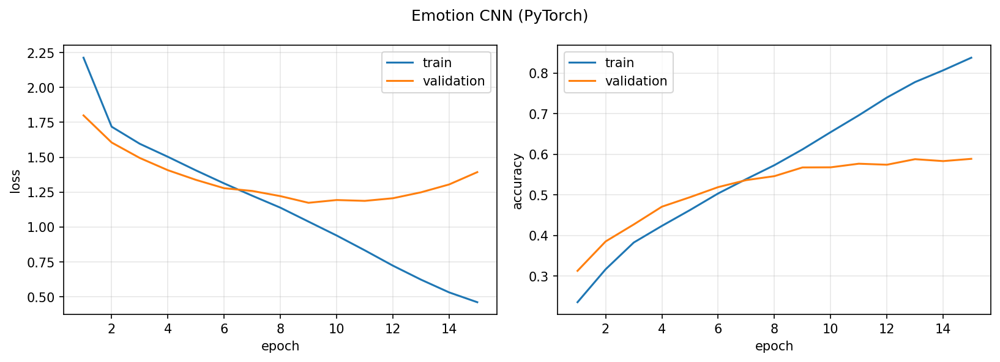{width=85%}

Hình 3.6. Loss và accuracy theo epoch của 3_Emotion_Reg_CNN, bản PyTorch.

**Nhận xét.** Bản PyTorch thấp hơn gốc 0.64 điểm accuracy nhưng val loss thấp hơn 0.0138. Hai số đi ngược chiều cho thấy đây là dao động của khởi tạo và thứ tự batch, không phải sai khác về mô hình. Cả hai bản đều quá khớp (overfitting) từ khoảng epoch 12: val loss tăng từ 1.2061 lên 1.3932 (gốc 1.2117 lên 1.4070) trong khi train accuracy tăng lên 83.81% (gốc 86.60%), cách val accuracy khoảng 25 điểm. Đây là lý do bản Training Utilities (mục 3.8) thêm tăng cường dữ liệu.

Nguồn số liệu: `results/3_Emotion_Reg_CNN/metrics.json`, `history.csv`; `results/so_sanh.csv`.

## 3.6. Tính tổng chữ số bằng CNN + LSTM (MNIST_CNN_LSTM)

Người viết: Phạm Trần Minh Khang

**Bài toán.** Dữ liệu tự sinh từ MNIST với `np.random.seed(2018)`: mỗi mẫu là chuỗi 8 ảnh 28×28, trong đó 1–8 ảnh đầu là chữ số, phần còn lại là ảnh 0; nhãn là tổng các chữ số (0–72), bài toán hồi quy. Mỗi ảnh đi qua cùng một CNN (3 khối Conv 64/128/256 + MaxPool + Dropout 0.2, bọc `TimeDistributed`), duỗi thành vector 2304 chiều, rồi qua LSTM 128 (trả cả chuỗi) → LSTM 128 (trả bước cuối) → Dropout 0.22 → Dense 1. MAE, SGD lr 0.01, batch 128, 30 epoch.

**Keras gốc và PyTorch:**

```python
# Keras
x = TimeDistributed(Conv2D(filters=64, kernel_size=(3, 3), padding='same', activation='relu'), name='conv1')(input_image)
x = TimeDistributed(MaxPooling2D(pool_size=(2, 2)), name='pool1')(x)
...
x = TimeDistributed(Flatten(), name='flatten')(x)
x = LSTM(units=128, return_sequences=True, name='lstm1')(x)
x = LSTM(units=128, return_sequences=False, name='lstm2')(x)
x = Dropout(rate=0.22, name='lstm_dropout')(x)
output_label = Dense(units=1, name='fc3_10ways_softmax')(x)
model.compile(loss='mean_absolute_error', optimizer=SGD(lr=0.01))
```

```python
# PyTorch
self.lstm1 = nn.LSTM(256 * 3 * 3, 128, batch_first=True)
self.lstm2 = nn.LSTM(128, 128, batch_first=True)

def forward(self, x):                                   # (N, 8, 1, 28, 28)
    n, t = x.shape[:2]
    x = x.reshape(n * t, *x.shape[2:])                  # gộp thời gian vào batch = TimeDistributed
    x = self.conv_dropout1(self.pool1(F.relu(self.conv1(x))))
    ...                                                 # khối 2, 3
    x = self.flatten(x).reshape(n, t, -1)               # (N, 8, 2304)
    x, _ = self.lstm1(x)                                # (N, 8, 128): return_sequences=True
    x, _ = self.lstm2(x)
    x = self.lstm_dropout(x[:, -1])                     # bước cuối: return_sequences=False
    return self.fc3_10ways_softmax(x).squeeze(1)

loss_fn = nn.L1Loss()                                   # = 'mean_absolute_error'
```

**Điểm khác cần chú ý.**

- **`TimeDistributed`** không có trong PyTorch. Gộp chiều thời gian vào chiều batch, cho qua CNN, rồi tách lại; CNN dùng chung trọng số cho 8 ảnh như `TimeDistributed`.
- **Số tham số lệch +1.024.** Mỗi cổng LSTM của PyTorch có hai vector bias (`bias_ih`, `bias_hh`), Keras có một. Hai lớp × 4 cổng × 128 = 1.024, nên 1.747.073 + 1.024 = 1.748.097. Tổng hai bias tương đương một bias của Keras.
- **Hàm kích hoạt cổng.** LSTM Keras 2.0.9 mặc định `recurrent_activation='hard_sigmoid'`; `nn.LSTM` dùng sigmoid và không đổi được. Đây là khác biệt kiến trúc duy nhất không giữ được.
- Giữ nguyên vòng lặp numpy và seed 2018 nên dữ liệu sinh ra trùng gốc; chỉ đổi mảng float64 thành float32 (bản gốc tốn khoảng 3 GB RAM cho tập train).

Bảng 3.6 đặt số liệu hai bản cạnh nhau.

Bảng 3.6. MNIST_CNN_LSTM: Keras và PyTorch.

| | Keras gốc | PyTorch |
| --- | ---: | ---: |
| Số tham số | 1.747.073 | 1.748.097 |
| MAE trên test | 0.6502 | 0.5588 |
| Epoch | 30 | 30 |
| Thời gian | 26.63 phút (GTX 1080) | 1150 s = 19.2 phút (Kaggle T4) |

Hình 3.7 là đường học (loss chính là MAE).

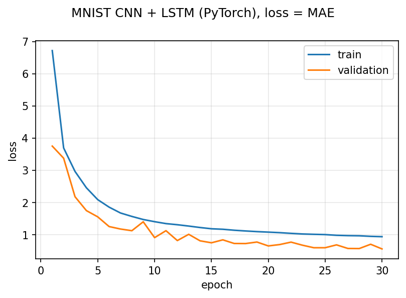{width=55%}

Hình 3.7. MAE train và test theo epoch của MNIST_CNN_LSTM, bản PyTorch.

**Nhận xét.** Bản PyTorch có MAE 0.5588, thấp hơn gốc 0.0914, tức đoán tổng lệch trung bình khoảng 0.56 đơn vị trên thang 0–72. Đây là chênh giữa hai lần chạy đơn lẻ, không đủ để nói bản nào tốt hơn. Từ epoch 22 đến 30, val MAE của gốc dao động từ 0.5768 đến 0.8494, của bản PyTorch từ 0.5588 đến 0.7702; hai khoảng chồng lên nhau, và số báo cáo của mỗi bản chỉ là giá trị ở epoch 30. Khác biệt `sigmoid`/`hard_sigmoid` ở cổng LSTM cũng có thể góp vào mức chênh. Ví dụ trong notebook: tổng thật 7, mô hình đoán 6.643.

Nguồn số liệu: `results/MNIST_CNN_LSTM/metrics.json`, `history.csv`; log epoch trong notebook gốc; `results/so_sanh.csv`.

## 3.7. Gender với các callback (4. Training Utilities/2_Human_Gender_CNN)

Người viết: Tạ Quang Trung

**Bài toán.** Dữ liệu và mô hình giống mục 3.4. Khác ở phần huấn luyện: Adam lr **1e-3**, số epoch đặt rất lớn (100000) và bốn callback: ModelCheckpoint (lưu khi `val_loss` giảm), EarlyStopping (patience 5), ReduceLROnPlateau (factor 0.1, patience 5, min_lr 1e-4) và TensorBoard. Sau khi dừng, gốc nạp checkpoint tốt nhất rồi mới đánh giá.

**Keras gốc và PyTorch:**

```python
# Keras
check_pointer = ModelCheckpoint(monitor='val_loss', save_best_only=True,
                                filepath='{epoch:06d}-{loss:.4f}-{acc:.4f}-{val_loss:.4f}-{val_acc:.4f}.hdf5')
early_stopping = EarlyStopping(monitor='val_loss', patience=5)
reduce_lr = ReduceLROnPlateau(monitor='val_loss', factor=0.1, patience=5, min_lr=0.0001)
tf_board = TensorBoard(log_dir='./logs')
model.fit(x_train, y_train, validation_data=(x_test, y_test), batch_size=128, epochs=100000,
          callbacks=[check_pointer, early_stopping, reduce_lr, tf_board])
model.load_weights('000027-0.2789-0.8976-0.3237-0.8773.hdf5')
```

```python
# PyTorch
check_pointer = ModelCheckpoint(
    str(ckpt_dir / "{epoch:06d}-{loss:.4f}-{acc:.4f}-{val_loss:.4f}-{val_acc:.4f}.pt"),
    monitor='val_loss', save_best_only=True)
early_stopping = EarlyStopping(monitor='val_loss', patience=5)
reduce_lr = reduce_lr_on_plateau(optimizer, factor=0.1, patience=5, min_lr=0.0001)
tf_board = TensorBoard(log_dir=RUNS_DIR / TEN)
history = fit(model, train_loader, test_loader, loss_fn, optimizer, 100000, metric=accuracy,
              callbacks=[check_pointer, early_stopping, tf_board], scheduler=reduce_lr)
model.load_state_dict(torch.load(check_pointer.best_path))
```

**Điểm khác cần chú ý.**

- `ModelCheckpoint` lưu `state_dict` (`.pt`) thay vì cả mô hình (`.hdf5`), tên file theo đúng mẫu gốc, epoch đếm từ 1.
- `EarlyStopping` không tự khôi phục trọng số tốt nhất, giống Keras; gốc gõ tay tên file tốt nhất, bản PyTorch lấy `check_pointer.best_path`.
- `ReduceLROnPlateau` có sẵn trong PyTorch nhưng là scheduler, truyền qua `scheduler=`. Đặt ngưỡng so sánh tuyệt đối 1e-4 như Keras (PyTorch mặc định ngưỡng tương đối). PyTorch giảm lr ở epoch xấu thứ 6; trong cả hai log lr không lần nào bị giảm vì EarlyStopping dừng trước.
- TensorBoard ghi bằng `SummaryWriter` vào `runs/`; notebook vẽ lại các đại lượng đó bằng `plot_history` thay cho ảnh chụp `tfboard.PNG` của gốc.

Bảng 3.7 đặt số liệu hai bản cạnh nhau.

Bảng 3.7. Gender + callback: Keras và PyTorch.

| | Keras gốc | PyTorch |
| --- | ---: | ---: |
| Số tham số | 4.063.570 | 4.063.570 |
| Val accuracy (checkpoint tốt nhất) | 87.73% | 88.09% |
| Val loss | 0.3237 | 0.3299 |
| Epoch tốt nhất / dừng | 27 / 32 | 42 / 47 |
| Thời gian | 3.19 phút (GTX 1080) | 282 s (Kaggle T4) |

Hình 3.8 là đường học của bản PyTorch.

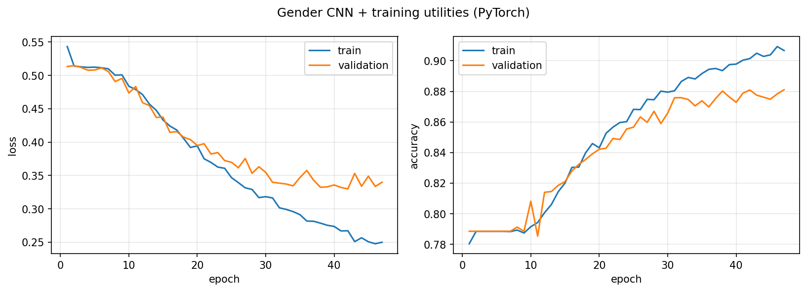{width=85%}

Hình 3.8. Loss và accuracy theo epoch của Gender + callback, bản PyTorch.

**Nhận xét.** Callback nâng accuracy từ 83.88% (mục 3.4) lên 88.09%, tức 4.21 điểm; gốc tăng 5.09 điểm (82.64% lên 87.73%). Phần lớn mức tăng đến từ lr lớn hơn (1e-3) cùng việc lấy checkpoint tốt nhất. Bản PyTorch dừng muộn hơn gốc 15 epoch: nó nằm ở mốc 0.7885 (đoán toàn male) đến epoch 7, còn gốc thoát mốc này từ epoch 4. Sau đó hai bản cùng xu hướng và dừng đúng 5 epoch sau epoch tốt nhất.

Nguồn số liệu: `results/tu_2_Human_Gender_CNN/metrics.json`, `history.csv`; log epoch trong notebook gốc; `results/so_sanh.csv`.

## 3.8. Emotion với tăng cường dữ liệu và EarlyStopping (4. Training Utilities/3_Emotion_Reg_CNN)

Người viết: Ngô Nguyễn Thành Nhân

**Bài toán.** Dữ liệu và mô hình giống mục 3.5. Thêm tăng cường dữ liệu (data augmentation) bằng `ImageDataGenerator` (xoay ±45°, dịch ngang/dọc 20%, lật ngang) và EarlyStopping patience 5, tối đa 100 epoch. Đánh giá mô hình ở epoch cuối (không nạp checkpoint).

**Keras gốc và PyTorch:**

```python
# Keras
datagen = ImageDataGenerator(rotation_range=45, width_shift_range=0.2,
                             height_shift_range=0.2, horizontal_flip=True)
history = model.fit_generator(datagen.flow(x_training, y_training, batch_size=128),
                              steps_per_epoch=len(x_training) / 128,
                              validation_data=(x_testing, y_testing), epochs=100,
                              callbacks=[early_stopping])
```

```python
# PyTorch: viết lại phép biến đổi của ImageDataGenerator Keras 2.0.9
def keras_random_transform(img):                    # img: (48, 48)
    h, w = img.shape
    theta = np.deg2rad(np.random.uniform(-45, 45))
    tx = np.random.uniform(-0.2, 0.2) * h
    ty = np.random.uniform(-0.2, 0.2) * w
    m = rotation @ shift                            # ma trận 3×3, đặt tâm biến đổi ở giữa ảnh
    out = ndimage.affine_transform(img, m[:2, :2], m[:2, 2], order=0, mode='nearest')
    if np.random.random() < 0.5:
        out = out[:, ::-1]                          # lật ngang
    return out

class AugmentedFER(Dataset):
    def __getitem__(self, i):
        return torch.from_numpy(keras_random_transform(self.x[i])).unsqueeze(0), self.y[i]

train_loader = DataLoader(AugmentedFER(x_training, y_training), batch_size=128, shuffle=True)
```

**Điểm khác cần chú ý.**

- `torchvision.transforms.RandomAffine` lấp vùng trống bằng 0 (màu đen) và nội suy khác Keras. Bản PyTorch viết lại đúng cách Keras 2.0.9 làm: ghép ma trận xoay và dịch, biến đổi quanh tâm ảnh bằng `scipy.ndimage.affine_transform` với `order=0` và `mode='nearest'`.
- `steps_per_epoch = 28709 / 128 = 224.3` nghĩa là 225 bước, đúng một lượt dữ liệu, giống một epoch của `DataLoader`.
- Tập validation không tăng cường, như gốc.

Bảng 3.8 đặt số liệu hai bản cạnh nhau.

Bảng 3.8. Emotion + augmentation: Keras và PyTorch.

| | Keras gốc | PyTorch |
| --- | ---: | ---: |
| Số tham số | 19.028.287 | 19.028.287 |
| Val accuracy (epoch cuối) | 61.63% | 61.66% |
| Val loss | 1.0158 | 1.0240 |
| Epoch tốt nhất / dừng | 52 / 57 | 49 / 54 |
| Thời gian | 22.75 phút (GTX 1080) | 1406 s = 23.4 phút (Kaggle T4) |

Hình 3.9 là đường học của bản PyTorch.

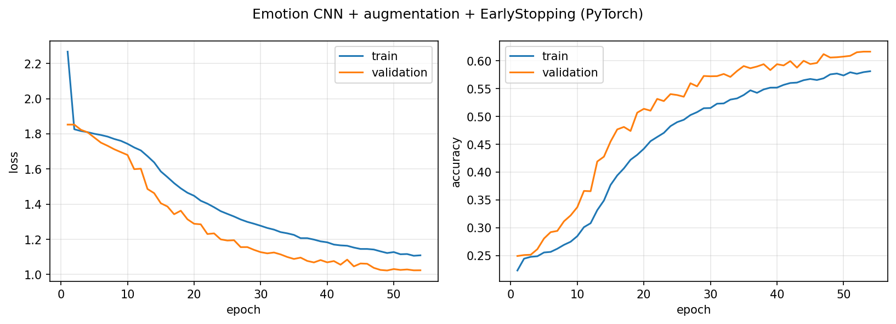{width=85%}

Hình 3.9. Loss và accuracy theo epoch của Emotion + augmentation, bản PyTorch.

**Nhận xét.** Hai bản gần trùng: 61.66% so với 61.63%, dừng ở epoch 54 so với 57. Tăng cường dữ liệu nâng accuracy 2.76 điểm so với bản không tăng cường (58.90% → 61.66%; gốc 59.54% → 61.63%) và kéo val loss từ 1.3932 xuống 1.0240. Train accuracy luôn thấp hơn val accuracy, vì ảnh train bị xoay, dịch, lật nên khó hơn ảnh validation.

Nguồn số liệu: `results/tu_3_Emotion_Reg_CNN/metrics.json`, `history.csv`; `results/so_sanh.csv`.

## 3.9. Phân đoạn bàn tay bằng SegNet (5. Others/1_segnet)

Người viết: Ngô Nguyễn Thành Nhân

**Bài toán.** Ảnh độ sâu (Kinect) cắt vùng bàn tay, resize về 96×96 bằng `order=0`, không chuẩn hóa. Nhãn theo từng pixel, 7 lớp: lòng bàn tay, 5 ngón, nền (mức xám 255, 43, 85, 128, 170, 212, 0). 2.450 ảnh train, 1.050 ảnh test. Mô hình SegNet: encoder kiểu VGG-16 (13 conv, mỗi conv có BatchNorm + ReLU, 5 lần MaxPool, 96 → 3) và decoder đối xứng với 5 lần UpSampling (3 → 96), cuối là conv 1×1 ra 7 kênh + BatchNorm + softmax theo pixel. Adam lr 1e-4, batch 8, 15 epoch.

**Keras gốc và PyTorch:**

```python
# Keras (một bộ conv và phần đầu ra)
Conv2D(64, (kernel, kernel), padding='same'),
BatchNormalization(),
Activation('relu'),
...
Conv2D(n_classes, (1, 1), padding='valid'),
BatchNormalization(),
autoencoder.add(Reshape((n_classes, img_h * img_w)))
autoencoder.add(Permute((2, 1)))
autoencoder.add(Activation('softmax'))
```

```python
# PyTorch
def cbr(c_in, c_out, k=3):
    return [nn.Conv2d(c_in, c_out, k, padding=k // 2),
            nn.BatchNorm2d(c_out, eps=1e-3, momentum=0.01),   # = Keras epsilon 1e-3, momentum 0.99
            nn.ReLU()]
...
nn.Conv2d(64, n_classes, 1),
nn.BatchNorm2d(n_classes, eps=1e-3, momentum=0.01),           # (N, 7, 96, 96): logits theo pixel

def forward(self, x):
    return self.decoder(self.encoder(x))       # softmax theo lớp nằm trong CrossEntropyLoss
```

**Điểm khác cần chú ý.**

- **BatchNorm.** Keras: giá trị mới = 0.99 · cũ + 0.01 · batch; PyTorch: giá trị mới = (1 − m) · cũ + m · batch. Muốn giống thì `momentum = 0.01`. PyTorch mặc định `eps = 1e-5`, Keras 1e-3, nên đặt lại cả hai.
- **Số tham số.** Keras "Total params" 29.458.211 gồm cả 15.886 running mean/var (non-trainable). PyTorch để chúng là buffer, không nằm trong `parameters()`. Bản PyTorch có 29.442.325 tham số train được, đúng bằng "Trainable params" của Keras; cộng buffer ra 29.458.211, đúng bằng tổng.
- **Đầu ra.** Bỏ `Reshape + Permute + softmax`; `nn.CrossEntropyLoss` tính trực tiếp trên `(N, 7, 96, 96)` với nhãn `(N, 96, 96)`.
- **Đường dẫn nhãn.** Gốc suy ra ảnh nhãn bằng `fn.replace('depth', 'labels')`, thay mọi chữ "depth" trong đường dẫn; với thư mục `depth_hand/` trong đề thì đường dẫn bị hỏng. Bản PyTorch ghép đường dẫn riêng.
- **Pixel nhãn lạ.** Ảnh nhãn có thêm 4 mức xám 51, 102, 153, 204 (0,06% số pixel train, 0,37% số pixel test, đếm trên toàn bộ ảnh) không thuộc 7 lớp. Ở gốc các pixel này thành one-hot toàn 0: góp 0 vào loss nhưng vẫn tính trong mẫu số, và được tính là lớp 0 khi đo accuracy. Bản PyTorch gán nhãn −100 rồi xử lý đúng như vậy (`cross_entropy(..., reduction='none').mean()` và `target.clamp(min=0)`).

Bảng 3.9 đặt số liệu hai bản cạnh nhau.

Bảng 3.9. SegNet: Keras và PyTorch.

| | Keras gốc | PyTorch |
| --- | ---: | ---: |
| Số tham số train được / tổng | 29.442.325 / 29.458.211 | 29.442.325 / 29.458.211 |
| Pixel accuracy trên test | 77.32% | 81.08% |
| Test loss | 0.6860 | 0.6827 |
| Epoch | 15 | 15 |
| Thời gian | 750 s (GTX 1080) | 480 s (Kaggle T4) |

Hình 3.10 là đường học, Hình 3.11 là một ví dụ phân đoạn.

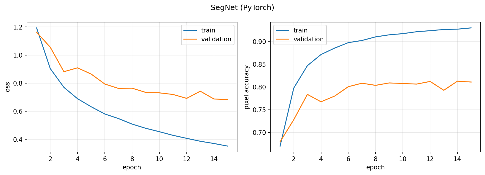{width=85%}

Hình 3.10. Loss và pixel accuracy theo epoch của SegNet, bản PyTorch.

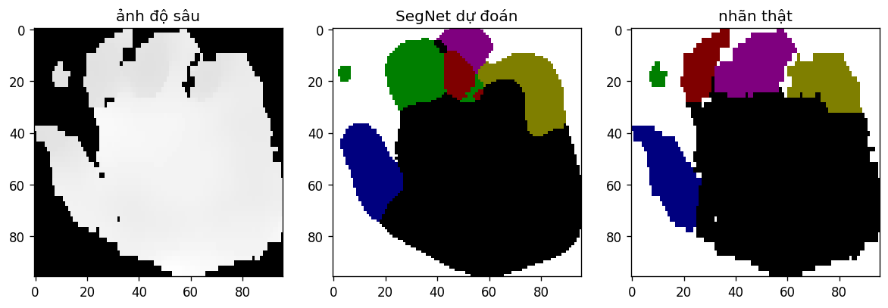{width=85%}

Hình 3.11. Ảnh độ sâu (trái), phân đoạn của SegNet PyTorch (giữa) và nhãn thật (phải) của một ảnh test chọn ngẫu nhiên.

**Nhận xét.** Bản PyTorch cao hơn gốc 3.76 điểm pixel accuracy, vượt ngưỡng 3 điểm mà bài đặt ra để phải tìm nguyên nhân. Nguyên nhân là lỗi của chính notebook gốc. Đoạn `Reshape((7, 9216))` + `Permute((2, 1))` lấy từ mã `keras-segnet` viết cho thứ tự kênh trước (channels_first), nhưng notebook chạy với kênh ở cuối, tensor `(N, 96, 96, 7)`. `Reshape` chỉ cắt lại dãy số theo thứ tự trong bộ nhớ: phần tử thứ `i·9216 + j` của dãy trở thành "điểm số lớp i của pixel j", tức pixel `(i·9216 + j) // 7`. Mỗi pixel đầu ra vì vậy lấy điểm số từ 7 pixel khác nhau rải khắp ảnh. Mạng Keras vẫn học được vì đây là một hoán vị cố định, nhưng khó hơn nhiều so với softmax đúng theo pixel. Log hai bản khớp với giải thích này: bản PyTorch cao hơn ngay từ epoch 1 (train 66.99% so với 63.14%, validation 67.94% so với 61.90%) và cao hơn ở cả 15 epoch, chênh 2.8–6.2 điểm trên tập train và 1.3–6.0 điểm trên validation, chứ không phải dao động ở vài epoch cuối.

Nguồn số liệu: `results/1_segnet/metrics.json`, `history.csv`; log epoch trong notebook gốc; `results/so_sanh.csv`.

## 3.10. Phát hiện xe bằng mạng toàn tích chập (5. Others/2_obj_detection)

Người viết: Tạ Quang Trung

**Bài toán.** 8.792 ảnh xe (nhãn +1) và 8.968 ảnh không phải xe (nhãn −1), ảnh màu 64×64, chia 70/30 (12.432 / 5.328). Mạng toàn tích chập (fully convolutional): chuẩn hóa `x/127.5 − 1` → Conv 10 → Conv 10 → MaxPool 8×8 → Dropout 0.25 → Conv 128 kernel 8×8 → Dropout 0.5 → Conv 1 kernel 1×1 tanh. Loss MSE, Adam mặc định, batch 128, 5 epoch. Phần cuối đưa cả ảnh `test.jpg` 720×1280 qua mạng để được bản đồ điểm số (heatmap) và vẽ khung quanh vùng có điểm > 0.99.

**Keras gốc và PyTorch:**

```python
# Keras
model.add(Lambda(lambda x: x/127.5 - 1., input_shape=input_shape, output_shape=input_shape))
model.add(Conv2D(10, (3, 3), activation='relu', name='conv1', padding="same"))
model.add(Conv2D(10, (3, 3), activation='relu', name='conv2', padding="same"))
model.add(MaxPooling2D(pool_size=(8, 8)))
model.add(Dropout(0.25))
model.add(Conv2D(128, (8, 8), activation="relu", name="dense1"))
model.add(Dropout(0.5))
model.add(Conv2D(1, (1, 1), name="dense2", activation="tanh"))
heatmodel = get_conv(input_shape=(None, None, 3), filename="localize.h5")
```

```python
# PyTorch
def forward(self, x, flatten=True):            # x: (N, 3, H, W), 0–255
    x = x / 127.5 - 1.0                        # Lambda
    x = F.relu(self.conv2(F.relu(self.conv1(x))))
    x = self.dropout1(self.pool(x))            # (N, 10, H/8, W/8)
    x = self.dropout2(F.relu(self.dense1(x)))  # (N, 128, H/8 − 7, W/8 − 7)
    x = torch.tanh(self.dense2(x))             # 64×64 → 1×1; 720×1280 → 83×153
    return x.flatten(1) if flatten else x

heatmap = model(to_nchw(data[np.newaxis]), flatten=False)   # cùng mô hình, ảnh lớn
```

**Điểm khác cần chú ý.**

- Conv của PyTorch không gắn với kích thước ảnh, nên **một** mô hình dùng được cho cả ảnh 64×64 khi train và ảnh 720×1280 khi vẽ heatmap. Gốc phải dựng mô hình thứ hai `input_shape=(None, None, 3)` rồi nạp lại trọng số từ file.
- **"accuracy" của gốc là gì.** Loss MSE và đầu ra có một giá trị nên Keras hiểu `metrics=['accuracy']` là `binary_accuracy`: so `round(dự đoán)` với nhãn. Nhãn là ±1 và `tanh` cho giá trị trong (−1, 1), nên mẫu chỉ được tính đúng khi dự đoán > 0.5 hoặc < −0.5; dự đoán trong (−0.5, 0.5) làm tròn thành 0 và luôn bị tính sai. Bản PyTorch tính đúng chỉ số này để so sánh, và tính thêm accuracy theo dấu (ngưỡng 0), là accuracy phân loại thật.
- Gốc chia train/test không đặt seed; bản PyTorch đặt `random_state=0`.
- Code vẽ khung của gốc sẽ báo `IndexError` nếu có ô được phát hiện ở hàng hoặc cột cuối của heatmap (`j*8 + 64 = 720`); bản PyTorch chặn chỉ số ở mép ảnh.

Bảng 3.10 đặt số liệu hai bản cạnh nhau.

Bảng 3.10. Phát hiện xe: Keras và PyTorch.

| | Keras gốc | PyTorch |
| --- | ---: | ---: |
| Số tham số | 83.367 | 83.367 |
| Test accuracy (cách Keras: round = nhãn) | 95.23% | 93.75% |
| Test accuracy theo dấu | không có | 96.36% |
| Test loss (MSE) | 0.0642 | 0.1074 |
| Epoch | 5 | 5 |
| Thời gian | không ghi | 106 s (CPU) |

Hình 3.12 là kết quả heatmap trên `test.jpg`.

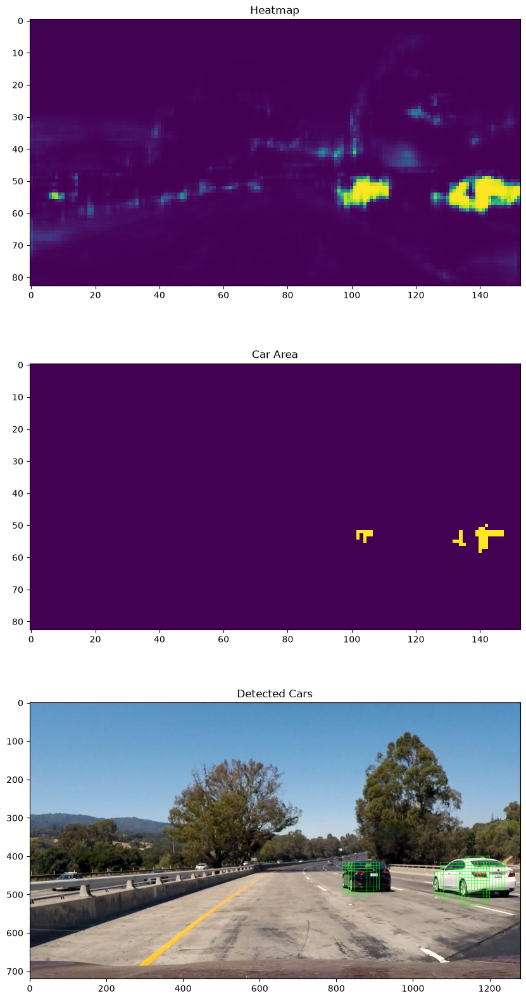{width=55%}

Hình 3.12. Heatmap (trên), vùng có điểm > 0.99 (giữa) và khung phát hiện xe (dưới) trên `test.jpg`, bản PyTorch.

**Nhận xét.** Theo cách tính của Keras, bản PyTorch thấp hơn gốc 1.48 điểm; theo dấu, accuracy là 96.36%. Có hai nguyên nhân. Thứ nhất là epoch cuối: val loss của bản PyTorch giảm còn 0.0629 ở epoch 4 (accuracy cách Keras 95.70%) rồi tăng lên 0.1074 ở epoch 5 (93.75%), mà cả hai bản đều đánh giá mô hình ở epoch cuối của một lần train chỉ 5 epoch. Thứ hai, hai bản không dùng cùng một cách chia train/test (gốc không đặt seed), nên tập test của hai bản khác nhau. Heatmap có 54 ô vượt 0.99, khoanh đúng cả hai xe trong ảnh và không có vùng báo nhầm.

Nguồn số liệu: `results/2_obj_detection/metrics.json`, `history.csv`, `heatmap_test.png`; `results/so_sanh.csv`.
