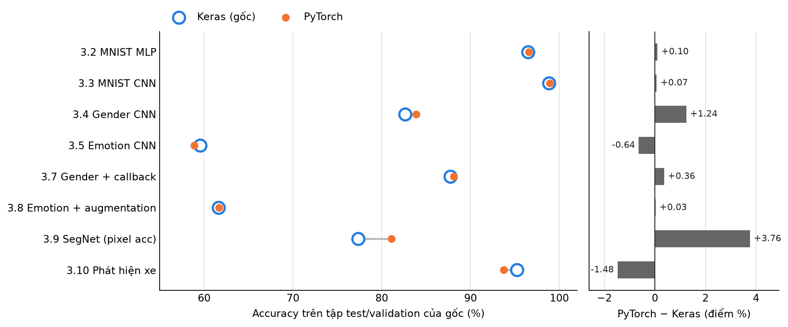

# 4. Tổng hợp kết quả

Người viết: Huỳnh Ngọc Trúc

## 4.1. Bảng tổng hợp

Bảng 4.1 tổng hợp 10 notebook có huấn luyện, theo thứ tự mục 3. Số lấy từ `results/so_sanh.csv`; chênh lệch là PyTorch trừ Keras, tính bằng điểm phần trăm với accuracy.

Bảng 4.1. Số tham số và kết quả của bản Keras gốc và bản PyTorch.

| Mục | Notebook | Chỉ số | Tham số Keras | Tham số PyTorch | Keras | PyTorch | Chênh | Thiết bị PyTorch |
| --- | --- | --- | ---: | ---: | ---: | ---: | ---: | --- |
| 3.1 | Func_apxm_MLP, quét A | test MSE | 65 | 65 | ≈ 0.0067 (hình) | 0.0086 | – | CPU |
| 3.1 | Func_apxm_MLP, quét B | test MSE | 2.049 | 2.049 | ≈ 0.0014 (hình) | 0.0013 | – | CPU |
| 3.1 | Func_apxm_MLP, quét C | test MSE | 513 | 513 | ≈ 0.0016 (hình) | 0.0015 | – | CPU |
| 3.2 | MNIST_MLP | test acc | 669.706 | 669.706 | 96.48% | 96.58% | +0.10 | CPU |
| 3.3 | 1_MNIST_CNN | test acc | 1.817.610 | 1.817.610 | 98.84% | 98.91% | +0.07 | T4 |
| 3.4 | 2_Human_Gender_CNN | val acc | 4.063.570 | 4.063.570 | 82.64% | 83.88% | +1.24 | T4 |
| 3.5 | 3_Emotion_Reg_CNN | val acc | 19.028.287 | 19.028.287 | 59.54% | 58.90% | −0.64 | T4 |
| 3.6 | MNIST_CNN_LSTM | MAE | 1.747.073 | 1.748.097 | 0.6502 | 0.5588 | −0.0914 | T4 |
| 3.7 | Gender + callback | val acc | 4.063.570 | 4.063.570 | 87.73% | 88.09% | +0.36 | T4 |
| 3.8 | Emotion + augmentation | val acc | 19.028.287 | 19.028.287 | 61.63% | 61.66% | +0.03 | T4 |
| 3.9 | SegNet | pixel acc | 29.442.325 | 29.442.325 | 77.32% | 81.08% | +3.76 | T4 |
| 3.10 | Phát hiện xe | test acc (cách Keras) | 83.367 | 83.367 | 95.23% | 93.75% | −1.48 | CPU |

Hình 4.1 đặt kết quả hai bản của 8 notebook phân loại trên cùng một trục, kèm mức chênh.

{width=100%}

Hình 4.1. Accuracy của bản Keras gốc (vòng tròn rỗng) và bản PyTorch (chấm đặc) cho 8 notebook phân loại (trái), và mức chênh PyTorch − Keras tính bằng điểm phần trăm (phải). MAE của CNN+LSTM và MSE của Func_apxm khác thang đo nên chỉ có trong Bảng 4.1.

## 4.2. Số tham số

Cả 10 notebook có mô hình (trừ `getting_started`) đều có số tham số đúng như dự tính trước khi chạy, được kiểm bằng `assert` ngay sau khi khai báo:

- 8 mô hình khớp tuyệt đối với `model.summary()` của Keras (MLP, CNN MNIST, Gender, Emotion, hai bản Training Utilities, phát hiện xe, và `gauss_mlp` với mọi B).
- CNN+LSTM có 1.748.097, nhiều hơn Keras 1.024 tham số. Mỗi cổng LSTM của PyTorch có hai vector bias: 2 lớp × 4 cổng × 128 = 1.024.
- SegNet có 29.442.325 tham số train được, bằng "Trainable params" của Keras. Cộng 15.886 running mean/var của BatchNorm (buffer trong PyTorch) ra 29.458.211, bằng "Total params".

Số tham số khớp là bằng chứng mạnh nhất rằng kiến trúc được chuyển đúng: chỉ cần sai một padding, một số filter hay một kích thước `Flatten` là số tham số lệch ngay.

## 4.3. Phân tích chênh lệch

Bảng 4.2 xếp các notebook theo độ lớn chênh lệch và nêu nguyên nhân.

Bảng 4.2. Chênh lệch giữa hai bản và nguyên nhân.

| Mức chênh | Notebook | Nguyên nhân |
| --- | --- | --- |
| dưới 0.5 điểm | MNIST_MLP (+0.10), MNIST_CNN (+0.07), Gender + callback (+0.36), Emotion + augmentation (+0.03) | khởi tạo ngẫu nhiên và thứ tự batch khác nhau |
| 0.5–1.5 điểm | Emotion (−0.64), Gender (+1.24), phát hiện xe (−1.48) | như trên, cộng thêm: Emotion và Gender chỉ chạy 15–30 epoch và còn dao động; phát hiện xe đánh giá ở epoch 5 lúc val loss vừa tăng, và chia train/test khác gốc |
| MAE −0.0914 | CNN+LSTM | val MAE của cả hai bản dao động khoảng 0.56–0.85 ở 9 epoch cuối; cổng sigmoid thay `hard_sigmoid` |
| +3.76 điểm | SegNet | lỗi `Reshape` + `Permute` trong notebook gốc (mục 3.9), bản PyTorch tính softmax đúng theo pixel |

Bảy trong tám notebook đo bằng accuracy chênh dưới 1.5 điểm, và chênh lệch không theo một chiều cố định: trong bảy notebook đó, bản PyTorch cao hơn ở năm notebook và thấp hơn ở hai, cùng ở mức dao động của một lần chạy. Điều này phù hợp với việc hai bản có cùng mô hình nhưng khác khởi tạo ngẫu nhiên và thứ tự dữ liệu. Ngoại lệ duy nhất có nguyên nhân hệ thống là SegNet, và nguyên nhân nằm ở bản gốc. Gender + callback dừng ở epoch khác gốc (47 so với 32) nhưng accuracy tốt nhất chỉ chênh 0.36 điểm, cho thấy callback được viết lại đúng.

Mỗi notebook chỉ chạy một lần với seed 0, nên mức chênh dưới 1 điểm không đủ để kết luận bản nào tốt hơn. Muốn kết luận chắc hơn cần chạy nhiều seed và so trung bình, việc này nằm ngoài thời gian của bài.

## 4.4. Môi trường và thời gian

Bản gốc chạy trên GTX 1080 (Keras 2.0.9) hoặc Colab T4 (tf.keras 2.14). Bản PyTorch chạy trên hai môi trường: 4 notebook nhẹ trên CPU cá nhân (PyTorch 2.15.0 bản CPU), 7 notebook còn lại trên Kaggle Tesla T4 (PyTorch 2.11.0, CUDA 13.0). Phần cứng và phiên bản khác nhau nên thời gian chạy ở các mục 3.x chỉ để tham khảo, không dùng để so tốc độ Keras với PyTorch.

Nguồn số liệu: `results/so_sanh.csv`; `results/<notebook>/metrics.json`; `report/hinh/so_sanh_keras_pytorch.png` (vẽ bằng `report/ve_hinh_tong_hop.py`).
